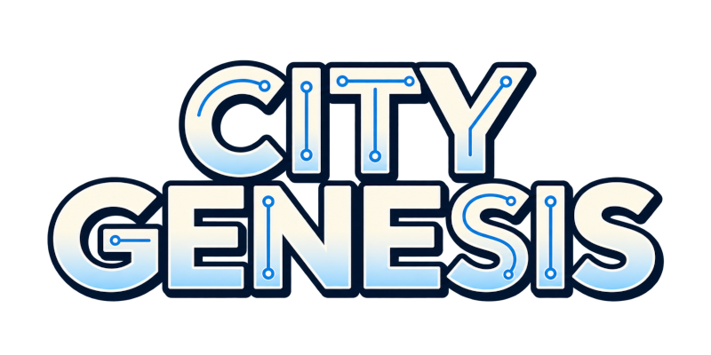
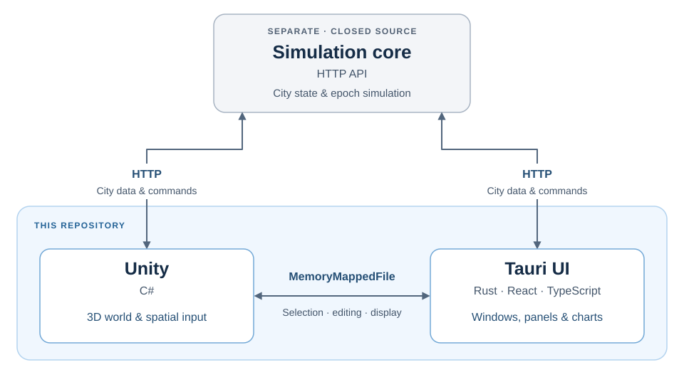

<p align="center">
  
</p>

<p align="center">
  <strong>Not a diorama maker or a traffic jam simulator, but a real economic simulation.</strong>
</p>

<p align="center">
  <a href="https://store.steampowered.com/app/5021240/CityGenesis/">Steam store page</a>
</p>

English | [Japanese (original)](README.ja.md)

# City Genesis

City Genesis is a city-building and economic simulation game. As the mayor, you put infrastructure and public services in place, and the city grows through the activity of its citizens and businesses.

This repository contains the open-source parts of the game: the Unity graphics, the Tauri UI, the source files for the 3D models, and developer documentation. The simulation core is a separate closed-source component that is used through its HTTP API.

## How the game works

The game alternates between **planning** and **simulation**. You look over the city, set budgets, and prepare construction plans, then run the next epoch when you are ready. The economy does not move while you are thinking.

The heavy simulation runs during epoch execution, separately from the rendering loop. Cars and pedestrians still move while you plan, but they are only there to visualize the core's results. Frame rate, camera position, and graphics detail must not affect economic results.

## Architecture

Unity renders the city and handles interaction in 3D space. Tauri overlays a React UI on the Unity window so that the panels, tables, and charts a city simulator needs can be built with web technology. The core holds the city's state and the economic rules.



| Component | Responsibility | Source |
| --- | --- | --- |
| Unity / C# | 3D rendering, visualization, selection, and placement | [`unity/`](unity/) |
| Tauri / Rust / React / TypeScript | UI, window management, and application lifecycle | [`tauri/`](tauri/) |
| Core | City state, simulation, and persistence through an HTTP API | Separate closed-source repository |

Both front ends read city data from the core's HTTP API and send edits to it. Over the IPC connection between them, they exchange selections, editing state, and display commands. For example, selecting a building in Unity opens its details in the UI, and choosing a construction tool in the UI switches Unity's input mode.

Tauri launches and manages the desktop app. The browser version shares the UI and Unity sources and replaces desktop window management and shared memory with a web shell and a JavaScript bridge.

## Development

The desktop version is for Windows.

You can download the full release build from [GitHub Releases](https://github.com/satken2/city-genesis/releases) as a free ZIP. It is the same build distributed on Steam and includes the core, Tauri, and Unity. Some features are limited when the game is not launched through Steam.

### Initial setup

Install the following tools:

| Tool | Purpose |
| --- | --- |
| Unity Hub and the Unity Editor version listed in [`ProjectVersion.txt`](unity/ProjectSettings/ProjectVersion.txt) | Running the 3D view and Unity-side tests |
| Node.js 22 or later and npm | Installing UI dependencies, running the UI, and testing |
| Rust's stable MSVC toolchain, Microsoft C++ Build Tools with “Desktop development with C++”, and WebView2 Runtime | Running Tauri. See the [Tauri prerequisites](https://v2.tauri.app/start/prerequisites/#windows) for installation instructions |
| .NET 8 SDK | Only needed for Unity-side .NET tests |

After cloning, or after pulling an update that changes dependencies, install the UI dependencies from the repository root:

```powershell
npm --prefix tauri ci
```

Add `unity/` to Unity Hub and open it, then wait for Unity to finish restoring packages, importing assets, and compiling scripts. If you plan to run Unity-side .NET tests, also generate the C# project files from the Editor and check that `unity/Assembly-CSharp.csproj` exists.

### First launch

1. Extract the distribution ZIP somewhere outside this repository. The core uses everything in the `Core/` directory, so don't copy out just `genesis.exe`.
2. Open PowerShell in the distribution's `Core/` directory and run the following. Keep this terminal open.

   ```powershell
   $env:GENESIS_API_PORT = "5000"
   .\genesis.exe
   ```

   When [http://127.0.0.1:5000/docs](http://127.0.0.1:5000/docs) opens, the core is ready. Make sure no other core or application is already using port 5000.
3. Open a second PowerShell terminal at the repository root and start the UI:

   ```powershell
   cd tauri
   npm run tauri dev
   ```

4. Open `unity/Assets/Scenes/GameScene.unity` in the Unity Editor and enter Play mode. Create a city or open a save from the UI, and check that the city shows up in the 3D view.

With this setup, the development UI and the Unity Editor connect to the core at `http://127.0.0.1:5000`. When you are done, stop the UI, exit Play mode in Unity, and press `Ctrl+C` in the core's terminal.

### Tests

From the repository root, you can run the UI tests and check types and bundling. The core and Unity do not need to be running.

```powershell
npm --prefix tauri test
npm --prefix tauri run build
```

For Unity-side .NET tests, generate the C# project files first as described in Initial setup, then run the test's script. For example, to run the road snapping test:

```powershell
./unity/Tests/RoadSnapping/run.ps1
```

The test regenerates the required DLLs and the `bin/` and `obj/` directories, so there is nothing to download from Git or copy by hand. This test also runs without the core or Unity's Play mode. For the requirements of each test, see its README under `unity/Tests/`, such as the [RoadSnapping README](unity/Tests/RoadSnapping/README.md). Individual UI tests, the browser version, and distribution builds are covered in the [UI README](tauri/README.md).

## Documentation

These documents explain the concepts and contracts that graphics and UI contributors need. Game terms follow the [translation glossary](docs/en/contributing/glossary.md).

- [Simulation concepts](docs/en/economics/01_overview.md): what the city represents and where epochs fit in.
- [Component integration](docs/en/programs/component-integration.md) and [IPC](docs/en/programs/ipc.md): how the three components work together.
- [Data loading](docs/en/geometries/H_data-loading.md) and [UI foundations](docs/en/programs/ui-foundations.md): mechanisms shared across rendering and the UI.
- [Compatibility](docs/en/programs/compatibility.md): how versions of the front end, core, and IPC contract relate to each other.

For individual HTTP endpoints, see the core's `/docs` or `/openapi.json`.

## Contributing

Pull requests for the Unity and Tauri sources and their documentation are welcome. Please open an issue to discuss larger changes first.

The economic simulation runs in the closed-source core, so changes to it cannot be completed with a pull request to this repository alone. Please use an issue to propose:

- Changes to the economic simulation
- Changes to the core's interfaces
- Changes to public documentation that describes the economic simulation

When submitting a pull request:

- Read [`AGENTS.md`](AGENTS.md) and the `AGENTS.md` in the directory you are changing before you start.
- The Japanese documentation is the original. Edit the Japanese text first, then update the English translation in the same pull request. Follow the [translation glossary](docs/en/contributing/glossary.md) for terminology.
- When adding assets such as images, sounds, or 3D models, check their source and terms of use, then add credits as described in [assets and credits](docs/en/contributing/asset-credits.md).
