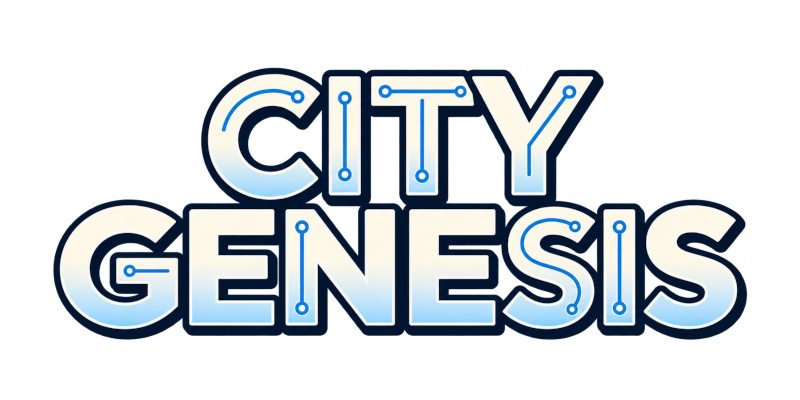
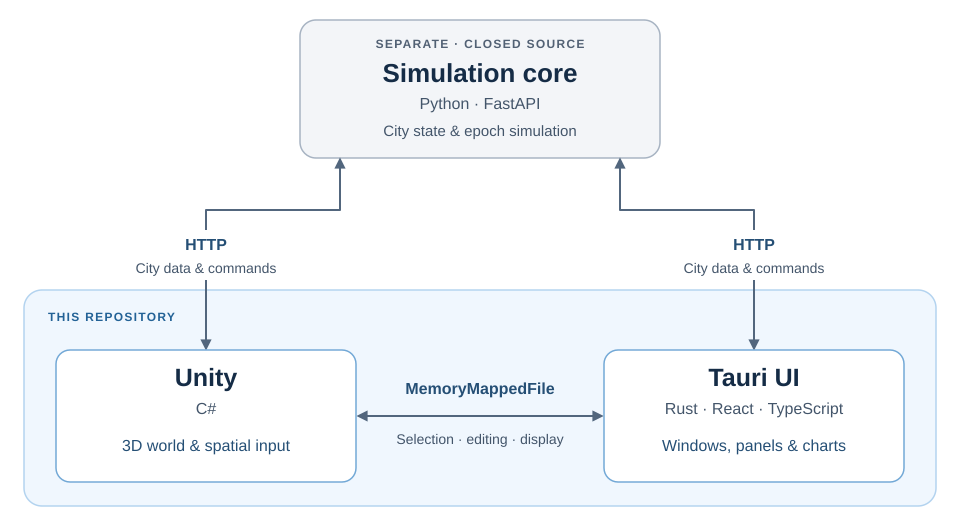

<p align="center">
  
</p>

<p align="center">
  <strong>Plan a city. Run an epoch. See how it grows.</strong>
</p>

<p align="center">
  <a href="#architecture">Architecture</a> ·
  <a href="#development">Development</a> ·
  <a href="#documentation">Documentation</a>
</p>

# City Genesis

City Genesis is a city-building and economic simulation game. As mayor, you shape the infrastructure and public services that allow a city to grow through the activities of its citizens and businesses.

This repository provides the game's open-source Unity graphics and Tauri user interface, together with model sources and developer documentation. The simulation core is a separate, closed-source component accessed through its HTTP API.

## The idea behind the game

Play alternates between **planning** and **simulation**. You inspect the city, allocate budgets, and prepare construction plans, then explicitly run the next epoch. The economy does not advance while you are deciding what to do.

Heavy simulation work happens during epoch execution, independently of the rendering loop. Vehicles and pedestrians can keep moving during planning, but they visualize the core's results. Frame rate, camera position, and visual detail must not change economic outcomes.

## Architecture

Unity renders the city and handles spatial interaction. Tauri places a React interface over the Unity window, using web technologies for the panels, tables, and charts a city simulator needs. The core owns the city's state and economic rules.



| Component | Responsibility | Source |
| --- | --- | --- |
| Unity / C# | 3D rendering, visualization, selection, and placement | [`unity/`](unity/) |
| Tauri / Rust / React / TypeScript | UI, window management, and application lifecycle | [`tauri/`](tauri/) |
| Core / Python / FastAPI | City state, simulation, and persistence through an HTTP API | Separate, closed-source repository |

Both front ends read city data and submit edits through the core's HTTP API. Their direct IPC connection carries selections, editing state, and display commands. For example, selecting a building in Unity opens its details in the UI; choosing a construction tool in the UI switches Unity's interaction mode.

Tauri launches and manages the desktop application. A browser build shares the UI and Unity sources, using a web shell and JavaScript bridge in place of desktop window management and shared memory.

## Working on the front end

- **Keep the core authoritative.** Display its results and submit player decisions through the API; keep economic rules in the core.
- **Give shared state one owner.** UI controls send intentions; the owner reports the result. Use the existing API and IPC layers to keep the interface and 3D view consistent.
- **Maintain shared contracts.** Keep Unity and Tauri in sync when changing IPC. API types and shared constants are generated from the core, so definition changes require coordination with its maintainer.

## Development

The desktop integration targets Windows. Use the Unity editor version recorded in [`ProjectVersion.txt`](unity/ProjectSettings/ProjectVersion.txt), Node.js and npm for the UI, and the Rust/Tauri build toolchain for the desktop application.

To develop the graphics and UI, run a compatible core executable or the [mock backend](docs/docs/programs/モックバックエンド.md). The mock supports loading and editing cities through the same HTTP API, so front-end development does not require access to the private simulation code. It cannot run epochs; load sample save data to work with an existing city.

With the core running, open `unity/` in Unity and use `Assets/Scenes/GameScene.unity` for the 3D view. From the repository root, install and launch the UI:

```powershell
cd tauri
npm ci
npm run tauri dev
```

For the browser UI, use `npm run dev:web` instead. See [component integration](docs/docs/programs/コンポーネント連携.md) for connection settings and the [UI README](tauri/README.md) for build commands. Unity checks live under [`unity/Tests/`](unity/Tests/); UI tests run with `npm test` from `tauri/`.

Original model libraries live in [`blender/`](blender/README.md); documentation sources and build instructions are in [`docs/`](docs/README.md). Before contributing, read the development conventions in [`AGENTS.md`](AGENTS.md) and in the directory you are changing.

## Documentation

The documentation explains concepts and contracts needed by graphics and UI contributors. Use the [translation glossary](docs/docs/programs/翻訳用語対応表.md) for game terminology.

- [Simulation concepts](docs/docs/economics/1_全体概要.md) — what the city represents and how epochs fit together.
- [Component integration](docs/docs/programs/コンポーネント連携.md) and [IPC](docs/docs/programs/IPC連携の整理.md) — how the three components cooperate.
- [Data loading](docs/docs/geometries/H_バックエンドデータロード.md) and [UI foundations](docs/docs/programs/UI共通基盤.md) — the shared rendering and interface mechanisms.
- [Compatibility](docs/docs/programs/バージョニングと互換性.md) — how the front end, core, and IPC contracts fit together across versions.

For individual HTTP operations, consult the core's `/docs` or `/openapi.json`, or the checked-in [OpenAPI specification](docs/docs/api/openapi.json).
