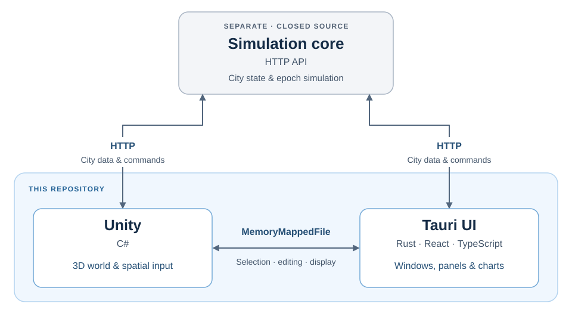

<p align="center">
  
</p>

<p align="center">
  <strong>Not a diorama builder. Not a traffic jam simulator. A true economic simulation.</strong>
</p>

<p align="center">
  <a href="https://store.steampowered.com/app/5021240/CityGenesis/">Steam store page</a>
</p>

English | [Japanese (original)](README.ja.md)

# City Genesis

City Genesis is a city-building and economic simulation game. As mayor, you shape the infrastructure and public services that allow a city to grow through the activities of its citizens and businesses.

This repository provides the game's open-source Unity graphics and Tauri user interface, together with model sources and developer documentation. The simulation core is a separate, closed-source component accessed through its HTTP API.

## The idea behind the game

Play alternates between **planning** and **simulation**. You inspect the city, allocate budgets, and prepare construction plans, then explicitly run the next epoch. The economy does not advance while you are deciding what to do.

Heavy simulation work happens during epoch execution, independently of the rendering loop. Vehicles and pedestrians can keep moving during planning, but they visualize the core's results. Frame rate, camera position, and visual detail must not change economic outcomes.

## Architecture

Unity renders the city and handles spatial interaction. Tauri places a React interface over the Unity window, using web technologies for the panels, tables, and charts a city simulator needs. The core owns the city's state and economic rules.



| Component | Responsibility | Source |
| --- | --- | --- |
| Unity / C# | 3D rendering, visualization, selection, and placement | [`unity/`](unity/) |
| Tauri / Rust / React / TypeScript | UI, window management, and application lifecycle | [`tauri/`](tauri/) |
| Core | City state, simulation, and persistence through an HTTP API | Separate, closed-source repository |

Both front ends read city data and submit edits through the core's HTTP API. Their direct IPC connection carries selections, editing state, and display commands. For example, selecting a building in Unity opens its details in the UI; choosing a construction tool in the UI switches Unity's interaction mode.

Tauri launches and manages the desktop application. A browser build shares the UI and Unity sources, using a web shell and JavaScript bridge in place of desktop window management and shared memory.

## Development

The desktop build targets Windows.

[GitHub Releases](https://github.com/satken2/city-genesis/releases) provides a free ZIP of the same complete production build distributed on Steam, including the core, Tauri, and Unity. Some features are restricted when the game is not launched through Steam.

### Initial setup

Install the following tools:

| Tool | Purpose |
| --- | --- |
| Unity Hub and the Unity Editor version listed in [`ProjectVersion.txt`](unity/ProjectSettings/ProjectVersion.txt) | Running the 3D view and Unity-side tests |
| Node.js 22 or later and npm | Installing UI dependencies, running the UI, and testing |
| Rust's stable MSVC toolchain, Microsoft C++ Build Tools with “Desktop development with C++”, and WebView2 Runtime | Running Tauri. See the [Tauri prerequisites](https://v2.tauri.app/start/prerequisites/#windows) for installation instructions |
| .NET 8 SDK | Required for Unity-side .NET tests |

After cloning or pulling an update that changes dependencies, install UI dependencies from the repository root:

```powershell
npm --prefix tauri ci
```

Add `unity/` to Unity Hub, open it, and wait for package restoration, asset import, and script compilation to finish. To run Unity-side .NET tests, also generate C# project files from the Editor and check that `unity/Assembly-CSharp.csproj` exists.

### First launch

1. Extract the distribution ZIP outside this repository. Keep the entire `Core/` directory together; do not copy out only `genesis.exe`.
2. Open PowerShell in the distribution's `Core/` directory and run the following. Leave this terminal running.

   ```powershell
   $env:GENESIS_API_PORT = "5000"
   .\genesis.exe
   ```

   Once [http://127.0.0.1:5000/docs](http://127.0.0.1:5000/docs) opens, the core is ready. Ensure port 5000 is not already used by another core instance or application.
3. Open another PowerShell terminal at the repository root and start the UI:

   ```powershell
   cd tauri
   npm run tauri dev
   ```

4. Open `unity/Assets/Scenes/GameScene.unity` in the Unity Editor and enter Play mode. Create a city or open a save through the UI, then check that the city appears in the 3D view.

In this setup, the development UI and Unity Editor connect to the core at `http://127.0.0.1:5000`. To finish, stop the UI and Unity's Play mode, then press `Ctrl+C` in the core terminal.

### Tests

Run the UI tests and check types and bundling from the repository root. Neither the core nor Unity needs to be running.

```powershell
npm --prefix tauri test
npm --prefix tauri run build
```

For Unity-side .NET tests, first generate the C# project files as described in initial setup, then use the relevant test script. For example, run the road snapping test with:

```powershell
./unity/Tests/RoadSnapping/run.ps1
```

The required DLLs and `bin/` and `obj/` directories are regenerated when the test runs; no download from Git or manual copying is needed. This test also runs without the core or Unity's Play mode. See the individual READMEs under `unity/Tests/`, such as the [RoadSnapping README](unity/Tests/RoadSnapping/README.md), for test-specific requirements. The [UI README](tauri/README.md) covers individual UI tests, the browser version, and distribution builds.

## Documentation

The documentation explains concepts and contracts needed by graphics and UI contributors. Use the [translation glossary](docs/en/contributing/glossary.md) for game terminology.

- [Simulation concepts](docs/en/economics/01_overview.md) — what the city represents and how epochs fit together.
- [Component integration](docs/en/programs/component-integration.md) and [IPC](docs/en/programs/ipc.md) — how the three components cooperate.
- [Data loading](docs/en/geometries/H_data-loading.md) and [UI foundations](docs/en/programs/ui-foundations.md) — the shared rendering and interface mechanisms.
- [Compatibility](docs/en/programs/compatibility.md) — how the front end, core, and IPC contracts fit together across versions.

For individual HTTP operations, consult the core's `/docs` or `/openapi.json`, or the checked-in [OpenAPI specification](docs/api/openapi.json).

## Contributing

Pull requests are welcome for the Unity and Tauri sources and the documentation that describes them. For larger changes, please open an issue to discuss them first.

The economic simulation is calculated by the closed-source core, so a pull request to this repository alone cannot complete such a change. Please propose the following in an issue:

- Changes to the economic simulation
- Changes to the core's interfaces
- Changes to public documentation that describes the economic simulation

When submitting a pull request:

- Read [`AGENTS.md`](AGENTS.md) and the `AGENTS.md` in the directory you are changing before you start.
- Japanese is the original language of the documentation. Edit the Japanese text first, then update the English translation in the same pull request. Follow the [translation glossary](docs/en/contributing/glossary.md) for terminology.
- When adding assets such as images, sounds, or 3D models, confirm their source and terms of use, then add credits as described in [assets and credits](docs/en/contributing/asset-credits.md).
