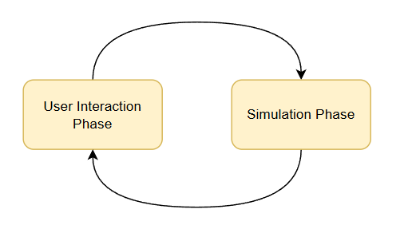
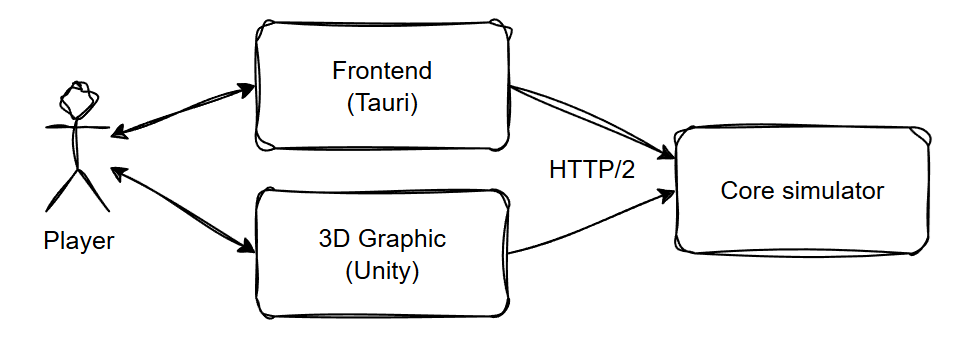
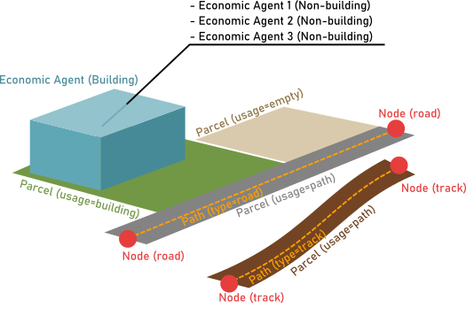

# 1. 基本概要

Urban Genesisの全体概要について。

## 1.1. 基本コンセプト

本ゲームは**Cities Skylines**や**SimCity**のような都市建設シミュレーションを参考にしつつ、以下のコンセプトを重視する。

- 都市というのは人々の営みによって自然発生的にできるものである
- 現実の都市は簡単に作ったり壊したりできず、色々なしがらみによって縛られている

## 1.2. 主な特徴

### エポックシステム

- **本ゲームでは「エポックごとに予算を配分したり建築計画を作成→シミュレーション開始」というフローを採用する。**
- **ユーザーが操作を確定してシミュレーションを開始するまで都市の状態は変化しないため、ユーザーが熟考することができる。**

1サイクルのことをエポック処理と呼ぶ。

### 近似シミュレーション

- **すべての人や車を個別にシミュレートせず、需給や交通量を数値として近似計算する。**
- **都市規模が大きくなっても、高いパフォーマンスを維持できるようにする。**

### 機能の疎結合

- **シミュレーションのコアプログラムは数値計算だけに特化し、グラフィック表示は別のプログラムで行う。**
- **経済シミュレーションと描画を分離し、グラフィック部分をオープンソースとして公開する。**

それぞれの要素は、以下のようなイメージになる。これらの要素は、Steamで販売される際は一つのパッケージとしてバンドルされる。

- **コアモジュール(バックエンド)**
  - グラフィック関連の処理は行わず、数値計算に特化。
  - REST APIまたはgPRCのインターフェースを持ち、グラフィックモジュールと連携する。
- **グラフィックモジュール (フロントエンド)**
  - Unityで実装される。
  - ゲーム進行はバックエンドが行い、UI側はユーザー入力を受けその結果を描画することに特化。

## 1.3. データ構造

本ゲームでは主に以下のデータで都市が作られる。

| データ           | 説明                                                                                                             |
| ------------- | -------------------------------------------------------------------------------------------------------------- |
| [3_道路網](3_道路網.md)     | ノードとパスのグラフ構造で都市内の道路・鉄道ネットワークを作る。 「幹線道路」「線路」「隘路」などの種類がある。直線または曲線の形状を持つ。                    |
| [4_地区と土地区画](4_地区と土地区画.md) | 地区も土地区画も任意の形状のポリゴンで表現される。地区の中に土地区画があり、建物や道路が建つ土台となる。                                                           |
| [2_経済主体](2_経済主体.md)    | 収支、雇用、需給などのデータを持ち、経済シミュレーションの基本単位となる。 土地区画に直接立地する(`building agent`)か、他の建物に入居する形(`non-building agent`)で存在する。 |

## 1.4. 設計想定値

概ね以下のような規模でもまともに動くようにプログラム設計する。

| データ          | 想定上限      | 目安                              |
| ------------ | --------- | ------------------------------- |
| 道路ノード        | 200,000   | 200m四方に1か所のノードで、15km x 15kmのエリア |
| 市民数          | 1,000,000 | 上記広さでだいたいリアルな人口                 |
| 世帯数 (住宅テナント) | 300,000   | 人口の3分の1想定                       |
| 商業テナント       | 100,000   | 人口の10%想定                        |
| 工業テナント       | 50,000    | 人口の5%想定                         |
| テナント合計       | 450,000   |                                 |
| 建物           | 90,000    | 1建物に5テナント                       |