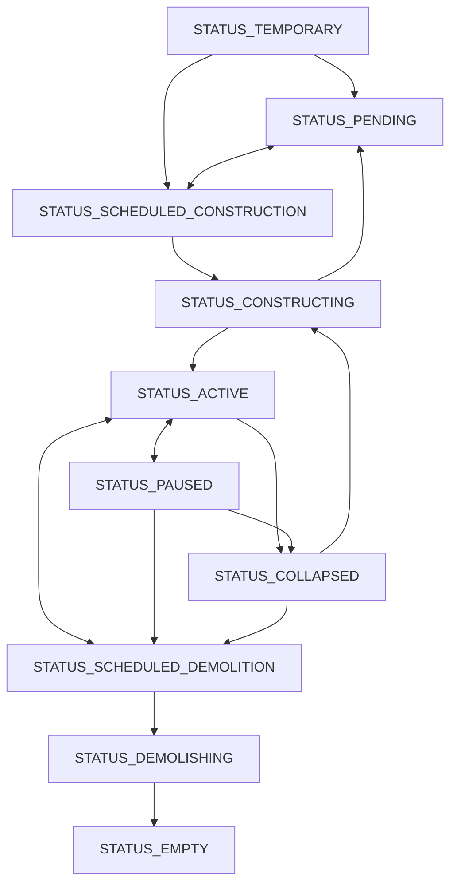

# 2. 経済主体

## 2.1. 経済主体とは

経済主体(agent)は、お金や財をやり取りするシミュレーションの基本単位である。世帯・店舗・工場・学校・輸出入の相手のほか、市政府や建物そのものも経済主体として表す。経済主体ごとに資金・需要・供給・雇用などを持ち、商品市場・労働市場・不動産市場で互いに取引する。

## 2.2. 経済主体の分類

経済主体は、大分類 `type`(`TYPE_*`)と小分類 `variant`(マスター `agent_master` のバリアントID)の2段階で分類する。

| 大分類 | 定数 | 内容 |
| --- | --- | --- |
| 市政府 | `TYPE_CITY` | 都市の会計主体。税を受け取り、公共支出を行う。市庁舎と中央銀行 |
| 教育機関 | `TYPE_EDUCATION` | 学校と大学([17_教育](17_教育.md)) |
| 世帯 | `TYPE_HOUSEHOLD` | 市民が属する収入と消費の単位。観光客も世帯で表す([15_世帯](15_世帯.md)・[31_観光](31_観光.md)) |
| 輸出入拠点 | `TYPE_TRADE` | 都市外との取引の相手。港湾・国際貨物駅など |
| 一般施設 | `TYPE_STANDARD` | 財やサービスを生産する施設。店舗・工場・農場から、発電所・病院などの公共サービスまで |
| 共有建物 | `TYPE_BUILDING` | 他の経済主体に床を貸す建物。住宅・オフィスビル・商業ビル・農地など |
| オープンスペース | `TYPE_OPEN_SPACE` | 生産も雇用もしない土地利用。駐車場・広場・公園と、造成の工事([34_造成](34_造成.md)) |
| その他 | `TYPE_DEFAULT` | 地区の代表エージェント([4_地区と土地区画](4_地区と土地区画.md))や公共交通の路線([6_公共交通機関](6_公共交通機関.md))のような会計の受け皿と、国境検問所 |

大分類は役割の分類で、施設ごとの性格は表さない。労働者を雇わない、原材料を市場から買わない、敷地を通り抜けられる、といった性質はバリアントごとのマスターの値で表す。

建物(`is_bd` が真)の経済主体は土地区画の上に建つ。建物ではない経済主体は建物の床を借りて入居し、`building_agent_id` が入居先の建物を指す。一般施設には、製鉄所・鉱山・発電所のように専用の建物を持つものと、店舗・事務所・多くの工場のように共有建物の床を借りるものがある。入居できるのは、そのバリアントが要求するフロアの種別を持つ建物だけである([13_不動産市場](13_不動産市場.md))。

公共施設(`public_facility` が真)は市が所有・運営する施設で、市長が建てた施設は公共施設になる([22_予算管理](22_予算管理.md))。民間の経済主体は、次節のように条件がそろうと自然に現れる。

## 2.3. 経済主体のスポーンと撤退

### 経済主体のスポーン

民間の経済主体は、市長が操作しなくても条件がそろうと現れる(スポーン)。世帯は独立・結婚・移民で現れ([15_世帯](15_世帯.md)・[18_移民](18_移民.md))、共有建物は入居したい経済主体の床が地区に足りないときに建つ([12_建物](12_建物.md))。一般施設は、地区で取り込める需要があり、原価に利益を乗せた価格で売れる見込みがあるときに参入する。都市内の需要が足りなくても、輸出で採算が取れれば参入する。

一般施設の参入は、需要と採算に加えて都市に現にある資源に縛られる。入れる場所(建てられる種類の土地区画や借りられる床)、余剰の労働力、電力・水道のように輸入できない投入財の都市内の供給者、原材料を賄う国内の供給と輸出入拠点の取扱能力、経済の規模に応じた借入の上限([7_金融システム](7_金融システム.md))のどれかが欠ければ参入しない。高度な人材が不可欠な業種は、その技能を教える大学([17_教育](17_教育.md))があるか、人材がすでに集まった都市にしか来ない。近くに同じ財の売り手がいれば新しい店の取り分は小さく、赤字で撤退した業種は同じ地区へしばらく戻らない。

新しい一般施設は、入居先が決まるまで地区の転居補助エージェントに仮入居した状態(`STATUS_TEMPORARY`)で現れ、建物に入居すると稼働を始める。専用の建物を持つ業種は、地区に同じ業種の停止中の施設があればそれを再稼働させ、無ければ建物の建設として現れる。

### 経済主体の撤退

直近の利益率が低い状態が続いた一般施設と、入居が少なく稼働率の低い共有建物は撤退する。建物は停止(`STATUS_PAUSED`)して入居者が退去し、建物を持たない施設は資金を清算して削除される([7_金融システム](7_金融システム.md))。公共施設は採算や稼働率では停止しない。停止した民間の建物は、地区でその床を求める需要が戻ると(入居者が決まった、同じ業種が再び参入したなど)稼働に戻る。

## 2.4. 経済主体のステータス変遷

| ステータス | 意味 |
| --- | --- |
| `STATUS_TEMPORARY` | 建物は配置の途中で、まだ確定していない。建物ではない一般施設は、参入して入居先を待っている |
| `STATUS_PENDING` | 配置済みで、着工を保留している |
| `STATUS_SCHEDULED_CONSTRUCTION` | 着工を指示済み。用地の買収や既存の建物の取り壊しを待っている |
| `STATUS_CONSTRUCTING` | 建設中。建設サービス財を調達した分だけ進む |
| `STATUS_ACTIVE` | 稼働中。修繕中も稼働中のまま(`under_maintenance`) |
| `STATUS_PAUSED` | 停止中。経済活動をせず、入居者は退去する |
| `STATUS_SCHEDULED_DEMOLITION` | 取り壊し予定。入居者の退去を待つ |
| `STATUS_DEMOLISHING` | 取り壊し中 |
| `STATUS_EMPTY` | 取り壊しや造成が終わり、清算を待つ。清算されると削除される |
| `STATUS_COLLAPSED` | 倒壊した廃墟。取り壊すか再建するまで残る |

建物ではない経済主体がとるのは `STATUS_TEMPORARY`・`STATUS_ACTIVE`・`STATUS_PAUSED`(公共交通の路線の運休)だけで、撤退すると削除される。建物の主な遷移は次のとおり。用地の買収や民間の建て替えでは、取り壊し予定を経ずに取り壊しが始まる。着工前の建物は削除(計画の取り消し)できる。建設・修繕・取り壊しの進み方は [12_建物](12_建物.md) を参照。

### ステータス変更日と変更理由

ステータスが変わるたびに、`status_from` と `status_reason` も合わせて更新される。`status_from` は現在のステータスになった日付(経過日数。[25_ゲーム内日付](25_ゲーム内日付.md))で、稼働中なら稼働開始日、倒壊なら倒壊日を表す。`status_reason` は現在のステータスになった理由である。

| 理由 | 意味 |
| --- | --- |
| `REASON_NONE` | 通常の遷移 |
| `REASON_FIRE` | 火災による倒壊 |
| `REASON_AGING` | 老朽化による倒壊・取り壊し予定 |
| `REASON_DEFICIT` | 低利益率による停止 |
| `REASON_LOW_UTILIZATION` | 低稼働率による停止 |
| `REASON_USER` | 市長の操作による変更 |
