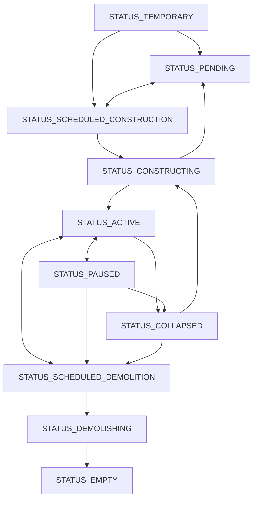

# 2. 経済主体

## 2.1. 経済主体とは

経済主体(agent)は、お金や財をやり取りするシミュレーションの基本単位である。世帯・店舗・工場・学校・輸出入の相手のほか、市政府や建物そのものも経済主体として表す。経済主体ごとに資金・需要・供給・雇用などを持ち、商品市場・労働市場・不動産市場で互いに取引する。

## 2.2. 経済主体の分類

経済主体は、大分類 `type`(`TYPE_*`)と小分類 `variant`の2段階で分類する。大分類は以下の通り。

| 大分類   | 定数                | 内容                                                                                       |
| ----- | ----------------- | ---------------------------------------------------------------------------------------- |
| 市政府   | `TYPE_CITY`       | 都市の会計主体。税を受け取り、公共支出を行う。                                                                  |
| 教育機関  | `TYPE_EDUCATION`  | 学校と大学([17_教育](17_教育.md))                                                                 |
| 世帯    | `TYPE_HOUSEHOLD`  | 市民が属する収入と消費の単位。観光客も世帯で表す([15_世帯](15_世帯.md)・[31_観光](31_観光.md))                            |
| 輸出入拠点 | `TYPE_TRADE`      | 都市外との取引の相手。港湾・国際貨物駅など                                                                    |
| 一般施設  | `TYPE_STANDARD`   | 財やサービスを生産する施設。店舗・工場・農場から、発電所・病院などの公共サービスまで                                               |
| 共有建物  | `TYPE_BUILDING`   | 他の経済主体に床を貸す建物。住宅・オフィスビル・商業ビル・農地など                                                        |
| 広場    | `TYPE_OPEN_SPACE` | 生産も雇用もしない土地利用。駐車場・広場・公園と、造成の工事([34_造成](34_造成.md))                                        |
| その他   | `TYPE_DEFAULT`    | 地区の代表エージェント([4_地区と土地区画](4_地区と土地区画.md))や公共交通の路線([6_公共交通機関](6_公共交通機関.md))のような会計の受け皿と、国境検問所 |

## 2.3. 経済主体のスポーンと撤退

### 経済主体のスポーン

民間の経済主体は、市長が操作しなくても条件がそろうと現れる(スポーン)。世帯は独立・結婚・移民で現れ([15_世帯](15_世帯.md)・[18_移民](18_移民.md))、共有建物は入居したい経済主体の床が地区に足りないときに建つ([12_建物](12_建物.md))。一般施設は、地区で取り込める需要があり、原価に利益を乗せた価格で売れる見込みがあるときに参入する。都市内の需要が足りなくても、輸出で採算が取れれば参入する。

### 経済主体の撤退

直近の利益率が低い状態が続いた一般施設と、入居が少なく稼働率の低い共有建物は撤退する。建物は停止(`STATUS_PAUSED`)して入居者が退去し、建物を持たない施設は資金を清算して削除される([7_金融システム](7_金融システム.md))。公共施設は採算や稼働率では停止しない。停止した民間の建物は、地区でその床を求める需要が戻ると稼働に戻る。

## 2.4. 経済主体のステータス変遷

| ステータス                           | 意味                                            |
| ------------------------------- | --------------------------------------------- |
| `STATUS_TEMPORARY`              | 建物は配置の途中で、まだ確定していない。建物ではない一般施設は、参入して入居先を待っている |
| `STATUS_PENDING`                | 配置済みで、着工を保留している                               |
| `STATUS_SCHEDULED_CONSTRUCTION` | 着工を指示済み。用地の買収や既存の建物の取り壊しを待っている                |
| `STATUS_CONSTRUCTING`           | 建設中。建設サービス財を調達した分だけ進む                         |
| `STATUS_ACTIVE`                 | 稼働中                                           |
| `STATUS_PAUSED`                 | 停止中。経済活動をせず、入居者は退去する                          |
| `STATUS_SCHEDULED_DEMOLITION`   | 取り壊し予定                                        |
| `STATUS_DEMOLISHING`            | 取り壊し中                                         |
| `STATUS_EMPTY`                  | 取り壊しや造成が終わり、清算を待つ                             |
| `STATUS_COLLAPSED`              | 倒壊した廃墟                                        |

建物ではない経済主体がとるのは `STATUS_TEMPORARY`・`STATUS_ACTIVE`・`STATUS_PAUSED`(公共交通の路線の運休)だけで、撤退すると削除される。建物の主な遷移は次のとおり。

