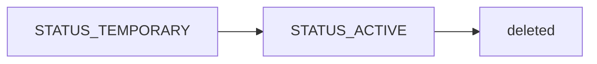
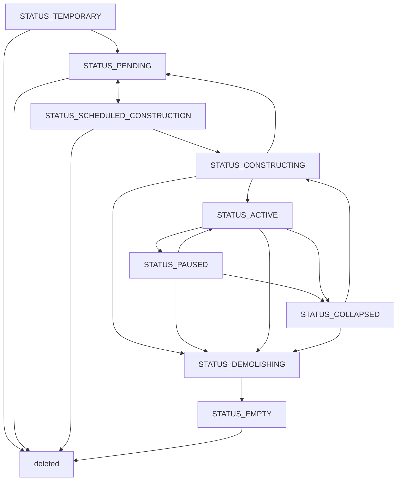

# 2. 経済主体
## 2.1. 経済主体とは

経済主体(`agent`)とは、都市経済シミュレーションの基本単位となる要素であり、都市内の世帯・店舗・企業のみならず、プレイヤーが運営する市政府自身など、金銭や物資のやり取りがあるものはすべてである。
経済主体ごとに、資金や需要・供給などの情報を持つ。

## 2.2. 経済主体の分類

カテゴリ(`type`)とサブカテゴリ(`variant`)があり、以下のような階層構造となる。

```
10: 一般施設
    ├ 1003: 牧場
    ├ 1009: 飲食店
    ├ 1051: 病院
    ├ 1052: 消防署
    └ 1053: 警察署
20: 共有建物
    ├ 2007: 高層アパート
    └ 2008: ショッピングモール
:
```

以下のカテゴリがある。

| 種類   | 定数                 | 説明                      | 作成可 | 生産  | 消費  | 雇用  | スポーン |
| ---- | ------------------ | ----------------------- | --- | --- | --- | --- | ---- |
| 市政府  | `TYPE_CITY=1`      | 公共支出を行い、税収を受け取る         |     |     | ●   | ●   |      |
| 教育機関 | `TYPE_EDUCATION=2` | 市民を教育する                 | ●   |     | ●   | ●   |      |
| 世帯   | `TYPE_HOUSEHOLD=3` | 市民が所属し、消費活動などを行う        |     |     | ●   |     | ●    |
| 輸出拠点 | `TYPE_EXPORT=4`    | 輸出する際の取引相手              | ●   |     | ●   | ●   |      |
| 輸入拠点 | `TYPE_IMPORT=5`    | 輸入する際の取引相手              | ●   | ●   |     | ●   |      |
| 一般施設 | `TYPE_STANDARD=10` | 店舗、工場、農地などあらゆる生産活動を行う施設 | ●   | ●   | ●   | ●   | ●    |
| 共有建物 | `TYPE_BUILDING=20` | 他の経済主体が入居することができる建物     | ●   |     | ●   |     | ●    |

## 2.3.  経済主体のスポーンと削除

### 経済主体のスポーン

一部の経済主体は、特定の条件を満たした時にスポーンする。

| 経済主体サブカテゴリ(variant) | スポーンのタイミング                                 |
| ------------------- | ------------------------------------------ |
| 世帯                  | 世帯のメンバーが一定以上の年齢になったり婚姻した場合。または外部から移民が来た場合。 |
| 一般施設                | 都市の中で商品の需要があると判定されたり、輸出することが可能だと判定された場合。   |
| 共有建物                | 経済主体がスポーンしようとしたが、空きフロアがなくてスポーンできなかった場合。    |

### 経済主体の削除

経済主体は 直近一定期間の平均利益がマイナスの場合に撤退する。

- 建物を持つ経済主体の場合、「停止(`STATUS_PAUSED`)」状態となる。
- 建物を持たない経済主体の場合、資金を清算した上で、経済主体は削除される。

資金の清算とは経済主体の持つ資金や借金を都市全体に還元することである。詳細については[[7_金融システム]]を参照。

## 2.4. 経済主体のステータス変遷

経済主体は以下のようなステータスを持ち、ステータスによってできることが異なります。

建物(`is_bd=True`の場合)はすべてのステータスを持つことができ、建物ではない場合(`is_bd=False`の場合)は`STATUS_TEMPORARY`, `STATUS_ACTIVE`, `STATUS_PAUSED`のみ持つことができる。

| ステータス                           | 説明                     | 都市シミュレーションでの動作                                                            | 他のステータスへの変更                                                                                                   | ステータス設定時の処理                                 |
| ------------------------------- | ---------------------- | ------------------------------------------------------------------------- | ------------------------------------------------------------------------------------------------------------- | ------------------------------------------- |
| `STATUS_TEMPORARY`                | プレイヤーが経済主体を作成している途中    | シミュレーションには影響せず、ユーザーの画面に表示されるのみ。                                           | ユーザーの操作で`STATUS_SCHEDULED_CONSTRUCTION`に変更できる。オブジェクトを削除することもできる。                                              | 何もしない                                       |
| `STATUS_PENDING`                  | プレイヤーが設置したが、まだ着工していない（保留状態） | シミュレーションには影響せず、ユーザーの画面に表示されるのみ。                                           | ユーザーの操作で`STATUS_SCHEDULED_CONSTRUCTION`（着工）に変更できる。オブジェクトを削除することもできる。                                       | 何もしない                                       |
| `STATUS_SCHEDULED_CONSTRUCTION` | 建物の建設が計画されたが、まだ着工していない | 建物の建設が決定されたが、既存建物の買収が完了していなかったり、取り壊されていないなどの理由により建設が開始されていない。             | 立地パーセルの`usage_id`が`VALUE_NONE`（空き地）になったら`STATUS_CONSTRUCTING`に自動変更される。オブジェクトを削除することもできる。                      | 同じ土地区画に存在する建物を検出し、取り壊し対象としてフラグ付けする          |
| `STATUS_CONSTRUCTING`           | 建物の建設が開始された。           | シミュレーションのエポックごとに「建設サービス」財を消費し、消費した分だけ建設が進行する。                             | 「建設サービス」財の調達量が必要量に達したら自動的に`STATUS_ACTIVE`に変更される。ユーザーの操作で`STATUS_DEMOLISHING`に変更することができる。                      | 立地する土地区画の`usage_id`を自エージェントのIDに更新する         |
| `STATUS_ACTIVE`                 | 建設や設置が完了している。          | 経済活動が行われる。建物の場合は、入居が開始される。改修中は `under_maintenance` が真になり、同じく建設サービス財で進捗する。 | 市政府所有の建物の場合、ユーザーの操作で`STATUS_PAUSED`または`STATUS_DEMOLISHING`に変更することができる。                                        | 何もしない                                       |
| `STATUS_PAUSED`                 | 建物が閉鎖されている             | 経済活動が行われず、テナントは退去させられる。周辺の治安と住環境に悪影響を与える。                                 | 市政府所有の建物の場合、ユーザーの操作で`STATUS_ACTIVE`または`STATUS_DEMOLISHING`に変更することができる。民間建物の場合、フロア需要が増加したら`STATUS_ACTIVE`に変わる。 | 入居テナントに退去フラグ（`is_evicted`）が設定される |
| `STATUS_DEMOLISHING`            | 取り壊しが進行している            | シミュレーションのエポックごとに「建設サービス」財を消費し、消費した分だけ建設が進行する。                             | ステータスは変更できない。「建設サービス」財の調達量が必要量に達したら`STATUS_EMPTY`に変更される。                                                      | 入居テナントに退去フラグ（`is_evicted`）が設定される |
| `STATUS_COLLAPSED`              | 倒壊した                   | 経済活動は行われない。周辺の住民心理に悪影響を与える。                                               | 市政府所有の建物の場合、ユーザーの操作で`STATUS_DEMOLISHING`（取り壊し）または`STATUS_CONSTRUCTING`（再建）に変更することができる。                                                          | 何もしない。ステータスを変更するのみ                          |
| `STATUS_EMPTY`                  | 建物の取り壊しが完了し、更地になった     | 取り壊し前に持っていたお金を残すために存在する。 買収が行われると資金が清算されて消滅する。                            | -                                                                                                             | 何もしない                                       |

**Non-building agent**



**Building agent**



## 2.5. 建物への入居

経済主体はサブカテゴリ(variant)ごとに建物と、建物ではないものがある。
建物の経済主体は空いている土地に建設され、建物ではない経済主体は、別の共有建物に入居する形となる。

### フロア種別

建物に入居する経済主体(`non-building agent`)の場合は、サブカテゴリ(variant)ごとに要求するフロアタイプがある。
フロアタイプが一致しない建物には入居できない。(詳細は[[12_建物]]に記載)

## 2.6. テナントの退去

共有建物(`TYPE_BUILDING`)が`STATUS_PAUSED`または`STATUS_DEMOLISHING`になると、入居しているテナントは退去しなければならない。
低利益率・低稼働率を理由に建物が`STATUS_PAUSED`に変更された場合も、直ちにテナントの`is_evicted`が設定される。

