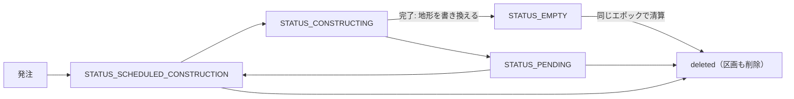

# 34. 造成

造成は、プレイヤーが描いた範囲の地形を1つの高さ(目標の高さ)にそろえる公共工事である。内陸を平らにする**整地**と、海に面した範囲を埋め立てて陸地を広げる**埋立**がある。

造成は建物の建設の仕組みに載っている。発注すると範囲がそのまま市有の土地区画になり、その全面に一時的な公共施設(造成工事の主体)が置かれる。主体は建設サービス財を買って工事を進め、完了すると範囲の地形を書き換えて、同じエポックのうちに区画ごと消える。地形は完了の時点で一度に書き換わるので、工事中や中止したときは元の地形のまま残る。

## 34.1. 発注から完了まで

範囲は世界座標の多角形(`[[x, z], ...]`。3点以上で、閉じていなくてよい)で指定する。`POST /api/v1/grading/preview` は発注と同じ審査と見積もりを返して何も作らず、`POST /api/v1/grading` が範囲の区画と主体を作る。主体はカテゴリ `TYPE_OPEN_SPACE` の公共施設で、サブカテゴリは整地工事 `VARIANT_GRADING_LAND` か埋立工事 `VARIANT_GRADING_SHORE`(まとめた共有定数が `GRADING_VARIANTS`)である。主体は発注でしか作れず、取り壊せず、範囲や種類も変えられない(変えるときは中止して発注し直す)。

完了しても稼働(`STATUS_ACTIVE`)にはならないので、エポック結果では消えた造成工事を完了(進捗100%)として報告する。工事は保留でき、着工前か保留中なら削除(中止)できる。中止しても支払い済みの工事代金は戻らない。工事中の範囲には、建物の建設・区画の編集・パスの計画ができない。

## 34.2. 種類と目標の高さ

造成の種類(`kind`)は範囲の位置から自動で決まる。範囲に区画を作ったときの区画の種類([4_地区と土地区画](4_地区と土地区画.md))が通常土地区画なら整地(`"land"`)、沿岸土地区画なら埋立(`"shore"`)で、海上区画になる範囲は造成できない。整地は範囲を目標の高さにし(高い所は削り、低い所は盛る)、埋立は目標の高さより低い所だけを盛る(高い陸は削らない)。どちらも範囲の境界は元の地形との段差のまま残る。

目標の高さ(`target_height`)は海面を0とする絶対標高(m)で、基準の高さに指定の高さ(`height_offset`)を足したものである。基準は範囲の接道(地表の道路に限る)の路面の高さで、地表の接道が無ければ、整地では範囲の現況の平均の高さ、埋立では既定の天端の高さ(共有定数 `SEA_GRADING_TOP`)になり、どれを使ったかは `base_kind` で返る。

指定の高さは整地だけが受け付け(上下限は共有定数 `GRADING_HEIGHT_OFFSET_LIMIT`)、埋立では常に0になる(天端はどこでも同じ高さにする)。目標の高さは発注の時点で確定し、以後は接道の道路が変わっても動かない。発注済みの工事の見積もりでは、確定した `target_height` だけが値を持ち、基準と指定の高さは null になる。

## 34.3. 審査と見積もり

プレビューと発注は同じ審査を行い、発注できない理由を理由コードの配列 `reasons` で返す。造成できるのは、既存の土地区画・パスと重ならず、川や湖から離れた範囲で、埋立の範囲は現在の陸地と面で重なっていなければならない。範囲の形が不正・都市の範囲外・広すぎる・海上区画になる(`invalid_polygon`・`outside_city`・`too_large`・`on_water`)ときは種類が決まらないので、見積もりも返さない。それ以外の理由があっても、種類と目標の高さが決まれば見積もりは返す。

発注は、資金以外の理由があればエラーコード `GRADING_VALIDATION_ERROR`(HTTP 400。応答に `reasons` を含む)、資金だけが足りなければ `INSUFFICIENT_FUNDS`(HTTP 409)で拒否される。

必要作業量(`work_volume`)は延床ではなく、切土・盛土の土量と、埋立で築く岸壁の面を作業単位に換算した和である([25_建設作業量と施工能力](25_建設作業量と施工能力.md))。着工前は見積もるたびにその時点の地形で測り直し、着工の時点で確定する。費用・工期・資金の項目は建物の建設費の見積もりと同じ名前と意味で([12_建物](12_建物.md))、公共建物の新設と同じ資金審査を受ける([22_予算管理](22_予算管理.md))。建物の平地基準に当たる費用は無いので `standard_construction_cost` は常に null で、バリアントごとの基準費用の対象にもならない。

## 34.4. 完了時の変化

埋立が完了すると、範囲が**埋立地**として記録され、陸地ポリゴン(海岸線)に範囲が足される。整地は何も記録を残さない。埋立地の海に面した辺は岸壁になり、岸壁沿いは元の高さを残した段差を天端(コンクリートの帯)で覆う。埋立地が保存するのは範囲と版(`version`)だけで、岸壁・天端は現在の海岸線と地形から毎回求める。あとから隣を埋め立てると、海に面さなくなった区間は岸壁でなくなり、その埋立地の `version` が上がる。埋立地のデータと描画は[D_地形形状](../geometries/D_地形形状.md)、埋立地の岸壁に面する港は[F4_港湾岸壁のメッシュ生成](../geometries/F4_港湾岸壁のメッシュ生成.md)を参照する。天端と岸壁の外の海はほかの地形の加工でも書き換わらず、パスは天端を地表で横切れない([J_パスの交差処理](../geometries/J_パスの交差処理.md))。

完了したエポックのうちに範囲は区画の無い土地に戻る。そこに作る区画の種類はその時点の海岸線で決まり、すでにある区画の種類は海岸線が広がっても変わらない。造成で書き換えた範囲に掛かる区画の勾配は、完了時に測り直す。サービス財の効果範囲は都市を作ったときの初期地形で決まるので造成では変わらず、埋立地の上は海面の高さにあるものとして判定される([8_商品市場](8_商品市場.md))。
