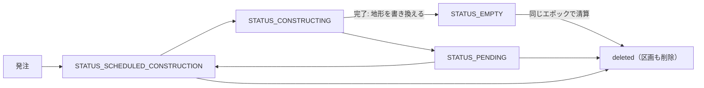

# 34. 造成

造成は、プレイヤーが指定した範囲の地形を目標の高さにそろえる公共工事である。内陸を平らにする**整地**と、海に面した範囲を埋め立てて陸地を広げる**埋立**の2種類がある。

造成は建物と同じ建設の仕組みの上に載っている。範囲には一時的な公共施設（造成工事の経済主体）が置かれ、建設サービス財を買って工事を進め、完了した時点で地形を書き換えて消える。地形は完了の時点で一度に書き換わるので、工事中や中止した場合は元の地形のまま残る。

## 34.1. 造成の流れ

1. **範囲の指定と見積もり**: 範囲を世界座標の多角形（`[[x, z], ...]`。3点以上で、閉じていなくてよい）で指定する。整地では目標の高さの基準からのずれ `height_offset`（m。省略は0）も指定できる（34.3節）。`POST /api/v1/grading/preview` は発注と同じ審査（34.4節）と見積もり（34.5節）を返し、何も作らない。
2. **発注**: `POST /api/v1/grading`（リクエストはプレビューと同じ）で発注すると、範囲がそのまま市有の土地区画になり、その全面に造成工事の主体が置かれる。目標の高さはこの時点で確定し、主体に保存される。
   - 主体はカテゴリ `TYPE_OPEN_SPACE` の公共施設で、サブカテゴリは整地工事 `VARIANT_GRADING_LAND`（3006）か埋立工事 `VARIANT_GRADING_SHORE`（3007）のどちらか（2つをまとめたリストが `GRADING_VARIANTS`）。作成時のステータスは `STATUS_SCHEDULED_CONSTRUCTION`。
   - 造成工事の主体は、この発注以外の方法（建物の建設・直接配置・経済主体の作成）では作れない。
3. **工事**: 区画は最初から空き地なので、次のエポックで着工（`STATUS_CONSTRUCTING`）する。以後は建物と同じく、建設サービス財を調達した分だけ進む（[建物](12_建物.md)）。
4. **完了**: 必要作業量に達しても稼働（`STATUS_ACTIVE`）にはならない。範囲の地形を書き換え（34.8節）、同じエポックのうちに主体と区画が消えて、範囲は区画の無い土地に戻る。エポック結果レポートでは、消えた造成工事を完了（進捗100%）として報告する。

## 34.2. 整地と埋立

造成の種類（API の `kind`）は範囲の位置から自動的に決まり、プレイヤーは選ばない。判定は、範囲にそのまま土地区画を作ったときの区画の種類（[地区と土地区画](4_地区と土地区画.md#土地区画の種類parcel_type)）と同じ規則による。

| | 整地（`kind`=`"land"`） | 埋立（`kind`=`"shore"`） |
| --- | --- | --- |
| 範囲 | 内陸（通常土地区画になる範囲） | 海に面する範囲（沿岸土地区画になる範囲。海を含んでよい） |
| 主体のサブカテゴリ | 3006 整地工事 | 3007 埋立工事 |
| 目標の高さ | 基準の高さ + 指定の高さ（`height_offset`）。基準は地表の接道の路面の高さ、無ければ範囲の現況の平均の高さ | 基準の高さ。基準は地表の接道の路面の高さ、無ければ `SEA_GRADING_TOP`（3m）。高さの指定は受け付けない |
| 完了時 | 範囲を目標の高さにする（高い所は削り、低い所は盛る） | 目標の高さより低い所だけを盛り（高い所は削らない）、埋立地を記録し、海岸線に範囲を足す |
| 後に残るデータ | なし | 埋立地（34.8節） |
| 範囲の境界 | 元の地形との段差のまま（法面は付かない） | 海に面した辺は岸壁、それ以外の辺は元の地形との段差 |

- 大部分が海の上にあり海上区画になる範囲は造成できない（`on_water`）。
- 海岸線に接していれば、海を含まない範囲でも埋立として扱われ、海に面した辺に岸壁が築かれる。
- 川や湖のそばは造成できない（`overlaps_water`）ので、岸壁が立つのは海に面した辺だけである。

## 34.3. 目標の高さ

造成は範囲を一つの高さ（目標の高さ。海面を0とする絶対標高 m で、API の `target_height`）にそろえる。埋立は目標の高さより高い所を削らない（34.8節）。目標の高さは、基準の高さ（`base_height`）に指定の高さ（`height_offset`）を足したものである。

### 基準の高さ

基準の高さの決め方は `base_kind` で区別する。

| `base_kind` | 基準の高さ | 適用 |
| --- | --- | --- |
| `"frontage"` | 範囲の接道の路面の高さ | 地表の接道があるとき（整地・埋立） |
| `"terrain_mean"` | 範囲の現況の平均の高さ（造成で書き換える格子点の現在の高さの平均） | 整地で、地表の接道が無いとき |
| `"sea_top"` | `SEA_GRADING_TOP`（海面から3m） | 埋立で、地表の接道が無いとき |

- **地表の接道があるとき**: 範囲に区画を作ったときの接道（[地区と土地区画](4_地区と土地区画.md#接道距離front_path_distance)）が地表の道路なら、その路面の高さを基準にする。
  - 値は区画の基準標高（`altitude`）と同じで、接道の中心線上で、範囲の接道に最も近い辺の中点に最も近い点の路面標高である（[土地形状](../geometries/B_土地形状.md#b7-路面辺と接道の判定)）。
  - 指定が0なら、造成した土地は接道と段差なく接し、その上に建つ建物がそのまま道路に出入りできる高さになる。
- **地表かどうかの判定**: 地形に沿って敷かれた道路は全線が地表である。それ以外の道路は、基準標高を求める点（上記）で路面が地形とほぼ同じ高さなら地表とみなす。それより高ければ高架、低ければ地下で、どちらも地表の接道にならない。高架や地下の道路の高さに地面を合わせると、道路の下が埋まったり道路が宙に浮いたりするためである。
- **地表の接道が無いとき**: 整地は範囲の現況の平均の高さが基準になるので、接道が無い範囲も整地できる。0を指定すると、切土と盛土がほぼ釣り合う。埋立は `SEA_GRADING_TOP` が基準になる。

### 指定の高さ

- 整地だけが `height_offset` を受け付ける。基準の高さからのずれ（m）で、正なら基準より高く、負なら低くする。上限は `GRADING_HEIGHT_OFFSET_LIMIT`（±100m）で、範囲外や数値でない値は `invalid_height_offset` になる。
- 埋立は指定を受け付けない。指定があっても無視して0として扱い、応答の `height_offset` も0になる。埋立地の天端はどこでも同じ高さで、岸壁と港の描画がそれを前提にしているためである。
- 目標の高さが海面より低くなる指定（`height_offset` が負で、目標の高さが0未満）は `below_sea_level` で発注できない。基準そのものが海面より低い範囲を、指定0以上で整地するのは許される。

### 発注後の扱い

- **発注時に確定**: 目標の高さは発注の時点で絶対標高として確定し、造成工事の主体に保存される。以後の見積もり・着工・完了はこの保存値だけを使い、基準を求め直さない。
  - 発注後に接道の道路が建設・撤去されても、プレイヤーが確認した見積もりと完了後の高さは変わらない。
- 保存された値は、造成工事の主体の見積もり（34.5節の `GET /api/v1/grading/{agent_id}`）の `target_height` で読める。この見積もりの `base_height`・`base_kind`・`height_offset` は null である。

## 34.4. 発注の審査

プレビューと発注は同じ審査を行い、発注できない理由を理由コードの配列（`reasons`）で返す。コードの順は下表のとおりである。

- 上の4つ（`invalid_polygon`〜`on_water`）が出た範囲は、種類が決まらない。それ以降は審査せず、見積もりの値も返さない（null または0）。
- それ以外の理由があっても、種類と目標の高さが決まれば見積もりは返す（`invalid_height_offset` のときは、指定を0として見積もる）。

| コード | 条件 | 理由 |
| --- | --- | --- |
| `invalid_polygon` | 頂点が3つ未満、自己交差している、または面積が1m²未満 | 自己交差を自動で直すと、描いた形と違う範囲を工事してしまう |
| `outside_city` | 範囲が都市の範囲に収まらない（テンプレート作成モードでも同じ） | 地形を書き換えられるのは都市の範囲の中だけ |
| `too_large` | 面積が `GRADING_MAX_AREA`（4km²）を超える | 見積もりと完了のたびに範囲の地形をすべて読む |
| `on_water` | 範囲が海上区画になる（陸地とほとんど重ならない） | 埋立は岸から陸地を広げる工事で、陸から離れた海の上だけを造成することはできない |
| `no_land_overlap` | 埋立で、範囲と現在の陸地（完了した埋立地を含む）の重なりが `GRADING_MIN_LAND_OVERLAP`（1m²）以下 | 岸の手前で止めた範囲は、完了後に岸との間へ細い海が残る。既存の埋立地に辺で接するだけの範囲も同じで、埋立地を広げるときは面で重ねる |
| `overlaps_parcel` | 既存の土地区画と面で重なる（辺で接するだけなら可） | 範囲そのものが造成工事の区画になる |
| `overlaps_path` | パスと重なる。道路・線路・インフラ・駅舎を含み、地表・高架・地下を問わない（公共交通の路線は下地の道路・線路で判定する） | 地形が変わると、パスの地表・高架・地下の区別や高さの関係が変わる |
| `overlaps_water` | 川の範囲や湖の水面範囲と接する、またはごく近い | 湖と川は陸地ポリゴンの穴なので、寄せると範囲が沿岸扱いになり、湖岸・川岸に岸壁が立ってしまう |
| `overlaps_quay_band` | 整地で、既存の埋立地の天端（34.8節）と面で重なる | 天端の下の高さを書き換えると、岸壁の外や天端の先に段差がはみ出す |
| `invalid_height_offset` | 整地で、`height_offset` が数値でない・有限でない・`GRADING_HEIGHT_OFFSET_LIMIT`（100m）を超える | 桁違いの入力で目標の高さが地形の範囲を外れる（34.3節）。見積もりは指定0として返す |
| `below_sea_level` | 整地で、`height_offset` が負かつ目標の高さが0m未満 | 陸地を海面より下へ掘ると、水の無い海底ができる（34.3節） |
| `too_narrow` | 埋立で、目標の高さにする地点が1つも無い（範囲全体が、岸壁際で元の高さを残す幅に収まる） | 岸壁だけで陸地ができない |
| `no_work` | 作業量が0（すでに目標の高さで平らなど）。整地で、書き換える格子点が1つも無く地表の接道も無いときも含む | 工事の必要が無い |
| `insufficient_funds` | 資金審査（34.6節）で資金が足りない | テンプレート作成モードなど、資金審査をしないときは出ない |

発注は、資金以外の理由が1つでもあればエラーコード `GRADING_VALIDATION_ERROR`（HTTP 400。応答に `reasons` を含む）で拒否される。資金だけが足りない場合は `INSUFFICIENT_FUNDS`（HTTP 409）で拒否される。

## 34.5. 作業量・費用・工期

造成の必要作業量は、延床面積ではなく土量と岸壁の大きさから求める。

- **切土・盛土**: 範囲の内側の1m間隔の格子点ごとに、目標の高さと現在の地形の差を取る。削る分を切土（`cut_volume`）、盛る分を盛土（`fill_volume`）として合計した土量（m³）である。埋立は削らないので、切土は常に0になる。完了時に高さを書かない地点（埋立で岸壁際に元の高さを残す地点と、ほかの埋立地の天端・保護された範囲。34.8節）は数えない。
- **岸壁の面**: 埋立で完了後に岸壁になる区間の長さ（`quay_length`）と、岸壁の面の面積（`quay_area`。区間の長さ × 天端から外側の海底までの高さ）。海が深いほど岸壁の面は大きくなる。
- **作業量**（`work_volume`）: 切土・盛土の土量と岸壁の面の面積に、それぞれ一定の係数を掛けて建設サービスの作業単位に換算した和。作業量そのものが地形から決まるので、建物のような階数・地形の起伏による補正は掛からない。

費用と工期は次のとおりである。

- **費用**（`estimated_construction_cost`）: 作業量 × 建設サービス財の単価。単価は、範囲に区画を作ったときの所属地区の平均価格（地区で価格が付いていなければ都市平均）を使う。建物の平地基準に当たるものが無いので、`standard_construction_cost` は常に null である。
- **工期**（`estimated_duration_days`）: 建物と同じ式（[建設作業量と施工能力](25_建設作業量と施工能力.md#建物の工期)）で、延床面積を範囲の面積（1階建て）とみなして求める。
- **基準と指定**: プレビューと発注の応答は、目標の高さ（`target_height`）に加えて、基準の高さ（`base_height`）、基準の決め方（`base_kind`。34.3節）、適用した指定の高さ（`height_offset`。埋立は0）を返す。基準を測れない範囲では `base_height`・`base_kind` が null になる。
- **見込み**: 都市の建設サービスの供給力から見た調達充足率（`construction_supply_ratio`）と見込み工期（`expected_duration_days`）も、建物のコストプレビューと同じ意味で返す（[建物](12_建物.md#建設サービスの自家調達と需給見通し)）。

作業量は、着工前は発注時に確定した目標の高さのまま、見積もるたびにその時点の地形で測り直し、着工の時点の地形で必要作業量として確定する。以後は他の建物と同じく、必要作業量に達するまで建設サービス財を調達する。

発注済みの造成工事の見積もりは `GET /api/v1/grading/{agent_id}` で得られる。プレビューと同じ項目（`valid`=true・`reasons`=[]）に `agent_id`・`parcel_id`・`status` を足して返す。目標の高さは発注時に保存した値で、`base_height`・`base_kind`・`height_offset` は null である。

## 34.6. 資金と予算

- 造成は公共工事なので、公共建物の新設と同じ発注時の資金審査（[予算管理](22_予算管理.md#公共工事の発注時の資金審査)）を受ける。推定総額は34.5節の費用で、市の未拘束の現金で賄えない発注は受理されない。
- プレビューも同じ判定結果（`affordable`・`required_total`・`available_funds`・`funds_shortfall`・`unlimited`）を返す。
- 発注した後は、着工前・保留中・工事中のあいだ、残り事業費が拘束額に数えられる。
- 工事代金は他の公共施設の建設と同じく建設の予算から支払われ、市の負担になる。
- 造成工事のサブカテゴリは、建物のバリアントごとの基準費用（`GET /api/v1/buildings/variant-affordability`）の対象にならない。費用は範囲を描かないと決まらないためである。

## 34.7. 保留と中止

- 工事は保留（`STATUS_PENDING`）にできる。着工前または保留中の工事は削除（中止）できる（ステータスの変遷は[経済主体](2_経済主体.md#24-経済主体のステータス変遷)）。
- 造成工事は取り壊せない（取り壊しに当たるステータスへは変更できない）。取り壊すと範囲の面積に応じた解体費が掛かるだけで、地形は何も変わらないためである。
- 範囲や種類も変えられない（サブカテゴリ・階数・形・構造の変更は拒否される）。範囲を変えるときは、中止して発注し直す。
- 主体を削除すると、発注で作った区画も一緒に消える。地形は完了のときにしか書き換えないので、中止した範囲の地形は元のまま残り、支払い済みの工事代金は戻らない。
- 工事中（主体が消えるまで）の範囲は守られる。完了時に範囲の地形が書き換わって区画ごと消えるので、上に建つ物が地面と敷地を失うのを防ぐためである。
  - その区画への建物の建設と、区画の形の変更・分割・削除はできない。民間の建物もその区画には建たない。
  - 範囲に掛かるパスも計画できない（[道路網](3_道路網.md)）。

## 34.8. 完了時の変化

### 地形

- **整地**: 範囲の内側の1m格子点をすべて目標の高さにする。範囲の境界は元の地形との段差のまま残り、法面は付かない。
- **埋立**: 範囲のうち目標の高さより低い地点だけを目標の高さまで盛り上げ、高い地点は削らずに残す。高い陸まで削ると、範囲の陸側の辺に崖ができるためである。岸壁から内側へ `QUAY_KEEP_WIDTH`（2.8m）以内の地点は元の高さ（海底）のまま残す。
  - 描画用の地形は格子点の間を補間して作られる。岸壁の真下まで盛り上げると、盛り土の斜面が岸壁の外の海面へはみ出すためである。
  - 残した段差は天端（下記）の下に隠れる。
- どちらも、ほかの埋立地の天端と、岸壁の外の保護された範囲（下記）は書き換えない。
- 地形を読めずに書き換えられなかった工事は、埋立地や海岸線を記録せずに工事中のまま残り、次のエポックで書き直す（何度書き直しても結果は同じになる）。

### 埋立地と海岸線

埋立が完了すると、範囲が**埋立地**として記録され、陸地ポリゴン（海岸線）に範囲が足される。

- 海岸線は都市の作成時に初期地形から抽出したものから始まり、埋立のたびに広がる。
- 海岸線と埋立地はセーブデータに保存され、ロードで地形から抽出し直すことはない。
- 整地は記録を何も残さない。

埋立地が保存するのは範囲（`polygon`）と変更検知用の `version` だけである。岸壁・天端・天端の高さは保存せず、現在の海岸線と地形から毎回求める。`GET /api/v1/terrain/reclaimed-lands` は、保存値と派生値をまとめて埋立地の一覧（`reclaimed_lands`）として返す。

| 項目 | 保存 | 内容 |
| --- | --- | --- |
| `reclaimed_land_id` | ● | ID |
| `polygon` | ● | 範囲（`[[x, z], ...]` の閉じたリング。造成工事の区画の形そのもの） |
| `version` | ● | 岸壁の区間が変わるたびに増える |
| `top_height` | | 天端の高さ（海面基準の m。完了時の目標の高さに等しい）。岸壁が無ければ null |
| `quays` | | 岸壁の区間。端点 `a`・`b` と、外向きの単位ベクトル `normal` |
| `walls` | | 垂直の面を張る外周の区間。岸壁と、岸壁の端で天端が陸側の辺に沿って出る袖（都市の範囲の縁の上には張らない）。形は `quays` と同じ |
| `band` | | 天端の多角形の列（穴あり。GeoJSON の MultiPolygon の coordinates と同じ形） |

岸壁と天端の描画は[地形形状](../geometries/D_地形形状.md#d17-埋立地reclaimed_lands)を参照する。

### 岸壁と天端

- **岸壁**は、埋立地の外周のうち外側が陸地でない、つまり海に面した区間である。辺から `QUAY_PROBE_DISTANCE`（0.5m）外側が陸地ポリゴンの外かどうかで決める。天然の陸や別の埋立地に接する辺と、都市の範囲の縁に沿う辺は岸壁にならない。
- **天端**は、岸壁から内側へ `QUAY_BAND_WIDTH`（5.6m）以内の帯状の範囲を覆うコンクリートである。
  - その上の地面の高さは天端の高さとして扱う（地形の方が高ければ地形）。
  - 元の高さを残した地点から目標の高さへの段差は、この帯の中に収まる。
- **隣の埋立**: 岸壁は保存しないので、あとから隣を埋め立てて陸地が広がると、海に面さなくなった区間は自動的に岸壁でなくなる。
  - その区間で元の高さを残していた地点のうち天端より低い所を天端の高さまで埋め、段差が溝として見えないようにする。
  - その埋立地の `version` を上げる。
- **保護**: 天端の範囲と、岸壁の外で道路の法面が届く範囲の海は、道路の造成・交差点の平坦化など、ほかの地形の加工で書き換えない。
  - 天端を書き換えると天端の先に段差が出る。岸壁の外の海底を法面で持ち上げると、岸壁の前に尾根ができる。
  - 岸壁の端で天然の陸や別の埋立地に掛かる部分は保護しない。
- **パス**は天端を地表レベルで横切れない。
  - 天端の上を渡るには、路面が天端より `WATER_BRIDGE_MIN_CLEARANCE`（0.5m）以上高い橋か、天端の下の完全埋設トンネルにする。
  - パスの始点・終点・経由点は、高架・地下でも天端の中には置けない。パスの相対高さの基準になる地面の高さが、天端の上と下の地形とで食い違うためである。
  - 地形を書き換えないインフラパスなどは対象外である。
  - 違反はエラーコード `CREATEPATH_QUAY_BAND_CROSSING` で拒否される。計画済みのパスも着工時に同じ検証を受け、違反していれば着工待ちのまま残る（[パスの交差処理](../geometries/J_パスの交差処理.md)）。
- **造成の重ね方**: 整地の範囲は天端に重ねられない（`overlaps_quay_band`）。埋立の範囲は既存の埋立地に重ねてよく、重ねて海に面さなくなった岸壁は上のとおり消える。
- **港湾**: 埋立地の岸壁に面する港湾は、港自身の岸壁を作らず、埋立地の岸壁に沿って荷役クレーンを並べる（[港湾岸壁のメッシュ生成](../geometries/F4_港湾岸壁のメッシュ生成.md#8-埋立地の岸壁に面する港)）。

### 区画

- 造成工事の主体と区画は、完了したエポックのうちに消える。範囲は区画の無い土地に戻り、以後は普通に区画や道路を作れる。
- 土地区画の種類は、区画を作った時点の海岸線で判定される。埋立地の上に作る区画は、海に面していれば沿岸土地区画、そうでなければ通常土地区画になる。
- すでにある区画の種類は、海岸線が広がっても変わらない（[地区と土地区画](4_地区と土地区画.md#土地区画の種類parcel_type)）。

### 地形に由来する値

- **建設難易度（勾配）**: 土地区画の勾配は加工後の現在の地形から測り、造成で書き換えた範囲に掛かる区画は完了時に測り直す。天端の上は天端の高さを地面とし、岸壁の外の海は数えない（[地区と土地区画](4_地区と土地区画.md#441-地形による建設難易度)）。
- **サービス財の効果範囲**: 効果範囲は都市を作ったときの初期地形で判定し、海面より低い地形は海面の高さとして扱う。造成は効果範囲を変えず、埋立地の上の区画は海面の高さにあるものとして判定される（[商品市場](8_商品市場.md#サービス財の供給範囲)）。
