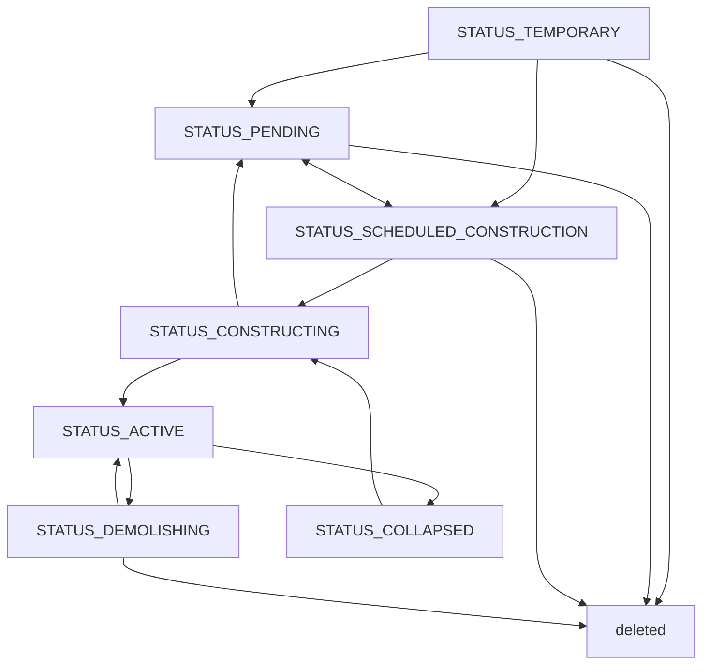

# 3. 道路網

都市の道路・線路・インフラの管路・公共交通の路線は、ノードとパスのグラフで表す。パスは形状を持つ線状の施設で、ノードはパスの端点と交差点である。

## 3.1 パスとノード

パスの形状は、アンカー（`start_point`・`end_point`・`waypoints`）と制御点（端点の `start_control`・`end_control`、ウェイポイントの `control_in`・`control_out`）による3次ベジエ曲線の連なりで、直線も制御点を直線上に置いた曲線として扱う。アンカーのYは地面からの相対高さである。定義の詳細は [A_パス形状](../geometries/A_パス形状.md) を参照。

パスの種類（`path_type`）は共有定数 `PATH_*` で表し、幅・車線数・高架にできるかといった規格の違いはバリアント（`path_variant`。`path_master` のキー）で表す。

| 種類 | 内容 |
| --- | --- |
| 街路 `PATH_STREET` | 自動車と歩行者が通る道路。沿道に土地区画を作れて接道先にもなれるのは `path_master` の `frontage_allowed` が真のバリアントだけ |
| 高速道路 `PATH_MOTORWAY` | 自動車だけが通る道路。インターチェンジのランプもこの種類 |
| 歩道 `PATH_WALKWAY` | 歩行者だけが通る道 |
| 線路 `PATH_TRACK` | 列車が走る線路。駅のホームとLRT専用軌道もこの種類。`infra_products` を持つバリアントは送電網を兼ねる（[26_インフラ網](26_インフラ網.md)） |
| モノレール `PATH_MONORAIL` | モノレールの軌道と駅 |
| 人員搬送 `PATH_CONVEYOR` | ロープウェイなど運行主体の無い設備。歩行者が乗降できる端点（`boardable`）でだけ乗り降りする（[30_人員搬送設備](30_人員搬送設備.md)） |
| 公共交通 `PATH_TRANSPORT` | 公共交通路線の停留所間の区間。建設を伴わない論理的な線（[6_公共交通機関](6_公共交通機関.md)） |
| インフラ `PATH_ELECTRICITY`・`PATH_WATER`・`PATH_PIPELINE` | 送電線・導水管・パイプライン。インフラ財の配送だけに使う（[26_インフラ網](26_インフラ網.md)） |
| 駅舎 `PATH_STATION_HOUSE` | ホームをまとめる駅舎の建屋。ノードを持たず、交通網にも交差の処理にも参加しない（[29_駅と駅舎](29_駅と駅舎.md)） |
| `PATH_DEFAULT` | 実体を持たない仮想道路 |

稼働中（`STATUS_ACTIVE`）のパスだけが両端にノードを持ち、交通網に参加する。ノードの種類（`type`）は、受け入れる接続のビットフラグ（`NODE_*` と、`INFRA_BIT_BASE` 以上の位にあるインフラ財ごとのビット）で、パスの端点はビットの積が空でないノードにだけ結合する。道路と線路は同じノードを踏切として共有でき、人員搬送のノードは道路・線路と結合しない。公共交通の停留所ノードは路線ごとに別に置き、道路に結合しなくても住民は最寄りの歩行者の道から使う。ノードIDは作成順に振って再利用せず、長く遊んだ都市では16ビット整数の範囲を超えるので、32ビット整数で扱う。

道路や線路が同じ高さで交差すると、交点にノードが作られて両方のパスが分割される（交差点・踏切）。高さの占有範囲（相対高さからバリアントの `height` まで）が重ならなければ立体交差になり、重なるのに同じ高さでなければ敷設できない。公共交通の区間パスと駅舎は交差してもノードを作らず、インフラパスは同じインフラ財を流すインフラパスとだけノードを作る（[J_パスの交差処理](../geometries/J_パスの交差処理.md)）。稼働中のパスは任意の地点で分割でき、後半が新しいパスとして元の設定を引き継ぐ。

### 線路の分岐・合流

鉄道・モノレールの分岐・合流は、完成済みで造り替え中でない本線へ、側線の端点を接続する形でだけ作れる。接点の位置・向き・高さが本線と一致し、接点の前後が本線と共通の平面（傾斜面でもよい）に収まる必要があり、本線の形は接続のために動かさず側線の側を合わせる。許容誤差と共通平面の区間の長さは共有定数 `RAIL_JUNCTION_*` で決まる。

## 3.2 高さと地形

アンカーの相対高さが正の区間は高架、負の区間は地下になる。高さを変えられるのは `path_master` の `height_editable` が真のバリアントだけで、相対高さは `min_height` 以上に限られる。`curve_allowed` が偽のバリアントは直線か折れ線でしか敷けない。相対高さ0のスパンは地形に沿うが、地形に追従しないパス（`follow_terrain` が偽）はアンカーの絶対標高を結んだ高さを通り、谷では橋に、丘では切り通しやトンネルになる。着工時に、地形に沿うスパンの下の地形を路面の高さへ造成する。

地下では、中心線の各地点の深さ（地形標高 − 路面の絶対標高）をバリアントの `height` と比べて区間を分ける。分類は地点ごとの深さだけで決まるので、1本のパスの中で切り通しとトンネルを何度でも行き来できる。

| 区間 | 条件 | 地形と描画 |
| --- | --- | --- |
| 切り通し | 0 < 深さ ≤ `height` | 着工時に地形を路面まで掘り下げ、通常どおり描画する |
| 坑口 | 深さが `height` をまたぐ地点 | トンネルの出入口のパーツ（`portal`）を置く |
| トンネル | 深さ > `height` | 地形を変えず、路面も描画しない |

地下・高架でも土地区画のある場所には原則として敷設できないが、十分に深い地下と、市有の区画の上や下を通る区間は区画を残したまま建設できる。浅い地下や高架のパスが通る区画には `has_crossing_path` が立つ（[4_地区と土地区画](4_地区と土地区画.md)）。

## 3.3 通行と交通

### 通行方向

パスの通行方向 `travel_direction` は `DIR_BOTH`（双方向）・`DIR_FORWARD`（始点→終点だけ）・`DIR_BACKWARD`（終点→始点だけ）である。自動車と公共交通の車両は一方通行の向きにしか進めないので、往路と復路で通る道が変わることがある。歩行者は両方向に歩ける。

線路・モノレールの軌道数は `path_master` の `lanes` である（道路の `lanes` は車線数）。単線は一方通行にも双方向にもでき、2本を互いに逆向きにすれば複線になる。1本で上下線を持つ複線は常に `DIR_BOTH` で、一方通行の指定は拒否される。どちらでも、パスと進む向きが決まれば列車の走る軌道は1つに決まるので、ノードは軌道を区別せず、単線と複線を自由につなげる。

線路の車両はノードで鋭角に折り返したり平面交差で曲がったりできず、折り返しは停留所でだけできる。道路では、高速道路が接続するノードでだけ、自動車の鋭角な転回に大きな時間のペナルティが掛かる。

### 速度と交通量

制限速度は、バリアントごとに都市全体で決める市の規制で、都市の `max_speed`（`{path_variant: km/h}`）に持ち、敷設済みのパスにも効く。表の更新は全体の差し替えで、含めなかったバリアントはマスターの `default_speed_limit` に戻る。個別に指定したパス（`override_max_speed`）は規制より優先される。プレイヤーが設定するのは街路と高速道路だけである。

パスの `base_speed` は、制限速度を上限にカーブと坂で落ちる、形状だけから決まる通過速度である。自動車の所要時間は、これに加えて交差点（街路の交差点・踏切・行き止まり）での停止とつなぎ目での減速を含む。制限速度が形状に比べて高すぎる道路ほど交通事故が起きやすい（[20_事故と災害](20_事故と災害.md)）。`path_master` の `min_curve_radius`・`max_grade` を超える形状は新設・形状変更ができず、Unity のプレビューとコアの検証は同じ値を使う。

交通量 `path_traffic`（`VEHICLE_*` をキーとする）は、そのパスを1日に通過する回数で、エポックごとに計算し直す。住民の移動は往復で、行きと帰りの経路に1回ずつ載るので、双方向の道路を往復すれば2回になる。経路は地区を単位にまとめて計算し、いずれかの地区に属する道路だけを通る。利用率 `utilization` は交通量を容量で割った0〜1の値で（線路は1軌道を1日に走れる列車の本数が容量）、高いほど渋滞して事故も増える。路上駐車の `parked_cars` は昼と夜の多い方の台数で、容量 `street_parking_capacity` を超えることがあり、`parking_ratio` は1で頭打ちにしない。駐車の値はセーブに含めず、ロード直後は次のエポックまで0になる。

### インターチェンジとジャンクション

インターチェンジ（IC）とジャンクション（JCT）は、ランプのバリアント（`path_master` の `ramp`）で敷いた道路の集まりから自動的に検出され、作る操作は無い。片端だけが内側にある道路を腕と呼び、腕がすべて高速道路ならJCT、街路があればIC（`INTERCHANGE_KIND_*`）になる。どの腕からどの腕へ走れるかは、鋭角に折り返さずに通行方向どおり走れるかで、道路の形とつながりだけで決まる。道路が変わると検出し直し、ランプを共有するものがIDとプレイヤーが付けた名前を引き継ぐ。経路探索はインターチェンジを1つの交差点として扱うが、交通量は実際に走るランプや本線に載る。応答の形の正は `tauri/src/types.ts` である。

## 3.4 パスのステータスと建設

| ステータス | 意味 |
| --- | --- |
| `STATUS_TEMPORARY` | 配置したが確定していない |
| `STATUS_PENDING` | 計画したが着工を保留している |
| `STATUS_SCHEDULED_CONSTRUCTION` | 着工を指示した。重なる土地区画が解消したエポックで着工する |
| `STATUS_CONSTRUCTING` | 工事中 |
| `STATUS_ACTIVE` | 稼働中。交通網・インフラ網に参加する |
| `STATUS_DEMOLISHING` | 取り壊し中。終わるとパスが消える |
| `STATUS_COLLAPSED` | 老朽化で倒壊した。その場で再建できる |

公共交通の区間パスはこの流れをたどらず、作成時から稼働中で、運休中は `STATUS_PAUSED` になる。

建設・修繕・取り壊しは、建設サービス財の作業量を調達して進む（[25_建設作業量と施工能力](25_建設作業量と施工能力.md)）。建設コストのあるパスの新設と造り替えは、計画した時点で事業費の全額を市の未拘束の現金で賄えなければ `INSUFFICIENT_FUNDS` で拒否される（[22_予算管理](22_予算管理.md)）。着工の指示を受けたパスは、占有範囲に掛かる土地区画が片付くまで待つ。わずかな重なりは区画を削り、市有の空き区画は削るか消し、民間の区画は市が自動で買収する（買収交渉中の区画は `under_acquisition`。買収金は予算カテゴリ `LEDGER_LAND_PURCHASE`）。市有の区画に立つ建物は、プレイヤーが取り壊すまで着工を待たせる。

稼働中のパスは、同じ種類の別のバリアントへ造り替えられる。費用は新設と同じで、工事中は旧バリアントのまま使われ、完了したエポックで切り替わって耐久度が新品に戻る。

## 3.5 道路(名前付き道路)

道路（名前付き道路）は、交差点で分かれた複数のパス（**区間**）を「青梅街道」のような1本の道路としてまとめる名札で、経済・交通の計算には関わらない。所属の正はパスの `road_id`（未所属は `VALUE_NONE`）で、区間は1つの道路にだけ属し、属せるのは `PATH_TYPES_NAMED_ROAD`（街路・高速道路）である。区間はステータスを問わず、つながっていなくてもよい。区間が0本になった道路はその時点で消え、道路IDは再利用しない。所属を変えてもパスの `version` は変わらないので、クライアントは道路一覧の `version` で追従する。表示と編集は [道路の詳細と道路名](../programs/道路の詳細と道路名.md) を参照。

道路の詳細は、区間を起点からの距離（**キロ程**）の1本の軸に並べて返す。並べ方は保存せず、区間の形とつながりから毎回同じ規則で求める。端点でつながった区間の塊ごとに最も長く続く並びを基準線（`main`）とし、並行する反対車線（`parallel`）と枝分かれ（`branch`）をそこへ取り付ける。応答はシミュレーションを含まないモックでも動く手書きのJSONで、形と値の定義の正は `tauri/src/components/road/roadTypes.ts` である。

### 幹線道路

パス一覧の `trunk` は、高速道路、または道路に属する区間なら真になる。プレイヤーが名前を付けてまとめた道路を主要な道とみなすためで、2D都市マップの「幹線道路」レイヤーはこれに従う（[都市マップの検索と経路案内](../programs/都市マップの検索と経路案内.md)）。

## 3.6 都市境界

都市の範囲の外にパスを置き、外の設備を編集できるのはテンプレート作成モードだけである。境界をまたぐパスは竣工時に境界で分割され、外側の区間は共通の「都市外」の地区に属する。経路探索は境界で途切れない。
