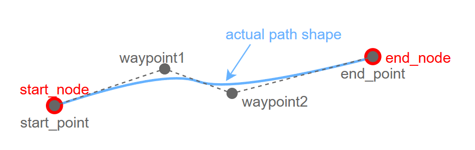
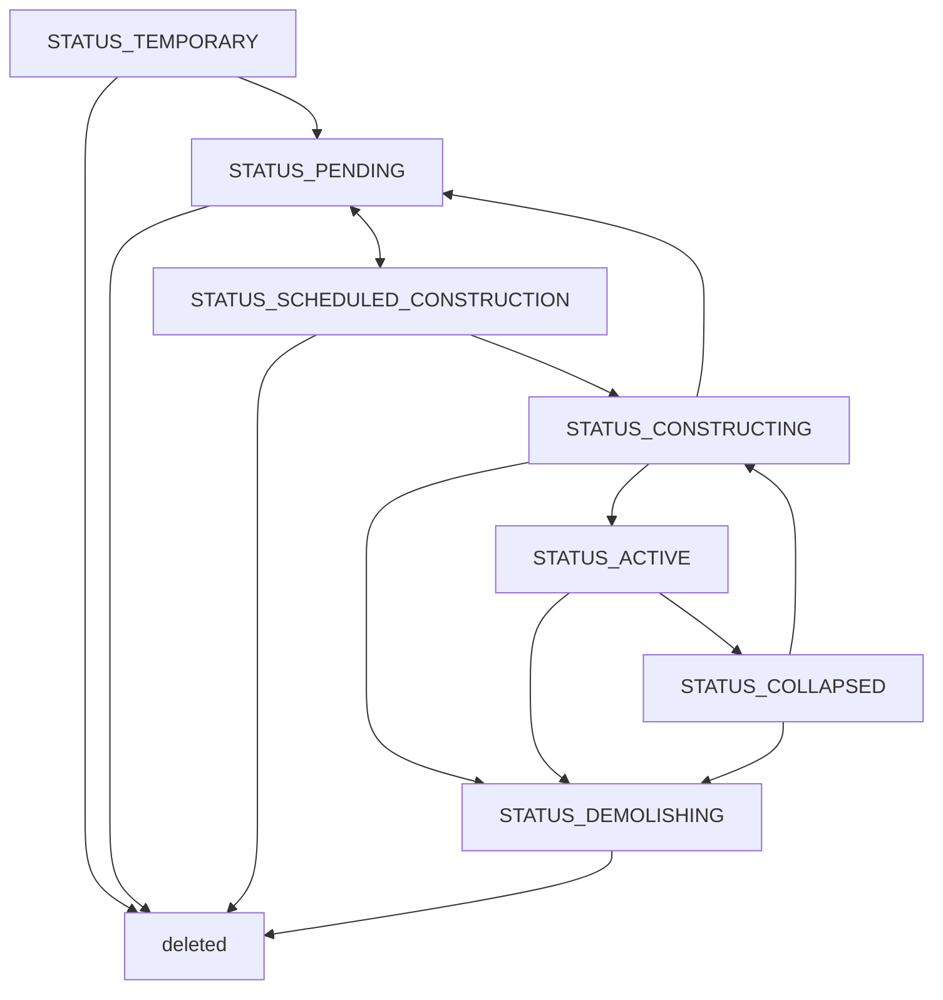

# 3. 道路網

都市の道路網や公共交通網を表現するノードおよびパスについて。

## 3.1 パスとノード

## 3.2 パスの考え方

### パス形状の表現

パスの形状は`start_point`と`end_point`と`waypoints`によって表現される。形状は直線またはベジエ曲線で表現され、直線も制御点を直線上に配置したベジエ曲線として扱われる。各端点には1つの制御点（`start_control`, `end_control`）があり、ウェイポイントには2つの制御点（`control_in`, `control_out`）がある。ステータスが`active`のパスは始点と終点にノードを持ち、住民や物資が移動する交通ネットワークの一部となる。

### 地下パス（トンネル）

パスのY座標（地面からの相対高さ）は負の値を取ることができ、その区間は地下パスとなる。

地下パスは、中心線に沿った各地点の「深さ（＝地形標高 − 道路の絶対標高）」によって、以下の区間に連続的に分類される。切替閾値にはバリアントのクリアランス高さ（`path_master`の`height`）をそのまま使う。

| 区間         | 条件                | 地形と描画                                        |
| ---------- | ----------------- | -------------------------------------------- |
| 切り通し（開削）   | 0 < 深さ ≤ `height` | 着工時に地形を道路標高まで掘り下げ（周囲は切土と同じ法面スロープ）、通常どおり描画される |
| 坑口         | 深さが`height`を跨ぐ境界点 | トンネル出入口のオブジェクト（`portal`パーツ）が配置される            |
| 完全埋設（トンネル） | 深さ > `height`     | 地形は変形されず、道路メッシュも描画されない（地中に埋まる）               |

区間分類は地点ごとの深さ関数として純粋に決まるため、1本のパス内で開削⇔トンネルを何度でも遷移でき、坑口は閾値を跨ぐすべての境界点に現れる。

**地形追従しないパス（`follow_terrain` が実効的に false。[[../geometries/A_パス形状|A_パス形状]]参照）も、相対高さが0のまま同じ深さ分類の対象になる。** アンカーのY座標を負に刻まなくても、非追従パスが丘に差し掛かって道路の絶対標高が地形標高を下回れば深さが正になり、上の表と同じく開削（掘削）・坑口・トンネルへ連続的に分類される。谷を渡って道路が地形より高くなる区間は逆に高架（橋）として描かれ、地形は変形しない。これにより「この2点を結ぶ道路。地面があれば勝手にトンネル、なくなれば橋」という敷き方が、標高の手動調整なしに実現できる。地下パス（負のアンカーY）と非追従パスの違いは「アンカーを地下に沈めるか、地表に置いたまま非追従にするか」だけで、掘削量・建設コスト・土地区画の買収免除（大深度・市有区画の地下/高架通過）の扱いは同一である。

**土地区画の扱い**は地上と同じで、地下でも土地区画が設定されている場所には原則建設できない（買収が必要）。ただし以下の2つの免除がある。

- **大深度免除**: 深さが一定値（都市パラメータ、既定20m）以上の区間は、土地の所有者を問わず土地区画を無視して建設できる。深い区間で分断される場合、買収対象は浅い区間ごとに個別に判定される。
- **市有区画の地下・高架免除**: 市政府が所有する土地区画の上は、パスがその区画を「地下」（路面の絶対標高が地形標高より低い）または「高架」（路面の絶対標高が、地形標高＋区画上の建物の高さより高い）で通過する場合に限り、深さ・高さを問わず**区画を残したまま**建設できる。接地している区間は通常のルールに従うが、ごく短い接地区間（数m程度）は「端点の接地」として許容される。

市有区画の免除によって区画を残したまま建設された場合、その区画には**横断パスあり**（`has_crossing_path`）フラグが立つ。フラグの効果は[[4_地区と土地区画]]を参照。

**立体交差の扱い**も地上と同じ占有高さ範囲 `[Y, Y+height]` の干渉判定に従う。ただし非追従スパン（高さ編集されたスパン・橋バリアントのスパン。地下パスを含む）が絡む交差では、相対高さではなく絶対標高（地形標高＋相対高さ）で比較する。これにより「丘の下を通るトンネル」と「丘の上の地表道路」は正しく立体交差として許可され、逆に開削区間（未着工）を横切る地表道路は干渉として拒否される。掘削済みの開削区間ではアンカーの相対高さが再正規化される（掘削で下がった地形標高差をrelYに繰り入れ、開削区間のアンカーはrelY≈0になる）ため、そこを横切る新しい地表道路は同じ高さの平面交差（交差点）になる。地下パス同士も、同じ絶対標高で交差すれば地下交差点（ノード）が生成される。詳細は[[J_パスの交差処理]]を参照。

地下パスの建設コストは深いほど高くなり、開削区間には掘削の土工分も計上される。

### ノードとパスの種類

パスには以下の種類があり、各種類はそれぞれの特性と役割を持つ。

| パスカテゴリ                        | 特徴                                                 |
| ----------------------------- | -------------------------------------------------- |
| 自動車専用道路(`PATH_MOTORWAY`)      | 自動車のみが通行できる道路。道路沿いに土地区画を作ることができない。                 |
| 街路(`PATH_STREET`)             | 自動車と歩行者が通行できる道路。道路沿いに土地区画を作ることができる。                |
| 線路(`PATH_TRACK`)              | 列車が通行できる線路。バリアントに `infra_products`（電力）を持つものは**電化線路**として送電網も兼ねる（[[26_インフラ網]]参照）。 |
| 公共交通(`PATH_TRANSPORT`)        | 公共交通路線を表現する。バスのノードは生活道路パス上、メトロのノードは線路パス上にしか設置できない。 |
| インフラ(`PATH_INFRASTRUCTURE`)   | 送電線・水道管などのインフラ網。交通には参加せず、インフラ財の配送にのみ使われる。端点には流せるインフラ財に対応した専用のインフラノードが作られる。端点とノードの結合ではY座標のズレが許容され、垂直に高さを変えて結合できる（垂直結合）。詳細は[[26_インフラ網]]を参照。 |

ノードの種類（`type`）は「そのノードが受け入れる接続種別の集合」を表す**ビットフラグ**である
（道路 / 鉄道 / モノレール / ロープウェイ / 公共交通 / インフラ財ごとのビット）。
パスの端点がノードへ結合（溶接）できるかは、ノードのビットとパスの接続マスクの
**ビット積が非空か**で決まる。道路と線路のノードは道路・鉄道の両ビットを持つ同種の
ノードであり（踏切として共有できる）、送電線の端点は電力ビットを持つノード
（インフラノード・電化線路のノード・施設の接続端子）にのみ結合できる。

### 公共交通パスの特記事項

公共交通パスは、通常の交通網の上に重なる独立したネットワークレイヤーである。ノードが停留所、パスが路線区間を表す。

- 公共交通パスは `line_agent_id` によって路線の収支を管理する経済主体([[2_経済主体]]）に紐づく。
- 停留所ノードは路線ごとに独立しており、複数の路線が1つのノードを共有することはない。
- 停留所ノードを道路と明示的に結合する必要はない。住民は最寄りの歩行者が通行できる道路から停留所を利用できる。

路線・車両・運賃などの経済シミュレーション上の扱いは[[6_公共交通機関]]を参照。

### 交差点のノード生成

異なる種類のパスが交差した場合、交差不可能なパス間の場合は互いのパスが分割され、交差点にノードが自動作成される。

|                             | 自動車専用道路(`PATH_MOTORWAY`) | 街路(`PATH_STREET`) | 線路(`PATH_TRACK`) | 公共交通(`PATH_TRANSPORT`) | インフラ(`PATH_INFRASTRUCTURE`) | その他(`PATH_DEFAULT`) |
| --------------------------- | ------------------------ | ----------------- | ---------------- | ---------------------- | --------------------------- | ------------------- |
| 自動車専用道路(`PATH_MOTORWAY`)    | ×                        | ×                 | ×                | ✅                      | ✅                           | ✅                   |
| 街路(`PATH_STREET`)           | ×                        | ×                 | ×                | ✅                      | ✅                           | ✅                   |
| 線路(`PATH_TRACK`)            | ×                        | ×                 | ×                | ✅                      | ✅                           | ✅                   |
| 公共交通(`PATH_TRANSPORT`)      | ✅                        | ✅                 | ✅                | ✅                      | ✅                           | ✅                   |
| インフラ(`PATH_INFRASTRUCTURE`) | ✅                        | ✅                 | ✅                | ✅                      | ×                           | ✅                   |
| その他(`PATH_DEFAULT`)         | ✅                        | ✅                 | ✅                | ✅                      | ✅                           | ✅                   |

インフラパスどうしの交差では、**同じ網に属する場合**（`infra_products` に共通の製品を持つ場合）
のみノードが生成され、インフラ網の分岐点として機能する。別網どうし（送電線×導水管など）と、
インフラパスと他種のパスの交差ではノード生成・パス分割は行われない（自由に立体交差できる）。

例外として、**インフラパスの端点を、同じインフラ財を流せる電化線路（線路でありながら
`infra_products` を持つバリアント）へ引き込んだ場合**に限り、電化線路が分割されて
接続ノードが生成される（タップ接続）。中間どうしの交差は従来どおり素通りする。
詳細は[[26_インフラ網]]を参照。

### 交差点での進行方向の連続性

ノードは複数のパスを繋ぐが、そこで「どちらの向きへでも進める」わけではない。進める方向は、パスがノードに接する向き（端点の接線）の幾何形状によって決まる。この「進行方向の連続性」の扱いはパスの種類によって異なる。

線路・モノレールのような**案内軌条系**では、車両は交差点・合流点で自由に向きを変えられない。なめらかにY字合流するように敷いた線路は合流先へ滑らかに入っていけるが、Y字で片方の線路からもう片方へ鋭角に折り返すことはできず、直角の平面交差では直進だけができて90°の転回はできない。折り返しは車両が停止する停留所（駅）でのみ可能である。これは公共交通の車両が走行する下地経路の探索に反映される（[[6_公共交通機関]]参照）。

道路では、**自動車専用道路（`PATH_MOTORWAY`）が接続する交差点・合流部**に限り、進行方向の連続性が自動車の経路選択に反映される。高速道路のランプで合流した直後に鋭角に転回して逆走方向へ進むような経路は、線路と違って禁止こそされないものの大きな時間ペナルティを受けるため、実質的に選ばれなくなる。鋭角転回を避ける必要がある場合、経路探索は「先の出口や道路の行き止まりまで走って転回して戻る」といった現実的な迂回路を自然に選択する。街路どうしの交差点はこの制約の対象外で、自由に右左折・転回できる。街路を走るバス・LRTと歩行者もこの制約を受けない。

### 既存パスの任意地点での分割

稼働中（`active`）のパスは、任意の地点を指定して1本を2本に分割できる。分割の基準点は次のように解釈される。

- 指定した地点がパスの中心線上にある場合は、その地点がそのまま分割点になる。
- 中心線から外れた地点を指定した場合は、その地点から中心線へおろした**垂線の足**（中心線上で最も近い点）が分割点になる。

分割点にはノードが1つ作成され、分割された2本のパスはそのノードで接続される。元のパスは前半（始点〜分割点）に更新され、後半（分割点〜終点）は新しいパスとして作成される。後半のパスは元のパスの種類（`path_variant`）・所属地区（`zone_id`）・耐久度などを引き継ぐ。パスが**ベジエ曲線**である場合も、分割の前後で曲線の形状はそのまま保たれる（分割点で曲線が折れたり形が変わったりしない）。

分割点が始点・終点に近すぎて一方が極端に短くなる場合は分割できない。分割は形状のみを事前確認する**プレビュー**にも対応しており、確定させずに分割後の2本の形状と分割点だけを取得できる。

## 3.3 パスのステータス変遷

パスは以下のようなステータスを持つ。
ステータスによってできることが異なる。

| ステータス                           | 説明                              | 都市シミュレーションでの動作                                     | 他のステータスへの変更                                                                                  | ステータス設定時の処理                                   |
| ------------------------------- | ------------------------------- | -------------------------------------------------- | -------------------------------------------------------------------------------------------- | --------------------------------------------- |
| `STATUS_TEMPORARY`                | ユーザーが道路を作成し、まだ確定していない           | シミュレーションには影響せず、ユーザーの画面に表示されるのみ。                    | ユーザーの操作で`STATUS_SCHEDULED_CONSTRUCTION`に変更できる。オブジェクトを削除することもできる。                             | 何もしない                                         |
| `STATUS_PENDING`                  | プレイヤーが設置したが、まだ着工していない（保留状態） | シミュレーションには影響せず、ユーザーの画面に表示されるのみ。                    | ユーザーの操作で`STATUS_SCHEDULED_CONSTRUCTION`（着工）に変更できる。オブジェクトを削除することもできる。                       | 何もしない                                         |
| `STATUS_SCHEDULED_CONSTRUCTION` | 建設が決定されたが、用地未取得などにより建設が開始されていない | オーバーラップする建物が「買収対象」「取り壊し対象」としてフラグ付けされ、買収や取り壊しが進行する。 | オーバーラップする建物や土地がすべてなくなったら`STATUS_CONSTRUCTING`に自動変更される。オブジェクトを削除することもできる。                     | オーバーラップする建物をや土地区画を検出し、買収・取り壊し対象としてフラグ付けする     |
| `STATUS_CONSTRUCTING`           | 用地取得と既存建物の取り壊しが完了し、建設が開始された。    | シミュレーションのエポックごとに「建設サービス」財を消費し、消費した分だけ建設が進行する。      | 「建設サービス」財の調達量が必要量に達したら自動的に`STATUS_ACTIVE`に変更される。ユーザーの操作で`demolish`に変更することができる。オブジェクトを削除できない。 | パス形状に応じた道路用土地区画を作成する。作成ルールは後述。                |
| `STATUS_ACTIVE`                 | 建設が完了している。                      | 交通ネットワークに組み込まれ、住民の経済活動に使用される。                       | ユーザーの操作で`STATUS_DEMOLISHING`に変更することができる。オブジェクトを削除できない。                                       | 始点と終点にノードを作成する。また、既存パスと交差する場合は交差地点に新しいノードを作る。 |
| `STATUS_DEMOLISHING`            | 取り壊し中                           | シミュレーションのエポックごとに「建設サービス」財を消費し、消費した分だけ建設が進行する。      | ステータスは変更できない。「建設サービス」財の調達量が必要量に達したらオブジェクトが自動消去される。                                           | 何もしない。ステータスを変更するのみ。                           |
| `STATUS_COLLAPSED`              | 倒壊した                            | 使用不能。周辺の住民心理に悪影響を与える。                              | ユーザーの操作で`STATUS_DEMOLISHING`（取り壊し）または`STATUS_CONSTRUCTING`（再建）に変更することができる。                                                     | 何もしない。ステータスを変更するのみ                            |

### 着工時の土地区画との重なりの扱い

`STATUS_SCHEDULED_CONSTRUCTION` のパスは、その占有範囲と既存の土地区画との重なりに応じて、エポック処理の中で着工可否が決まる。

- **境界の接触**: 区画と道路の縁がちょうど接しているだけ（面としての重なりがない）場合は、重なりなしとして扱われ、着工を妨げない。
- **軽微な重なり（かすめ）**: 道路の縁が区画の角や縁をごく薄く削る程度の重なりは、所有者や建物の有無を問わず着工を妨げない。着工時に重なった部分だけが区画から削り取られ（**部分収用**）、区画は残りの形で存続する。所有者が市政府以外の場合は、削った面積の割合に応じた土地代が市政府から所有者へ支払われる。既存道路の端点から少し角度を変えて道路を延長し、沿道の土地区画にわずかに食い込んでも建設できるのはこのためである。ただし、削りが区画上の**建物本体**に及ぶ場合は着工できない（建物は削れない）。
- **市有の空き区画への部分的な重なり**: 重なりが区画のごく一部（おおむね3割以下）で、残りが土地区画として成立する場合は、上と同じく重なり部分だけを削り取って区画を存続させる。それを超える大きな重なりの場合は、着工時に区画全体が自動的に削除される。
- **有意な重なり**: 民間所有の区画、または建物が立地する区画に道路の接地区間が有意に重なる場合は着工できず、`STATUS_SCHEDULED_CONSTRUCTION` のまま待機する（建物の取り壊しなどで重なりが解消されれば、以降のエポックで自動的に着工する）。
- 市有区画を**地下・高架**で通過する場合は、区画を無変更のまま残して着工できる（前述の「地下パス」の節を参照）。

部分収用や区画の自動削除に伴う市政府から所有者への支払いは、財政上は土地収用の支出として記録される。

### パスの造り替え（バリアント変更）

敷設済み（`STATUS_ACTIVE`）のパスは、**同じパスカテゴリ内の別バリアント**へ造り替えることができる（例: 狭い街路→広い街路）。解体して新設し直す必要はない。

- **対象**: `STATUS_ACTIVE` のパスのみ。パスカテゴリ（`path_type`）をまたぐ変更はできない。公共交通パスは対象外。インフラパスは同じインフラ財を流せるバリアント間でのみ変更できる。
- **チェック**: 新設時と同じ基準で検証される。新バリアントの幅での土地区画との重複（買収が必要な区画に有意に重なる場合は拒否。軽微な重なりや部分的に重なる市有の空き区画は受理時に重なり部分だけが削り取られ、大きく重なる市有の空き区画は自動削除される。判定は「着工時の土地区画との重なりの扱い」と同じ）、立体交差、高さ制約（標高を設定できないバリアントへ高架・地下パスを造り替えることは不可）などがチェックされ、条件を満たさない場合はエラーになる。パスの上に公共交通の停留所がある場合は、新バリアントでも停留所が設置可能であることが必要。
- **コスト**: 建設コストは**新設と同額**。新バリアントの幅・高架/地下倍率で算出した建設体積の全量が、建設サービス財として市場から調達される（[[12_建物]]のパス建設と同じ枠組みで、需要は建設代理エージェントが受け持つ）。
- **工事中の挙動**: パスは `STATUS_ACTIVE` のまま交通ネットワークで使われ続け、幅・制限速度・容量も**旧バリアントのまま**維持される。調達不足時は建設不足アラート（`ALERT_PATH_CONSTRUCTION_SHORTAGE`）が表示される。
- **完了**: 建設サービス財の調達が完了したエポックでバリアントが切り替わり、幅・速度・容量・見た目が新バリアントの値に更新される。耐久度（`durability`）は新品（1.0）にリセットされる。プレイヤーが手動設定した制限速度は温存される。
- **キャンセル**: 完了前ならいつでもキャンセルでき、パスは旧バリアントのまま残る（調達済みの建設サービス財は返金されない）。
- **修繕との関係**: 修繕（[[12_建物]]参照）中のパスに造り替えを指示すると修繕は自動キャンセルされる。造り替え中のパスは修繕対象にならず、修繕を開始することもできない。

進行中の造り替えは、パスのプロパティ `rebuild_variant`（変更先バリアント。未設定時は -1）で表現される。APIでは `POST /api/v1/paths/{path_id}/rebuild`（`dry_run` 対応）で開始、`DELETE /api/v1/paths/{path_id}/rebuild` でキャンセル、`GET /api/v1/paths/{path_id}/construction-cost?path_variant=` で事前のコストプレビューができる。エポック実行結果（`epoch_report`）には造り替え中パスの一覧（`rebuild_items`）と進捗が含まれる。

## 3.4 都市境界の扱い

新たにpathを配置する際、ノードの位置が[[都市限界]](city.city_boundary)の外にある場合、そのノードのinterconnectフラグを1にします。また、そのノードの位置は強制的に都市限界の端に変更します。
つまり、本来のノードの位置(都市限界の外)ではなく、パスと都市限界の交点にノードを移動します。
これにより、都市限界の境界上にノードを配置することができます。

