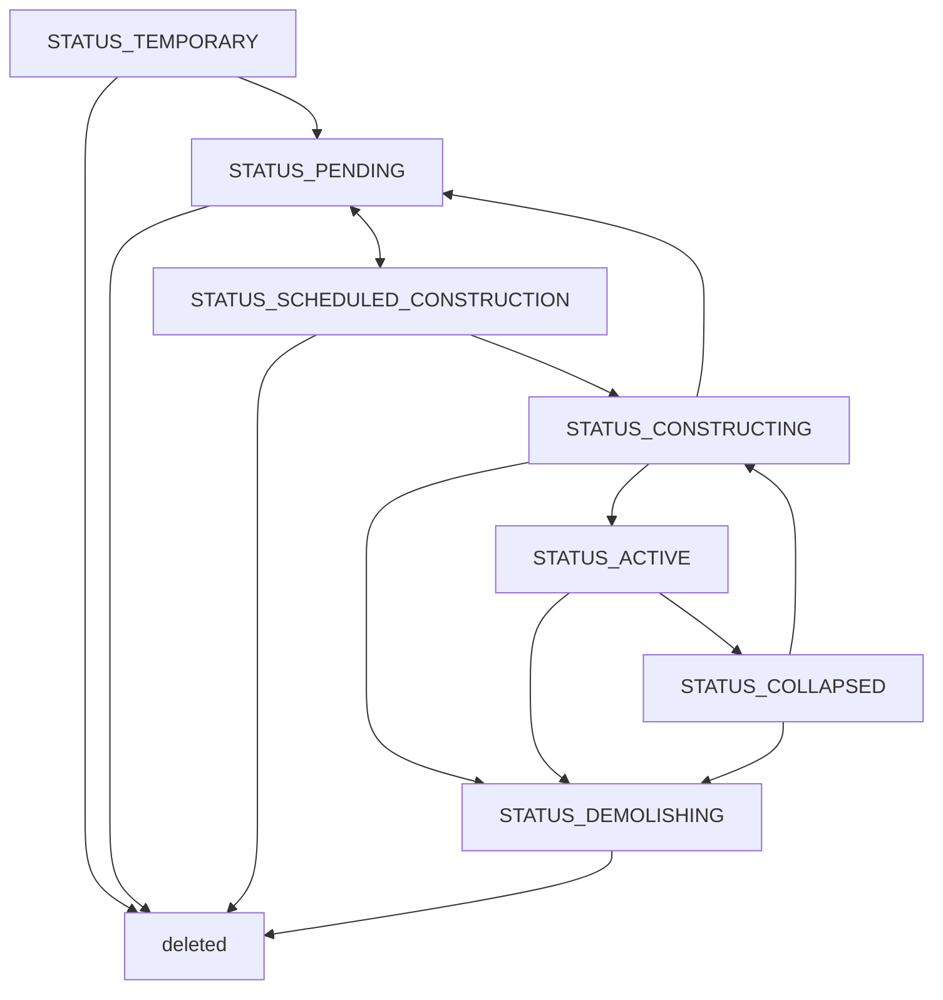

# 3. 道路網

都市の道路網や公共交通網を表現するノードおよびパスについて。

## 3.1 パスとノード

### 鉄道の線形制約

鉄道線路・橋梁（電化/非電化、レンガ高架を含む）の最大勾配は5%（50‰）、最小曲線半径は100mとする。勾配は[神戸電鉄の50‰の実例](https://global.shintetsu.co.jp/)を含めるゲーム上の許容上限であり、一般的な本線の推奨設計値ではない。ホーム区間は最大4.5%・半径100mの別規格を維持し、通常線路の緩和を適用しない。

駅周辺の分岐だから半径100m未満が標準になるわけではない。[北大阪急行延伸の設計資料](https://www.city.minoh.lg.jp/kitakyu/documents/3.pdf)では分岐付帯曲線100m以上、本線160m以上、ホーム沿い400m以上を使い分けている。本ゲームの100mは低速分岐も含めた許容下限で、ホームの実際の設計条件まで再現するものではない。急曲線による通過速度の低下は引き続き適用する。

制限値の正は `path_master.min_curve_radius`（m）と `max_grade`（%）。Unityのプレビューとバックエンドの敷設検証が同じマスターを参照し、Tauriは検証結果を表示する。

## 3.2 パスの考え方

### 線路の分岐・合流

鉄道・モノレールの分岐・合流は、完成済み(`STATUS_ACTIVE`)で造り替え中でない本線へ、側線の端点を接続する形で許可する。建設中・計画中・待機中の本線への合流と、既存の側線端点をかすめて後から本線を追加する逆向き合流は干渉となる。端点同士を滑らかにつなぐ単純延長は、相手が未完成でも許可する。道路のT字路・交差点は未完成の道路に対しても計画できる。

接続位置の許容誤差は5cm、接線の方向差は0.1度以下とする。分岐・合流では、接点から本線の両方向と側線方向へ各20mの区間が共通の平面に収まり、高さのずれが1cm以下である必要がある。水平面だけでなく傾斜面も許可する。側線は共通平面を保ちながら既存の曲率制限に従って曲がり、区間外では縦曲線も許可する。短い側線を後から延長する場合も、既存ポイントの共通平面を維持する。本線の形状は接続のために動かさない。

中心線の中間どうしが交差する平面交差・踏切と、高さの占有範囲が重ならない立体交差は、この合流制約とは別に扱う。

### パス形状の表現

パスの形状は`start_point`と`end_point`と`waypoints`によって表現される。形状は直線またはベジエ曲線で表現され、直線も制御点を直線上に配置したベジエ曲線として扱われる。各端点には1つの制御点（`start_control`, `end_control`）があり、ウェイポイントには2つの制御点（`control_in`, `control_out`）がある。ステータスが`active`のパスは始点と終点にノードを持ち、住民や物資が移動する交通ネットワークの一部となる。

### 地下パス（トンネル）

パスのY座標（地面からの相対高さ）は負の値を取ることができ、その区間は地下パスとなる。

地下パスは、中心線に沿った各地点の「深さ（＝地形標高 − 道路の絶対標高）」によって、以下の区間に連続的に分類される。切替閾値にはバリアントのクリアランス高さ（`path_master`の`height`）をそのまま使う。

| 区間         | 条件                | 地形と描画                                        |
| ---------- | ----------------- | -------------------------------------------- |
| 切り通し（開削）   | 0 < 深さ ≤ `height` | 着工時に地形を道路標高まで掘り下げ（周囲は切土と同じ法面スロープ）、通常どおり描画される |
| 坑口         | 深さが`height`を跨ぐ境界点 | トンネル出入口のオブジェクト（`portal`パーツ）が配置される            |
| 完全埋設（トンネル） | 深さ > `height`     | 地形は変形されず、道路メッシュも描画されない（地中に埋まる）               |

区間分類は地点ごとの深さ関数として純粋に決まるため、1本のパス内で開削⇔トンネルを何度でも遷移でき、坑口は閾値を跨ぐすべての境界点に現れる。

**地形追従しないパス（`follow_terrain` が実効的に false。[A_パス形状](../geometries/A_パス形状.md)参照）も、相対高さが0のまま同じ深さ分類の対象になる。** アンカーのY座標を負に刻まなくても、非追従パスが丘に差し掛かって道路の絶対標高が地形標高を下回れば深さが正になり、上の表と同じく開削（掘削）・坑口・トンネルへ連続的に分類される。谷を渡って道路が地形より高くなる区間は逆に高架（橋）として描かれ、地形は変形しない。これにより「この2点を結ぶ道路。地面があれば勝手にトンネル、なくなれば橋」という敷き方が、標高の手動調整なしに実現できる。地下パス（負のアンカーY）と非追従パスの違いは「アンカーを地下に沈めるか、地表に置いたまま非追従にするか」だけで、掘削量・建設コスト・土地区画の買収免除（大深度・市有区画の地下/高架通過）の扱いは同一である。

**土地区画の扱い**は地上と同じで、地下でも土地区画が設定されている場所には原則建設できない（買収が必要）。ただし以下の2つの免除がある。

- **大深度免除**: 深さが一定値（都市パラメータ、既定20m）以上の区間は、土地の所有者を問わず土地区画を無視して建設できる。深い区間で分断される場合、買収対象は浅い区間ごとに個別に判定される。
- **市有区画の地下・高架免除**: 市政府が所有する土地区画の上は、パスがその区画を「地下」（路面の絶対標高が地形標高より低い）または「高架」（路面の絶対標高が、地形標高＋区画上の建物の高さより高い）で通過する場合に限り、深さ・高さを問わず**区画を残したまま**建設できる。接地している区間は通常のルールに従うが、ごく短い接地区間（数m程度）は「端点の接地」として許容される。

市有区画の免除によって区画を残したまま建設された場合、その区画には**横断パスあり**（`has_crossing_path`）フラグが立つ。フラグの効果は[4_地区と土地区画](4_地区と土地区画.md)を参照。

**立体交差の扱い**も地上と同じ占有高さ範囲 `[Y, Y+height]` の干渉判定に従う。ただし非追従スパン（高さ編集されたスパン・橋バリアントのスパン。地下パスを含む）が絡む交差では、相対高さではなく絶対標高（地形標高＋相対高さ）で比較する。これにより「丘の下を通るトンネル」と「丘の上の地表道路」は正しく立体交差として許可され、逆に開削区間（未着工）を横切る地表道路は干渉として拒否される。掘削済みの開削区間ではアンカーの相対高さが再正規化される（掘削で下がった地形標高差をrelYに繰り入れ、開削区間のアンカーはrelY≈0になる）ため、そこを横切る新しい地表道路は同じ高さの平面交差（交差点）になる。地下パス同士も、同じ絶対標高で交差すれば地下交差点（ノード）が生成される。詳細は[J_パスの交差処理](../geometries/J_パスの交差処理.md)を参照。

地下パスの建設コストは深いほど高くなり、開削区間には掘削の土工分も計上される。

### ノードとパスの種類

パスには以下の種類があり、各種類はそれぞれの特性と役割を持つ。

| パスカテゴリ                        | 特徴                                                 |
| ----------------------------- | -------------------------------------------------- |
| 街路(`PATH_STREET`)             | 自動車と歩行者が通行できる道路。道路沿いに土地区画を作ることができる。                |
| 高速道路(`PATH_MOTORWAY`)      | 自動車のみが通行できる道路。道路沿いに土地区画を作ることができない。                 |
| 歩道(`PATH_WALKWAY`)            | 歩行者のみが通行できる道。「歩行者専用道路(LRT付き)」バリアントはLRTの走行網にも含まれ、中央に上下線のLRT軌道（複線）を持つ、歩行者とLRTだけが通るトランジットモールになる（[6_公共交通機関](6_公共交通機関.md)）。 |
| 線路(`PATH_TRACK`)              | 列車が通行できる線路。バリアントに `infra_products`（電力）を持つものは**電化線路**として送電網も兼ねる（[26_インフラ網](26_インフラ網.md)参照）。鉄道の複線は、1本のパスが上下線の軌道を持つ複線のバリアント（軌道数2。通行方向は常に双方向）で作ることも、単線を2本並べて（上下線を互いに逆向きの一方通行にして）作ることもできる。LRT専用軌道もこの種別の複線のバリアントである（後述の「通行方向」）。どの路線種別が走れるかは公共交通マスターの走行網で決まる。 |
| 公共交通(`PATH_TRANSPORT`)        | 公共交通路線を表現する。停留所ノードは路線種別ごとに決まった下地パスの上にしか設置できない（バスは街路、メトロなど鉄道系は駅パス、LRTは走行網の街路・歩行者専用道路(LRT付き)・LRT専用軌道）。 |
| 人員搬送(`PATH_CONVEYOR`)         | ロープウェイなど、車両・運行主体を持たずに人を運ぶ設備。歩行者だけが利用でき、乗降できるのは乗降可能バリアント(`boardable`)の端点のみ。路線・停留所は作らない。詳細は[30_人員搬送設備](30_人員搬送設備.md)。 |
| インフラ(`PATH_ELECTRICITY` / `PATH_WATER` / `PATH_PIPELINE`)   | 送電線・導水管・パイプラインのインフラ網。運ぶインフラ財の系統ごとに種別が分かれるが、挙動は共通である。交通には参加せず、インフラ財の配送にのみ使われる。端点には流せるインフラ財に対応した専用のインフラノードが作られる。端点とノードの結合ではY座標のズレが許容され、垂直に高さを変えて結合できる（垂直結合）。詳細は[26_インフラ網](26_インフラ網.md)を参照。 |

街路のうち、`path_master.frontage_allowed=true` のバリアントだけが沿道土地区画の生成と接道指定に対応する。歩道付き道路橋（バリアント223）は `PATH_STREET` なので自動車・歩行者とも通行できるが、`frontage_allowed=false` のため沿道に区画を生成できず、既存区画の接道候補にもならない。この制限は道路の高さや地形追従の設定に依存せず、地表に敷いた場合も同じである。橋の取り付け部で土地にアクセスさせる場合は、その部分を通常の街路として分けて敷設する。

道路橋は標高編集が可能で、地形に追従しない設定を既定とする。両端の相対高さが0でも谷をまたぐ区間は橋になる。構造物の実効高さによる建設費は既存の高架道路と同じ計算に従う。

ノードの種類（`type`）は「そのノードが受け入れる接続種別の集合」を表す**ビットフラグ**である
（道路 / 鉄道 / モノレール / 人員搬送 / 公共交通 / インフラ財ごとのビット）。
パスの端点がノードへ結合（溶接）できるかは、ノードのビットとパスの接続マスクの
**ビット積が非空か**で決まる。道路と線路のノードは道路・鉄道の両ビットを持つ同種の
ノードであり（踏切として共有できる）、送電線の端点は電力ビットを持つノード
（インフラノード・電化線路のノード・施設の接続端子）にのみ結合できる。

ノードID（パスの `start_node_id` / `end_node_id`、施設の `infra_node_id` / `depot_node_id` など）は作成順に振られる整数で、ノードが削除されても同じIDが再び使われることはない。道路の竣工、交差点での分割、停留所や施設の接続端子の設置、路線の経路の編集などでノードは作られ続けるため、長く遊んだ都市ではIDが16ビット整数の上限（32767）を超える。ノードIDは32ビット整数（C# の `int`、TypeScript の `number`）で扱うこと。

### 制限速度

制限速度はバリアント（規格）ごとに都市全体で定める市の規制で、規制ウィンドウの「制限速度」タブから変更する。都市の開始時はマスターの既定値（`path_master` の `default_speed_limit`。2車線道路40km/h、6車線道路60km/h、4車線高速道路100km/hなど）が入っている。

変更は**敷設済みのパスにも遡及する**。ただし、パス詳細から個別に制限速度を指定したパス（`override_max_speed`）だけは個別指定が優先され、規制の変更では塗り替えられない。個別指定を解除すると、そのパスは即座に規制の値へ戻る。

都市の制限速度テーブルは `GET /api/v1/city/` の `max_speed`（`{path_variant: km/h}`）で読み、`PATCH /api/v1/city/` の `max_speed` で更新する。PATCH はテーブルを丸ごと差し替え、含まれていないバリアントはマスターの既定値で補われる（以前の設定は残らない）。そのため更新側は変更したバリアントだけでなく全バリアント分を送る。

設定できるのは制限速度が実際に所要時間へ効く種別、すなわち自動車が走る**街路・高速道路**に限る。鉄道線路・モノレール線路の制限速度はプレイヤーが設定する値ではなく、マスターの既定値（300km/h）に固定された名目上の上限で、規制ウィンドウにもパス詳細にも表示しない。列車の速度は線路の曲線半径と路線種別の最高速度で決まる（[6_公共交通機関](6_公共交通機関.md)）。歩道は歩行者速度のパラメータで、人員搬送（ロープウェイ）は設備そのものの巡航速度で動くため規制の対象外であり、公共交通の区間パス・インフラパス・駅舎パスはそもそも通過時間を持たない。歩行者専用道路（LRT付き）も歩道なので規制の対象外で、その上を走るLRTはバリアント既定の制限速度（パス詳細での個別指定は可能）を上限に走る。

制限速度はあくまで上限であり、実際の通過速度（`base_speed`）は次項の線形制約でさらに下がる。形状に対して高すぎる制限速度を設定した道路は、その乖離のぶんだけ交通事故が増える（[20_事故と災害](20_事故と災害.md)）。

### パスの線形制約（曲線半径・勾配）

道路や線路は、その形状（線形）から物理的に無理なく出せる**通過速度**を持つ。急なカーブは横方向の加速度を一定以下に抑える速度（半径Rのカーブで √(横加速度×R)）までしか出せず、道路は急な坂でも減速する。この通過速度は経路探索の所要時間・渋滞・交通事故の起きやすさに直結し、公共交通の車両もこの速度を上限に道路・線路の上を走る（[20_事故と災害](20_事故と災害.md)、[6_公共交通機関](6_公共交通機関.md)）。

さらに、バリアント（規格）ごとに**最小曲線半径**と**最大勾配**の上限があり、これを超える形状のパスは敷設できない。

| 種別 | 最小曲線半径 | 最大勾配 |
|---|---:|---:|
| 高速道路 | 50m | 8% |
| 街路（舗装） | 制限なし（減速のみ） | 15% |
| 未舗装路 | 制限なし | 20% |
| 歩道 | 制限なし | 30% |
| 鉄道線路 | 160m | 3.5% |
| モノレール | 50m | 6% |
| 人員搬送（ロープウェイ） | 制限なし（直線のみ） | 制限なし |

勾配は、地形に追従する区間では地形の起伏（造成後の道路面）から、高架・橋・トンネルの区間ではアンカーの標高の補間から決まる。急斜面に地表の線路を引きたい場合は、等高線に沿わせるか高架・切り通しで勾配を緩める必要がある。

敷設中は3D画面が規格を超える区間を赤い線で示し、カーソル脇に最小曲線半径（R）と最大勾配（G）が出る。規格を超えていると建設パネルで確定できない。既存のパスには遡及しない（規格の変更で稼働中の線路が止まることはない）。

橋梁・貨物PF・駅舎など部材が曲がれないバリアント（`curve_allowed` が偽）は、直線かアンカーで折れる折れ線でしか敷設できない。曲線（`curved`=true）を指定した新設（`POST /api/v1/paths`）・変更（`PATCH /api/v1/paths/{id}` で `curved` かバリアントを変える）・事前検証（`POST /api/v1/paths/validate`）はエラー（HTTP 400）として拒否され、`curved` を省略した新設は直線として作られる。バリアントごとの高さの範囲（`min_height` 未満の相対高さ。地下に潜れないバリアントの地下や、高架専用の駅の地上など）を外れるアンカーを持つパスも、新設・変更・事前検証とも同じく拒否される。

### 交差点での減速と停止

通過速度（`base_speed`）はパスの形状だけから決まる値で、パスの端で止まるかどうかは含まない。自動車の所要時間は、この形状の速度を上限に、パスの両端のノードで出せる速度（**境界速度**）までの加速・減速を含めて決まる。加速と減速は一定の加減速度で行うので、停止1回で失う時間は速い道路ほど大きい。境界速度はノードに集まるパスのつながりだけで決まり、パスの種類ごとの特別扱いはない。

- **行き止まり**: 通り抜けられる道路がつながっていないノード（一方通行どうしが向かい合う突き当たりを含む）では止まる。
- **交差点**: 3本以上の道路・線路・モノレールが集まるノードでは、交差点で止まる種類の道路は止まる。止まるかどうかは道路の種類（`path_types` の `junction_stop`）で決まり、街路は止まり、高速道路は止まらない。線路と平面交差する踏切も交差点として街路は止まる。高速道路は止まらないので、ランプが合流・分流するノードでも本線は減速しない。
- **つなぎ目**: それ以外のノードでは、通り抜けられる道路のうち最も速く抜けられる先への速度になる。つなぎ目の角度をカーブと同じ規則（曲線半径と横加速度）で速度に直し、両側の制限速度の小さい方を超えない。まっすぐなつなぎ目では減速しないので、直線の道路をどこで分けても所要時間は変わらない。ランプが本線へ合流する角度や、高速道路が街路へそのまま続く端では、この規則で減速する。

交通事故の起きやすさ（[20_事故と災害](20_事故と災害.md)）は形状の通過速度と制限速度の乖離で決まり、交差点で止まることは含めない。公共交通の車両は停留所以外のパスの端で止まらない（[6_公共交通機関](6_公共交通機関.md)）。

### パスの交通量と利用率

路上駐車は通過交通量とは別の台数 `parked_cars` を持つ。これは昼夜のうち多い側の路駐台数で、合法容量 `street_parking_capacity` を超えることがある。路駐率 `parking_ratio`（`parked_cars / street_parking_capacity`。容量0の道路は0）も持ち、1を超える値は容量超過の度合いを表す（1で頭打ちにしない）。合法容量を持つのは稼働中の地上の生活道路だけで、長さに比例する。3つともエポックごとに計算し直す値でセーブには含まれず、ロード直後は次のエポックまで0になる。車が路上へ出てくる仕組みは [12_建物](12_建物.md) の「12.14 駐車」を参照。Unityでは稼働中かつ駐車容量のある生活道路の両側に車両を表示する。実寸で置けるところまでを描画上限とし、超過台数そのものは減らさない。詳細は [路上駐車の描画](../geometries/O_車両の走行描画.md#路上駐車の描画) を参照。

稼働中のパスは、車種別の交通量 `path_traffic`（`VEHICLE_*` をキーとする dict）を持つ。値は**そのパスを1日あたりに通過する回数**（乗用車・トラック・バスなら台/日、歩行者なら人/日。交通量調査の通行量と同じ数え方）である。通勤・通学・買い物・物流・公共交通の運行など、経路にそのパスを含むすべての移動が加算され、エポックごとに再計算される。通勤・通学・買い物・物流の移動は行きと帰りの往復として数え、行きの経路と帰りの経路にそれぞれ1回ずつ加算する。双方向の道路を行きも帰りも通れば1往復で2、一方通行などで行きか帰りの片方しか通らない道路は1になる。

交通量は「通過数」なのでパスの長さには依存しない。同じ経路上にある長いパスと短いパスは同じ値を持つ。

パスは交通カテゴリ別のキャパシティ `path_capacity`（同じく1日あたりにさばける台数）も持ち、利用率 `utilization` は交通量をキャパシティで割った値になる。線路（`PATH_TRACK`）とモノレールの軌道（`PATH_MONORAIL`）のキャパシティは道路の「秒間処理台数」ではなく、バリアントの最小運転間隔（`min_headway_min`、未設定なら共通既定値。1軌道あたりの値）から「運行時間 ÷ 最小運転間隔 × 軌道数」で求めた1日あたりの列車本数（全軌道の合計）である。列車は進む向きで決まる1本の軌道を走るので、公共交通の路線設定に対する事前検証と線路の利用率は軌道ごとに数え、最も負荷の高い軌道の便数を1軌道の容量と比べる（[6_公共交通機関](6_公共交通機関.md)の「線路容量」参照）。利用率が高い道路は通過に時間がかかるようになり（渋滞）、交通事故の発生確率も上がる（[20_事故と災害](20_事故と災害.md)参照）。

### パス詳細での表示

UIの統計・集計と名前付き道路の表示は[道路の詳細と道路名](../programs/道路の詳細と道路名.md)に定義する。

### 公共交通パスの特記事項

公共交通パスは、通常の交通網の上に重なる独立したネットワークレイヤーである。ノードが停留所、パスが路線区間を表す。

- 公共交通パスは `line_agent_id` によって路線の収支を管理する経済主体([2_経済主体](2_経済主体.md)）に紐づく。
- 停留所ノードは路線ごとに独立しており、複数の路線が1つのノードを共有することはない。
- 停留所ノードを道路と明示的に結合する必要はない。住民は最寄りの歩行者が通行できる道路から停留所を利用できる。駅舎に所属するホームの停留所は、駅舎の出入口を経由して利用する([29_駅と駅舎](29_駅と駅舎.md) 29.7)。

路線・車両・運賃などの経済シミュレーション上の扱いは[6_公共交通機関](6_公共交通機関.md)を参照。

### 交差点のノード生成

異なる種類のパスが交差した場合、交差不可能なパス間の場合は互いのパスが分割され、交差点にノードが自動作成される。

表中の「インフラ」は、インフラパスの種別（`PATH_ELECTRICITY` / `PATH_WATER` / `PATH_PIPELINE`）をまとめて指す。

|                             | 高速道路(`PATH_MOTORWAY`) | 街路(`PATH_STREET`) | 線路(`PATH_TRACK`) | 公共交通(`PATH_TRANSPORT`) | インフラ | その他(`PATH_DEFAULT`) |
| --------------------------- | ------------------------ | ----------------- | ---------------- | ---------------------- | --------------------------- | ------------------- |
| 高速道路(`PATH_MOTORWAY`)    | ×                        | ×                 | ×                | ✅                      | ✅                           | ✅                   |
| 街路(`PATH_STREET`)           | ×                        | ×                 | ×                | ✅                      | ✅                           | ✅                   |
| 線路(`PATH_TRACK`)            | ×                        | ×                 | ×                | ✅                      | ✅                           | ✅                   |
| 公共交通(`PATH_TRANSPORT`)      | ✅                        | ✅                 | ✅                | ✅                      | ✅                           | ✅                   |
| インフラ | ✅                        | ✅                 | ✅                | ✅                      | ×                           | ✅                   |
| その他(`PATH_DEFAULT`)         | ✅                        | ✅                 | ✅                | ✅                      | ✅                           | ✅                   |

人員搬送(`PATH_CONVEYOR`)は表の「その他」と同じ扱いで、どの種類のパスとも(人員搬送どうしでも)交差ノードを作らない。乗降は交差ではなく乗降ノードの自動接続で表現する([30_人員搬送設備](30_人員搬送設備.md))。

インフラパスどうしの交差では、**同じ網に属する場合**（`infra_products` に共通の製品を持つ場合）
のみノードが生成され、インフラ網の分岐点として機能する。別網どうし（送電線×導水管など）と、
インフラパスと他種のパスの交差ではノード生成・パス分割は行われない（自由に立体交差できる）。

例外として、**インフラパスの端点を、同じインフラ財を流せる電化線路（線路でありながら
`infra_products` を持つバリアント）へ引き込んだ場合**に限り、電化線路が分割されて
接続ノードが生成される（タップ接続）。中間どうしの交差は従来どおり素通りする。
詳細は[26_インフラ網](26_インフラ網.md)を参照。

### 通行方向

パスは通行方向 `travel_direction` を持つ。値は共有定数の `DIR_BOTH`（0。双方向。既定）、`DIR_FORWARD`（1。始点→終点の向きだけ通れる）、`DIR_BACKWARD`（2。終点→始点の向きだけ通れる）のいずれかである。一方通行の道路・線路では、自動車も公共交通の車両もその向きにしか進めない。住民の移動の経路（交通量の割り当て）でも、自動車は一方通行の道路をその向きにしか通らない。そのため往路と復路で通る道路が変わることがあり、一方通行でしかつながっていない場所へは片方の向きにしか自動車で行けない。歩行者は一方通行の道路も両方向に歩ける。往路と復路で通る道路が違うと、交通量は往路の道路と復路の道路に半分ずつ載る（[パスの交通量と利用率](#パスの交通量と利用率)）。住民の通勤時間や、勤務先・買い物先・取引先を選ぶときの所要時間も、往路と復路の平均で評価する。

線路の**軌道数**は、線路系のバリアント（線路 `PATH_TRACK`・モノレール `PATH_MONORAIL`）では `path_master` の `lanes`（未設定・1未満は1）である。道路の `lanes` は車線数であって軌道数ではない（LRT付き街路の4車線・6車線は軌道数に数えない）。

- **単線（軌道数1）**: 鉄道・モノレールの単線の線路・駅。一方通行にも双方向（単線を往復する運転）にもできる。単線を2本並べて互いに逆向きの一方通行にすれば、上下線が別々のパスの複線になる。
- **1本で複線を持つ線路（軌道数2）**: 1本のパスが上下線の軌道を持ち、往路と復路が同じパスを通る。通行方向は常に `DIR_BOTH` で、一方通行にはできない。LRT専用軌道（バリアント431。幅7m・2軌道、軌道中心は中心線から±1.75m）と、鉄道・モノレールの複線の線路・駅のバリアントが該当する。複線の駅は上下線それぞれの外側にホームを持つ相対式か、上下線の間の中央の間隔（`center_width`）に1面のホームを持つ島式である。島式の駅は線路の間隔がホームの幅だけ広く、前後の複線とはノードでつながる。

どちらの線路でも、**パスと進む向きが決まれば、列車が走る軌道は1つに決まる**（単線はその軌道、1本で複線を持つ線路は進む向きの側の軌道）。ノードは点で、どの軌道につながるかを持たないので、単線と複線のパスは同じノードで自由につなげられ、1つのノードに集まった線路は通行方向と後述の進行方向の連続性が許すかぎり全部つながる。

1本で複線を持つ線路に `DIR_BOTH` 以外を指定する操作は、エラー（HTTP 400）として拒否される。対象は新設（`POST /api/v1/paths`）、事前検証とプレビュー（`POST /api/v1/paths/validate`）、経路提案（`POST /api/v1/paths/propose-route` の各成分の `travel_direction`）、変更（`PATCH /api/v1/paths/{id}` で `travel_direction` を変える、または `path_variant` を1本で複線を持つバリアントへ変える）、造り替え（`POST /api/v1/paths/{id}/rebuild` で一方通行の単線を1本で複線を持つバリアントへ造り替える）である。交差点の発生や任意地点での分割など、プレイヤーの直接操作でない作成・更新ではエラーにせず、`DIR_BOTH` に揃える。`travel_direction` に0・1・2以外の値を指定した場合は、バリアントによらず拒否される。

### 交差点での進行方向の連続性

ノードは複数のパスを繋ぐが、そこで「どちらの向きへでも進める」わけではない。進める方向は、パスがノードに接する向き（端点の接線）の幾何形状によって決まる。この「進行方向の連続性」の扱いはパスの種類によって異なる。

線路・モノレールのような**案内軌条系**では、車両は交差点・合流点で自由に向きを変えられない。なめらかにY字合流するように敷いた線路は合流先へ滑らかに入っていけるが、Y字で片方の線路からもう片方へ鋭角に折り返すことはできず、直角の平面交差では直進だけができて90°の転回はできない。折り返しは車両が停止する停留所（駅）でのみ可能である。これは公共交通の車両が走行する下地経路の探索に反映される（LRTではLRT専用軌道どうしの接続にだけ働く。[6_公共交通機関](6_公共交通機関.md)参照）。

道路では、**高速道路（`PATH_MOTORWAY`）が接続する交差点・合流部**に限り、進行方向の連続性が自動車の経路選択に反映される。高速道路のランプで合流した直後に鋭角に転回して逆走方向へ進むような経路は、線路と違って禁止こそされないものの大きな時間ペナルティを受けるため、実質的に選ばれなくなる。鋭角転回を避ける必要がある場合、経路探索は「先の出口や道路の行き止まりまで走って転回して戻る」といった現実的な迂回路を自然に選択する。街路どうしの交差点はこの制約の対象外で、自由に右左折・転回できる。街路を走るバス・LRTと歩行者もこの制約を受けない。

### インターチェンジとジャンクション

高速道路と他の道路をつなぐ出入口（インターチェンジ、IC）や、高速道路どうしの分岐・合流（ジャンクション、JCT）は、専用の**ランプ**用バリアントで敷いた道路の集まりとして表現される。ランプは `path_master` の `ramp` が true のバリアントで、種別は高速道路（`PATH_MOTORWAY`）に限られる（現行は102「ランプ」と103「2車線ランプ」）。ランプの建設・耐久度・交通量・形状・描画は通常の高速道路と同じで、歩行者は通行できず、沿道に土地区画も作れない。

プレイヤーがインターチェンジそのものを作る操作は無い。敷設済みの道路から、以下の規則でインターチェンジが**自動的に検出**される。

- 対象は稼働中（`STATUS_ACTIVE`）の街路・高速道路だけ。計画中・工事中のランプは数えないので、インターチェンジはランプが竣工した分から順に成立していく。
- 端点のノードを共有してつながったランプの集まりが1つのインターチェンジの核になる。
- ランプの集まりごとに、ランプとその端点を囲む範囲を `INTERCHANGE_HULL_MARGIN_M`＝10m だけ広げたものを占める範囲とする。範囲どうしが重なるランプの集まりは、道路でつながっていなくても1つのインターチェンジにまとめられる（上り線と下り線を別の道路で敷いた本線の両側にあるランプなど）。
- ランプの端点はインターチェンジの内部ノードである。さらに、ランプの端点から出て、範囲の内側にある**他の道路が接続しない途中のノード**だけを通って再び内部ノードに戻る道路の途中のノードも内部とみなす。これにより、ランプの間を通る本線や、ランプの出入口をつなぐ街路を途中で分割していても、それらは内部に含まれる。交差点（3本以上の道路が接続するノード）や行き止まりは内部に取り込まないので、範囲の内側に市街地の街路網が入り込んでいても、その街路は通常の道路のまま扱われる。
- 両端がともに内部ノードの道路を**内部パス**、片端だけが内部ノードの道路を**腕**（arm）と呼ぶ。腕が内部ノードに接する端点を**ポータル**と呼ぶ。腕は外部の道路網とインターチェンジの出入口であり、腕が2本未満のものは交差点として働かないのでインターチェンジとして扱わない。
- 腕がすべて高速道路ならジャンクション（`INTERCHANGE_KIND_JCT`）、1本でも街路があればインターチェンジ（`INTERCHANGE_KIND_IC`）になる。

自動車の経路探索は、インターチェンジを**1つの交差点**として扱う。ある腕から入って別の腕（同じ腕へ戻るUターンを含む）へ出る移動の所要時間は、内部の道路を実際に走る最短の所要時間と一致し、ランプでの鋭角転回のペナルティ（前項）も同じように掛かる。この扱いは経路計算を軽くするためのもので、インターチェンジの外の地点どうしの経路の選ばれ方や所要時間は変わらない。経路探索で自動車が通れるのはいずれかの地区に属する道路だけ（地区外の道路は通らない）で、地区の中の経路はその地区の道路だけを通るという前提もそのまま保たれる。インターチェンジの一部のランプが別の地区や地区外にあっても、地区の中の経路がそのランプを近道に使うことはない。インターチェンジを通る移動の交通量 `path_traffic` は、実際に走る内部のランプや本線の各パスに計上される。腕が複数の地区にまたがるインターチェンジは、それらの地区の間を自動車で行き来する接続点になる。歩行者はこの扱いの対象外で、内部の街路も通常の道路として歩ける。

インターチェンジは、どの腕からどの腕へ行けるかを**接続**（`connections`）として持つ。接続は、ある腕から入って別の腕へ出るまでに鋭角転回のペナルティを一度も受けずに走れる組である（ペナルティを受ければ走れる組は含めない）。経路探索と同じ曲がれる方向の規則と通行方向で判定するが、所要時間や混雑には依存せず、道路の形とつながりだけで決まる。一方通行のランプや本線はその向きにしか通れず、進入する腕はインターチェンジへ向かって、退出する腕はインターチェンジから外へ向かって走れるものに限る。地区に属していない道路も区別せずに含めるので、地区外の腕を含む組は、接続にあっても経路探索では使われない。同じ腕へ戻るUターンは含めない。インターチェンジの詳細パネルは、この接続を「出発する道路」から「到着する道路」への矢印で描く。

検出結果は都市データとしてセーブされ、インターチェンジごとにIDと名前を持つ。道路が変化すると、次のエポックの経路計算またはインターチェンジAPIの呼び出し時に検出し直される。検出し直したとき、以前のインターチェンジとランプを1本でも共有するものは（ランプの追加・撤去・分割があっても）IDと名前を引き継ぐ。引き継ぎは1対1で、1つのインターチェンジが2つに分かれた場合や2つが1つにまとまった場合は、共有するランプの多い組（同数ならIDの小さい方）が引き継ぐ。引き継ぎ先の無いインターチェンジは削除され、新しく成立したものには一度も使われていないIDが振られる。名前はプレイヤーが変更でき、初期値は空文字（未命名。表示側が種別とIDから仮の名前を作る）である。

インターチェンジは次のプロパティを持つ（リストはすべて昇順）。

| プロパティ | 型 | 内容 |
|---|---|---|
| `interchange_id` | int | インターチェンジID |
| `name` | str | 名前。空文字は未命名。最大 `INTERCHANGE_NAME_MAX_LENGTH`（64）文字 |
| `kind` | int | `INTERCHANGE_KIND_IC`（1）または `INTERCHANGE_KIND_JCT`（2） |
| `center` | [x, z] | 範囲の重心のワールド座標 |
| `polygon` | [[x, z], ...] | 内部とみなす範囲の外周（閉じた先頭点の重複なし） |
| `path_ids` | [int, ...] | 内部パスのID（ランプ以外の道路を含む） |
| `ramp_path_ids` | [int, ...] | 内部パスのうちランプのID |
| `node_ids` | [int, ...] | 内部ノードのID（ポータルを含む） |
| `arms` | [{`node_id`, `path_id`}, ...] | 腕の一覧。`node_id` はポータル、`path_id` は腕の道路。(`node_id`, `path_id`) の昇順 |
| `connections` | [[int, int], ...] | 接続。[進入する腕の `path_id`, 退出する腕の `path_id`] の昇順 |

APIは次の3つで、作成・削除の口は無い。

| API | 内容 |
|---|---|
| `GET /api/v1/interchanges/` | `{version, interchanges}`。`interchanges` は `interchange_id` 昇順のレコード一覧。`version` はインターチェンジの集合・構成・名前が変わるたびに増える整数で、クライアントは前回と同じなら再描画を省ける。末尾のスラッシュが必要 |
| `GET /api/v1/interchanges/{interchange_id}` | `{interchange, arms}`。`arms` は腕ごとの道路の情報 `{node_id, path_id, path_type, zone_id, zone_name}`（`path_type` は道路の種別、`zone_id`・`zone_name` は両面が同じ地区の腕の所属地区。2地区の境界の腕と地区に属していない腕は `0`・`null`）。存在しなければ404 |
| `PATCH /api/v1/interchanges/{interchange_id}` | 本文 `{name}` で名前を変更し、`{interchange}` を返す。前後の空白は除かれ、空文字で未命名に戻る。文字列でない場合や最大文字数を超える場合は400 |

どのAPIも応答の直前に道路の変化を検出し直す。ただしエポック実行中はシミュレーションが道路を書き換えている途中なので検出し直さず、直前に検出済みの内容を返す（改名はできる）。エポック中の変化は、そのエポックの経路計算で検出し直される。

### 既存パスの任意地点での分割

稼働中（`active`）のパスは、任意の地点を指定して1本を2本に分割できる。分割の基準点は次のように解釈される。

- 指定した地点がパスの中心線上にある場合は、その地点がそのまま分割点になる。
- 中心線から外れた地点を指定した場合は、その地点から中心線へおろした**垂線の足**（中心線上で最も近い点）が分割点になる。

分割点にはノードが1つ作成され、分割された2本のパスはそのノードで接続される。元のパスは前半（始点〜分割点）に更新され、後半（分割点〜終点）は新しいパスとして作成される。後半のパスは元のパスの種類（`path_variant` / `path_type`）・ステータス・所属地区（`zone_id`）・耐久度・曲線か直線か・通行方向・地形追従の個別設定・設備設定・駅パスの設定（ホームの設置側・駅舎の配置端・通路の方式・設計標高・所属駅）に加えて、所属道路（`road_id`。[3.5 道路(名前付き道路)](#35-道路名前付き道路)）・区間名（`name`）・タグ（`tag`）・個別の制限速度（`override_max_speed` と `max_speed`）・建設スピードの目標（`utilization_target`）・進行中の造り替え（`rebuild_variant`）と修繕（`under_maintenance`）の状態を引き継ぐ。建設・造り替え・修繕・解体の進み具合（必要な建設量・調達済みの量・建設サービス財の需要）は、分割後の前半と後半の中心線の長さの比で配分され、2本の合計の仕事量は分割の前と変わらない。これらの引き継ぎは任意地点での分割に限らず、交差点の発生・近接スナップ・都市境界での分割にも共通である。パスが**ベジエ曲線**である場合も、分割の前後で曲線の形状はそのまま保たれる（分割点で曲線が折れたり形が変わったりしない）。

分割点が始点・終点に近すぎて一方が極端に短くなる場合は分割できない。分割は形状のみを事前確認する**プレビュー**にも対応しており、確定させずに分割後の2本の形状と分割点だけを取得できる。

## 3.3 パスのステータス変遷

パスは以下のようなステータスを持つ。
ステータスによってできることが異なる。

| ステータス                           | 説明                              | 都市シミュレーションでの動作                                     | 他のステータスへの変更                                                                                  | ステータス設定時の処理                                   |
| ------------------------------- | ------------------------------- | -------------------------------------------------- | -------------------------------------------------------------------------------------------- | --------------------------------------------- |
| `STATUS_TEMPORARY`                | ユーザーが道路を作成し、まだ確定していない           | シミュレーションには影響せず、ユーザーの画面に表示されるのみ。                    | ユーザーの操作で`STATUS_SCHEDULED_CONSTRUCTION`に変更できる。オブジェクトを削除することもできる。                             | 何もしない                                         |
| `STATUS_PENDING`                  | プレイヤーが設置したが、まだ着工していない（保留状態） | シミュレーションには影響せず、ユーザーの画面に表示されるのみ。                    | ユーザーの操作で`STATUS_SCHEDULED_CONSTRUCTION`（着工）に変更できる。オブジェクトを削除することもできる。                       | 何もしない                                         |
| `STATUS_SCHEDULED_CONSTRUCTION` | 建設が決定されたが、用地未取得などにより建設が開始されていない | オーバーラップする建物が「買収対象」「取り壊し対象」としてフラグ付けされ、買収や取り壊しが進行する。 | オーバーラップする建物や土地がすべてなくなったら`STATUS_CONSTRUCTING`に自動変更される。オブジェクトを削除することもできる。                     | オーバーラップする建物をや土地区画を検出し、買収・取り壊し対象としてフラグ付けする     |
| `STATUS_CONSTRUCTING`           | 用地取得と既存建物の取り壊しが完了し、建設が開始された。    | シミュレーションのエポックごとに「建設サービス」財を消費し、消費した分だけ建設が進行する。      | 「建設サービス」財の調達量が必要量に達したら自動的に`STATUS_ACTIVE`に変更される。ユーザーの操作で`demolish`に変更することができる。オブジェクトを削除できない。 | 建設体積（形状に応じた基本体積＋地形の切土・盛土の土工体積）を算出し、「建設サービス」財の需要を設定する。また、パスの占有範囲の地形を路面の高さへ平坦化する。 |
| `STATUS_ACTIVE`                 | 建設が完了している。                      | 交通ネットワークに組み込まれ、住民の経済活動に使用される。                       | ユーザーの操作で`STATUS_DEMOLISHING`に変更することができる。オブジェクトを削除できない。                                       | 始点と終点にノードを作成する。また、既存パスと交差する場合は交差地点に新しいノードを作る。 |
| `STATUS_DEMOLISHING`            | 取り壊し中                           | シミュレーションのエポックごとに「建設サービス」財を消費し、消費した分だけ建設が進行する。      | ステータスは変更できない。「建設サービス」財の調達量が必要量に達したらオブジェクトが自動消去される。                                           | 何もしない。ステータスを変更するのみ。                           |
| `STATUS_COLLAPSED`              | 倒壊した                            | 使用不能。周辺の住民心理に悪影響を与える。                              | ユーザーの操作で`STATUS_DEMOLISHING`（取り壊し）または`STATUS_CONSTRUCTING`（再建）に変更することができる。                                                     | 何もしない。ステータスを変更するのみ                            |

### 発注時の資金審査

建設コストを持つパス（建設コスト係数が0より大きいバリアント）の新設と造り替えは、配置（計画）の時点で事業費の全額を市の未拘束の現金で賄える場合にだけ受理される。未舗装路のようにコスト0のパスは資金に関わらず敷設できる。資金が足りない場合は `INSUFFICIENT_FUNDS` で拒否され、1回の敷設操作で複数のパスを作る場合は途中の1本が拒否された時点で全体が不受理になる（作成済みの分も巻き戻される）。詳細は[22_予算管理](22_予算管理.md)の「公共工事の発注時の資金審査」を参照。

### 着工時の土地区画との重なりの扱い

`STATUS_SCHEDULED_CONSTRUCTION` のパスは、その占有範囲と既存の土地区画との重なりに応じて、エポック処理の中で着工可否が決まる。

- **境界の接触**: 区画と道路の縁がちょうど接しているだけ（面としての重なりがない）場合は、重なりなしとして扱われ、着工を妨げない。
- **軽微な重なり（かすめ）**: 道路の縁が区画の角や縁をごく薄く削る程度の重なりは、所有者や建物の有無を問わず着工を妨げない。着工時に重なった部分だけが区画から削り取られ（**部分収用**）、区画は残りの形で存続する。所有者が市政府以外の場合は、削った面積の割合に応じた土地代が市政府から所有者へ支払われる。既存道路の端点から少し角度を変えて道路を延長し、沿道の土地区画にわずかに食い込んでも建設できるのはこのためである。ただし、削りが区画上の**建物本体**に及ぶ場合は着工できない（建物は削れない）。
- **市有の空き区画への部分的な重なり**: 重なりが区画のごく一部（おおむね3割以下）で、残りが土地区画として成立する場合は、上と同じく重なり部分だけを削り取って区画を存続させる。それを超える大きな重なりの場合は、着工を待たず区画全体が自動的に削除される（計画パスの占有地は分類された時点で更地のまま確保される。他の区画の買収・取り壊しを待つ間に、この空き地へ建物がスポーンして着工が永久に妨げられるのを防ぐため）。
- **有意な重なり**: 民間所有の区画、または建物が立地する区画に道路の接地区間が有意に重なる場合は着工できず、`STATUS_SCHEDULED_CONSTRUCTION` のまま待機する（建物の取り壊しなどで重なりが解消されれば、以降のエポックで自動的に着工する）。
- 市有区画を**地下・高架**で通過する場合は、区画を無変更のまま残して着工できる（前述の「地下パス」の節を参照）。
- **着工前・一時停止中の建物の敷地**: 建物が着工前や一時停止中で区画がまだ空き地に見えても、その区画は削除・部分削りされず、接地して重なる道路は着工待ちになる。
- **造成工事の範囲**: 工事中の整地・埋立の範囲には、地表・高架・地下・インフラを問わずパスを計画できない（完了時に範囲全体の地形が書き換わり、上や下を通るパスの高さ関係が変わるため）。造成が完了すれば普通の土地に戻る。

部分収用や区画の自動削除に伴う市政府から所有者への支払いは、財政上は土地収用の支出として記録される。

### 民間区画の自動用地買収

着工を阻む有意な重なりのうち、**民間所有の区画**に対しては市政府による用地買収が自動的に進む。

1. **交渉開始**: 着工待ちの道路と有意に重なった民間区画は、次のエポックで買収交渉中になる（区画のプロパティ `under_acquisition` が true になる）。交渉中の区画に立地する建物は、経済主体詳細ウィンドウでアイコンがオレンジの枠と「買収交渉中」ラベルで縁取られる。
2. **成立**: 交渉中の区画は毎エポック確率的に買収が成立する。成立すると市政府が旧所有者へ買収金（建物の残存価値 + 解体費 + 土地代）を支払い、区画は市有化される。区画上の建物は取り壊し（`STATUS_DEMOLISHING`）に入る。
3. **着工**: 取り壊しの完了で区画が市有の空き地になると、区画は即座に削除されて更地のまま確保され、すべての障害が解消された道路が着工する。

買収金は予算カテゴリ「**用地買収**」（`LEDGER_LAND_PURCHASE`）から支出される。このカテゴリの必要額は買収交渉中の全区画の買収金見積の合計として毎エポック算出されるため、予算比率 1.0 なら資金がある限りすべての交渉が成立できる。比率を下げると 1 エポックに成立する買収が予算内に絞られ（残りは次エポックへ持ち越し）、**比率 0 で買収を一時停止できる**（詳細は [22_予算管理](22_予算管理.md)）。予算不足で成立できなかった交渉は `under_acquisition` を保持したまま持ち越される。計画パスの削除などで買収の理由がなくなった区画は交渉が自動的に中止され、`under_acquisition` は false に戻る。

なお、**市有区画に建物が立地する**ケース（プレイヤー自身の公共施設が道路計画と重なる場合）は自動買収・自動取り壊しの対象にならない。プレイヤーが手動で建物を取り壊さない限り、道路は着工待ちのまま残る。

### パスの造り替え（バリアント変更）

敷設済み（`STATUS_ACTIVE`）のパスは、**同じパスカテゴリ内の別バリアント**へ造り替えることができる（例: 狭い街路→広い街路）。解体して新設し直す必要はない。

- **対象**: `STATUS_ACTIVE` のパスのみ。パスカテゴリ（`path_type`）をまたぐ変更はできない。公共交通パスは対象外。インフラパスは同じインフラ財を流せるバリアント間でのみ変更できる。
- **チェック**: 新設時と同じ基準で検証される。新バリアントの幅での土地区画との重複（買収が必要な区画に有意に重なる場合は拒否。軽微な重なりや部分的に重なる市有の空き区画は受理時に重なり部分だけが削り取られ、大きく重なる市有の空き区画は自動削除される。判定は「着工時の土地区画との重なりの扱い」と同じ）、立体交差、高さ制約（標高を設定できないバリアントへ高架・地下パスを造り替えることは不可）などがチェックされ、条件を満たさない場合はエラーになる。パスの上に公共交通の停留所がある場合は、新バリアントでも停留所が設置可能であることが必要。線路では、造り替え後の軌道数・容量で、このパスを走る路線の計画便数が1軌道の容量を超える場合も拒否される（[6_公共交通機関](6_公共交通機関.md)「線路容量」。すでに容量を超えている線路では、負荷率がさらに上がる造り替えだけを拒否する）。造り替え中の線路は、路線の新設・変更の事前検証でも造り替え後の軌道で判定される。造り替えは通行方向を変えないので、一方通行の線路を1本で複線を持つバリアントへ造り替えることはできない（「通行方向」参照）。
- **コスト**: 建設コストは**新設と同額**。新バリアントの幅・高架/地下倍率で算出した建設体積の全量が、建設サービス財として市場から調達される（[12_建物](12_建物.md)のパス建設と同じ枠組みで、需要は建設代理エージェントが受け持つ）。
- **工事中の挙動**: パスは `STATUS_ACTIVE` のまま交通ネットワークで使われ続け、幅・制限速度・容量も**旧バリアントのまま**維持される。調達不足時は建設不足アラート（`ALERT_PATH_CONSTRUCTION_SHORTAGE`）が表示される。
- **完了**: 建設サービス財の調達が完了したエポックでバリアントが切り替わり、幅・速度・容量・見た目が新バリアントの値に更新される。耐久度（`durability`）は新品（1.0）にリセットされる。プレイヤーが手動設定した制限速度は温存される。
- **キャンセル**: 完了前ならいつでもキャンセルでき、パスは旧バリアントのまま残る（調達済みの建設サービス財は返金されない）。
- **修繕との関係**: 修繕（[12_建物](12_建物.md)参照）中のパスに造り替えを指示すると修繕は自動キャンセルされる。造り替え中のパスは修繕対象にならず、修繕を開始することもできない。

進行中の造り替えは、パスのプロパティ `rebuild_variant`（変更先バリアント。未設定時は -1）で表現される。APIでは `POST /api/v1/paths/{path_id}/rebuild`（`dry_run` 対応）で開始、`DELETE /api/v1/paths/{path_id}/rebuild` でキャンセル、`GET /api/v1/paths/{path_id}/construction-cost?path_variant=` で事前のコストプレビューができる。エポック実行結果（`epoch_report`）には造り替え中パスの一覧（`rebuild_items`）と進捗が含まれる。

## 3.4 都市境界の扱い

新たにpathを配置する際、ノードの位置が都市限界の外にある場合、そのノードのinterconnectフラグを1にします。また、そのノードの位置は強制的に都市限界の端に変更します。
つまり、本来のノードの位置(都市限界の外)ではなく、パスと都市限界の交点にノードを移動します。
これにより、都市限界の境界上にノードを配置することができます。

## 3.5 道路(名前付き道路)

**道路**（名前付き道路）は、交差点で分かれた複数のパスを「青梅街道」のような1本の道路としてまとめる名札である。道路を構成するパスを**区間**と呼び、どの道路にも属さない区間を**名もなき道**と呼ぶ。道路は名前・色と区間の集まりだけを持ち、経済・交通の計算には一切関与しない。交通量・所要時間・耐久度などは区間ごとの既存の値を道路単位で並べ、集計して返すだけで、経路探索も道路という単位を知らない。

UIでの表示（道路詳細パネル・3Dの強調帯と道路名ラベル・地図の道路名）は[道路の詳細と道路名](../programs/道路の詳細と道路名.md)を参照。

### 道路への所属の規則

- 所属の正はパス側の `road_id`（int）である。どの道路にも属さない区間は `VALUE_NONE`（-1）。1つの区間が属する道路は1つまでで、複数の道路が同じ区間を共有することはない。
- 道路に属せるのは街路と高速道路だけ（共有定数 `PATH_TYPES_NAMED_ROAD` = [`PATH_STREET`, `PATH_MOTORWAY`]）。1本の道路に街路と高速道路が混ざってもよい。歩道・線路・インフラなどは属せない。
- 区間のステータスは問わない。計画中・発注済み・工事中の区間も道路に含められる。所属だけの変更は都市外の区間の編集制限の対象にならない。
- 区間どうしが連続している必要はない。つながっていない区間を含む道路は、途中で途切れた道路として扱われる（後述の「塊」）。
- **区間が0本になった道路は直ちに削除される**。区間の撤去の完了、計画の取り消し、所属の解除、結合による吸収、種別の変更、別の道路への付け替えのどれで0本になっても同じで、区間の無い道路は存在しない。削除された道路の詳細を取得すると404になる。
- 道路IDは1から作成順に振られ、道路が削除されても再利用されない。
- 名前は前後の空白を除き、連続する空白を1つにまとめて保存する。最大 `ROAD_NAME_MAX_LENGTH`（64）文字。空文字も許され、未命名を表す（表示側が「道路 #id」のような仮の名前を補う）。
- 色は `#rrggbb` 形式。作成時に省略すると、共有定数 `ROAD_COLOR_PALETTE`（8色）から作成順に巡回して割り当てられる。
- パスごとの名前（`name`）は道路とは別に残り、区間名（橋やトンネルの名前など）として使う。パスの既定の名前は空文字で、表示側が「パス #id」や「道路名（区間 #id）」を補う。
- 道路の記録（名前・色・起点の位置）は都市データとして、各区間の `road_id` はパスのデータとしてセーブされる。

### 分割・結合・削除・種別変更での扱い

- **分割**: 交差点の発生や任意地点での分割でできた後半のパスは、元のパスの `road_id` を引き継ぐ（[既存パスの任意地点での分割](#既存パスの任意地点での分割)）。分割で道路から区間が抜けることはない。
- **結合**: 同じ道路に属するパスどうし、または片方が名もなき道なら結合でき、結合後のパスは属している方の道路の区間になる。別々の道路に属するパスどうしの結合は `dry_run` を含めてエラー（HTTP 400）として拒否される（どちらかの道路から区間が黙って消えるため）。結合後に残るパスが区間名・タグを持っていなければ、吸収される側のものを引き継ぐ。
- **削除**: パスが削除されると所属も消え、それで区間が0本になった道路は削除される。
- **種別の変更**: `PATCH /api/v1/paths/{id}` で種別（バリアント）を変えて街路・高速道路でなくなったパスは、道路から外れる。バリアントだけを送った場合も種別はバリアントのマスターに従う。造り替えは同じ種別の中でしか行えないので、造り替えで所属は変わらない。

### 幹線道路

パス一覧（`GET /api/v1/paths`）の `trunk` は、**高速道路、または道路に属する区間**（`road_id` が1以上）なら真になる。マスターには幹線を表す列は無い。プレイヤーが名前を付けてまとめた道路を主要な道とみなすためで、2D都市マップの「幹線道路」レイヤーはこの判定に従う（[都市マップの検索と経路案内](../programs/都市マップの検索と経路案内.md#ベースマップの描画)）。

### 区間の並びとキロ程

道路の詳細は、区間を起点からの距離（**キロ程**）という1本の軸に並べて返す。並べ方は保存されず、要求のたびに区間の形状とつながりから求められる。同じ区間の集まりと起点の設定に対しては、常に同じ並べ方になる。

- **塊**（`sections`）: 端点でつながった区間のまとまり。計画中の区間はまだノードを持たないが、端点どうしがノードの結合と同じ距離の範囲にあればつながっているとみなす。塊と塊の間は途切れ（未接続）で、2番目以降の塊の `gap_before_m` は前の塊の終点からその塊の始点までの直線距離である。キロ程は途切れの距離も足して、途切れの前後で連続させる。
- **基準線**: 塊ごとのキロ程の軸。塊の中で最も長く続く区間の並びで、塊が1つの輪になっている（環状）ならその輪を一周する。
- **役割**（`role`）: 基準線を構成する区間は `main`。基準線と並行する一方通行の区間（上り線と下り線を別々のパスで敷いた道路の反対車線）は `parallel`。それ以外（基準線から枝分かれした区間など）は `branch`。反対車線がそれぞれ別の交差点につながっていて、区間のつながりだけでは別の塊になる場合も、並行していれば同じ塊の `parallel` として扱い、途切れにはしない。同じ2つの交差点の間を上り線・下り線の2本だけで結んだ道路も、環状ではなく上下線の分かれた道路として扱う。
- **向き**（`direction`）: 一方通行の区間は、進む向きがキロ程の増える向きなら `down`（下り）、減る向きなら `up`（上り）。双方向の区間は `both`。
- **起点**: 起点の位置（`origin`）が未設定なら、道路全体の主な方向の西端（南北方向に長い道路は南端）が起点になる。起点と終点を入れ替える（`PATCH` の `reverse: true`）と、`origin` は入れ替え前の終点側の端の位置に更新され、以後はそちらの端が起点になる。`origin` を座標で持つので、区間の分割・結合でパスIDやノードIDが変わっても起点の側は保たれる。端の塊が環状のとき（起点と終点が同じ位置になるとき）は、入れ替えで輪を回る向きと塊の並びが反転する。入れ替えを2回行うと元の並べ方に戻る。
- **道路名の表示位置**（`label_points`）: 塊ごとに基準線の中点を1つ置き、長い塊には約1500mおきに追加する。`angle_deg` はその点での基準線の向きをワールドXZ平面で `atan2(dz, dx)` の度で表したもの。

### 詳細の値と集計

区間ごとの値（`segments`）は、そのパスの既存の値をそのまま、または次の定義で返す。

| プロパティ | 内容 |
|---|---|
| `traffic` | `path_traffic` のうち歩行者と道路車両で0より大きいもの（キーは `VEHICLE_*` を文字列にしたもの。1日あたり） |
| `road_traffic` / `capacity` | 道路交通（自動車類）の1日あたりの交通量と容量。容量が0以下なら `null` |
| `vc` | 混雑度 = `road_traffic` ÷ `capacity`。**1で頭打ちにしない**（0〜1に丸められた `utilization` とは別）。容量が無ければ `null` |
| `speed_limit` / `base_speed` | 制限速度（`max_speed`）と、形状から決まる通過速度（km/h） |
| `travel_time_free_min` | 自動車の自由走行の所要時間（分） |
| `travel_time_min` | 自動車の混雑込みの所要時間（分）。経路探索・車両の走行描画と同じ混雑の扱いで自由走行の所要時間から求める。容量の無い区間は混雑させない |
| `durability` / `noise` / `air_pollution` / `parked_cars` / `street_parking_capacity` | パスの同名の値 |
| `accident` | 当エポックに交通事故が起きた（アラートの `ALERT_PATH_ACCIDENT`） |
| `under_maintenance` / `rebuilding` | 修繕中 / 造り替え中（`rebuild_variant` が設定されている） |
| `structure` | `"tunnel"`（完全に地下）、`"bridge"`（接道できない街路のバリアント＝道路橋・吊り橋）、それ以外は `null`。高速道路はマスターから橋かどうかを判別できないため `"bridge"` にならない |
| `attach_km` | `branch` の区間が基準線に取り付くキロ程。基準線上の端点があればそのキロ程（両端とも基準線上なら小さい方）、無ければ並行区間の端につながる端点を基準線へ投影した位置、それも無ければ基準線に近い方の端を基準線へ投影した位置。`main` / `parallel` の区間は `null` |

稼働中でない区間と、通れない区間の所要時間は `null` である。交通量・騒音などの値が非常に大きく表現できる上限を超えた場合は、その上限の値に丸めて返す。

道路全体の集計（`stats`）の主な定義は次のとおり。

| プロパティ | 内容 |
|---|---|
| `avg_daily_traffic` | 平均断面交通量（台/日）。稼働中の `main` 区間の `road_traffic` を区間長で重み付けした平均 |
| `vehicle_km` | 走行台キロ（台km/日）。稼働中の `main`・`parallel` 区間の Σ `road_traffic` × 区間長（km） |
| `max_vc` / `avg_vc` | 稼働中の区間で最大の混雑度とその区間の位置、稼働中の `main`・`parallel` 区間の混雑度の区間長重み付き平均 |
| `congested_length_m` | 混雑度0.8以上の稼働中の区間の延長 |
| `travel_time_free_min` / `travel_time_min` | `main` 区間を起点から終点まで走る所要時間の合計。所要時間が `null` の `main` 区間を1本でも含むと `null` |
| `travel_speed_free_kmh` / `travel_speed_kmh` | `main` 区間の延長 ÷ 上の所要時間 |
| `delay_vehicle_hours` | 渋滞損失（台時/日）= Σ `road_traffic` × (混雑込み − 自由走行の所要時間) ÷ 60 |
| `avg_durability` / `low_durability_count` | 稼働中の区間の区間長重み付き平均耐久度と、耐久度が都市の道路の修繕基準を下回る区間の数（修繕基準が0＝修繕しない設定なら0） |
| `active_length_m` / `planned_length_m` | 稼働中の延長と、計画中・発注済み・工事中の延長 |
| `lanes_composition` | 車線数ごとの延長（延長の長い順） |

道路上の出来事（`events`）はキロ程の昇順に並ぶ。

- `terminal`: 塊ごとの始点と終点（`position` が `start` / `end`）。
- `crossing`: 基準線上のノード（並行区間の端点ノードを含む）で、道路に属していない街路・高速道路・線路（踏切）が接続するもの。同じ道路の区間はまとめて1件にし、交差点を貫いていれば `side` が `"both"` になる。`side` はキロ程の進む向きに対して相手が伸びる側。上下線が分かれた道路で、2つの車線側の交差点を短い道路で結んだ交差（中央分離帯を渡る交差道路）は1件にまとめる。
- `interchange`: インターチェンジ（[インターチェンジとジャンクション](#インターチェンジとジャンクション)）の内部ノードを通る位置。インターチェンジごとに1件（最小のキロ程）で、その内部ノードは `crossing` にならない。
- `stop`: 区間を下地とする公共交通の停留所。

`zones` は区間の所属地区（2地区の境界の区間は両面の地区）をキロ程の順に初出の順で、`transit_lines` は区間を経路に含む公共交通路線を返す。

### API

いずれも手書きのプレーンJSONで、シミュレーションを含まないモック配布物でも動く。形の正は `city-genesis/tauri/src/components/road/roadTypes.ts`。

| API | 内容 |
|---|---|
| `GET /api/v1/roads/` | `{version, roads}`。`roads` は `road_id` 昇順の一覧（`road_id`, `name`, `color`, `path_ids`（昇順）, `segment_count`, `length_m`（全区間の中心線長の合計）, `bbox`（[minx, minz, maxx, maxz]。取れなければ `null`）, `label_points`）。`version` は道路の集合・名前・色・起点・所属・区間の形状と状態が変わると変わる整数（2^48未満）で、前回と同じなら再描画を省ける。末尾のスラッシュが必要 |
| `GET /api/v1/roads/{road_id}` | 一覧の1件に `version`, `origin`, `stats`, `sections`, `segments`, `events`, `zones`, `transit_lines` を加えた詳細。存在しなければ404 |
| `POST /api/v1/roads/` | 本文 `{name, color?, path_ids}` で道路を作成し `{road}` を返す。`path_ids` は1本以上必要。別の道路に属していた区間は付け替えになる |
| `PATCH /api/v1/roads/{road_id}` | 本文 `{name?, color?, reverse?}`。名前・色の変更と、`reverse: true` で起点と終点の入れ替え。`{road}` を返す |
| `DELETE /api/v1/roads/{road_id}` | 道路を削除し `{deleted: true, cleared_path_ids}` を返す。区間は残り、名もなき道に戻る |
| `POST /api/v1/roads/{road_id}/members` | 本文 `{add?, remove?}` で区間を一括で付け外しし、`{road, deleted}` を返す。`add` の区間が別の道路に属していれば付け替えになる（それで元の道路が0本なら元の道路は削除される）。この道路が0本になれば `{road: null, deleted: true}`。検証をすべて済ませてから書き換えるので、途中で失敗して一部だけ変わることはない |
| `GET /api/v1/roads/trace?path_id=&road_id=` | 直進方向の自動延長の候補 `{path_ids, bbox}`。`bbox` は候補の区間の中心線を囲む範囲（一覧の `bbox` と同じ [minx, minz, maxx, maxz]。候補が無ければ `null`）。`path_id` を渡すとその区間（結果に含む）の両端から、`road_id` だけを渡すとその道路の各塊の両端から外側へ、交差点を最もまっすぐ進む同じ種別の区間をたどる。左右対称の分かれ道、曲がりの大きい交差点（`ROAD_TRACE_MAX_DEFLECTION_DEG` を超える）、行き止まり、別の道路の区間で止まり、ランプはたどり始めがランプのときだけ候補にする。合流してくる側の道路が本線を横取りすることはない。`road_id` の既存の区間は結果に含めない |
| `POST /api/v1/roads/extension-candidates` | 本文 `{points: [[x, z] または [x, y, z], ...]}`。各点に端点（始点・終点。計画中の区間も含む）を持つ街路・高速道路の区間のうち、同じ道路に属するものが**ちょうど1本**の道路を、その道路の延長の候補として `{candidates: [{road_id, name, color, point_index}]}` で返す（2本以上なら道路がその点を貫いている＝枝分かれなので候補にしない）。`point_index` は最初に見つかった点の番号 |

道路の外のAPIでも所属を扱う。

- `POST /api/v1/paths` の各パスは `road_id`（int または `null`）を受け付ける。存在しない道路や、街路・高速道路でない種別を指定すると、一括作成全体がエラー（HTTP 400）になり何も作られない。
- `PATCH /api/v1/paths/{id}` はステータスを問わず `road_id` を受け付ける。`null`・-1・0 は所属の解除。検証は作成と同じ。**所属の変更ではパスの `version` は変わらない**ので、クライアントは道路一覧の `version` で追従する。
- パスの一覧（`multi_path`）と詳細（`single_path`）は `road_id` を返す（未所属は -1）。
- 予算の対象一覧（`GET /api/v1/city/budgets/agents`）の道路の行は、パスの `name` をそのまま（空文字を含む）返し、`road_id`（所属する道路が無ければ -1）と `road_name`（無ければ空文字）を添える。
- 都市マップの場所検索（`GET /api/v1/navigation/places`）の候補には、名前の付いた道路が `kind: "road"` として含まれる（[都市マップの検索と経路案内](../programs/都市マップの検索と経路案内.md#http契約)）。

## 建設工期の共通モデル

道路・線路の工期は延長・幅に依存せず、単位面積あたりの作業量（種別係数・高架/地下の高さ倍率・造成ペナルティ）だけで決まる。同じ道路を1本で引いても細切れに引いても、工期も建設サービス財の需要総量も変わらない。種類別の工期倍率はなく、パラメーターは建物と別に持つ。詳細は[建設作業量と施工能力](25_建設作業量と施工能力.md)。
