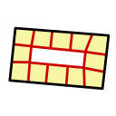
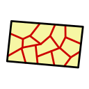

# 4. 地区と土地区画
## 4.1. 地区

地区は、都市をいくつかのエリアに分けるための重要な概念である。
需要や供給の計算、および商品の取引などはすべて地区単位でシミュレーションされるため、地区は経済シミュレーションの基礎となる単位である。

### 地区の作成方法

プレイヤーが地区を作成する際、直接指定するのはその地区に所属させる**道路（パス）**のみである。
プレイヤーは自由な組み合わせの道路を選択して1つの地区としてグループ化する。

**都市には常に1つ以上の地区が存在する。** ゲーム開始時に「初期地区」が1つ作成され、市庁舎（市政府）・中央銀行・支援拠点（旧・輸入拠点）・物資搬出拠点（旧・輸出拠点）はこの初期地区に所属した状態で開始する。プレイヤーが最初に市庁舎を設置し、そこから都市を拡張していく起点となる地区である。

地区は道路の集合として定義されるが、**道路が1本も所属していない地区も存在しうる**（初期地区がまさにそれで、開始直後は道路を持たない）。都市に地区が初期地区の1つしか無く、まだどの道路もどの地区にも所属していない間は、プレイヤーが最初に敷設した道路がその初期地区に自動的に合流する。以降に敷いた道路は、接続先の既存地区を継承するか、どの地区にも接続しなければ新しい地区を自動作成する。ただし、既に十分大きくなった地区へは合流せず、あふれた道路群は新しい地区として芽吹く（後述の成長キャップ）。

### 自動管理地区と確定地区

すべての地区は `auto_managed` プロパティによって2つの状態のいずれかを取る。

| 状態 | `auto_managed` | 説明 |
| --- | --- | --- |
| **自動管理地区** | 1 | システムが所属道路の組み替え（統合など）を自由に行える地区。システムが自動作成した地区はこの状態で始まる（初期地区を含む） |
| **確定地区** | 0 | プレイヤーが確定した地区。システムは所属道路が減る方向の組み替えを一切行わない。プレイヤーが作成した地区はこの状態で始まる |

プレイヤーが地区を明示的に編集（名前の変更、建築規制の変更、所属道路の変更）すると、その地区は自動的に確定地区へ昇格する。また、`auto_managed` を直接指定することで、編集を伴わずに地区を確定したり（ピン）、確定を解除して自動管理へ戻したりできる。

この2状態モデルの狙いは、**地区を丁寧に設定しなくてもゲームを進められる**ことにある。地区を触らないプレイヤーの都市では、道路網の成長に合わせてシステムが適度な大きさの地区を自動的に維持する。一方、プレイヤーが意図を持って作った地区の形状は、システムが勝手に変更することはない。

各状態の地区は次のように振る舞う。

- **自動管理地区**は、互いに道路網で直接つながると1つの地区に自動統合される。ただし統合後が大きくなりすぎる場合は統合されず、隣り合う独立した地区として残る。
- **確定地区**にも新しい道路は合流できる（地区は成長できる）。ただし所属道路が減る方向・組み替える方向の変更は、プレイヤーの操作以外では発生しない。
- どちらの地区にも**成長キャップ**があり、一定の規模を超えた地区へは新しい道路が合流しない。あふれた道路群は新しい自動管理地区として芽吹く。

### 地区の分断と復元

道路の取り壊しなどで地区内の道路網が分断された場合、地区は分割される（同じ地区の道路は互いに到達可能でなければならないため）。最大の道路群が元の地区として残り、切り離された道路群は新しい自動管理地区になる。このとき分離された地区は元の地区への系譜（`parent_zone_id`）を記憶しており、**道路網が再びつながると元の地区へ自動的に吸収され、分断前の状態に復元される**。再連結の判定には建設中の道路も含まれるため、工事による一時的な分断は工事の完了を待たずに解消される。

この復元は元の地区が確定地区であっても行われる。プレイヤーが確定した形状へ「戻す」方向の変更だからである。ただし、分離された側の地区をプレイヤーが編集して確定地区にした場合、その地区は独立した地区として扱われ、自動統合の対象から外れる。

地区は道路が1本も無くなっても即座に消えるわけではないが、経済活動の拠点を持たない空地区は自動削除の対象となる。ただし**最後の1地区だけは、道路が無くても削除されない**（市庁舎や初期エージェントの所属先を常に保証するため）。この結果、プレイヤーが全ての道路を撤去しても地区は必ず1つ残り、次に道路を敷けば再びその地区に合流する。

### 地区と土地区画・経済主体の所属関係

すべての土地区画は、必ず1本の接道（`front_path_id`）を持っている。
この道路が所属する地区が、その土地区画の所属地区となる。
また、経済主体（建物）は土地区画に立地するため、立地している土地区画の所属地区がその経済主体の所属地区となる。
このように、地区への所属関係は「道路 → 土地区画 → 経済主体」という階層的な伝播によって決定される。

**土地区画は必ずいずれかの地区に所属する（地区未所属の区画は存在しない）。** 都市には常に地区が1つ以上存在するため、まだ接道の定まらない区画（道路が1本も無い状態で作った区画など）も、最も近い地区、それも解決できなければ任意の既存地区にフォールバックして所属する。例えば市庁舎を設置すると、その区画は初期地区に所属する。接道が後から定まれば、その道路の地区へ所属が更新される。

面している道路は、区画の作成・形状変更時に周囲の街路との距離から自動で決定されるが、**プレイヤーは土地区画詳細パネルから接道を明示的に選び直すことができる**。パネルには、その区画に面している街路（一定距離以内の街路）が候補として一覧表示され、その中から接道を選択して変更できる。接道を変えると、上記の伝播により**その土地区画の所属地区が変わり、そこに立地する経済主体の所属地区（＝経済シミュレーションの単位）も変わる**。この操作は区画の状態（空き地・建設予定・建物あり）を問わず行える。

### 地区の形状

地区はポリゴンという形状情報をプロパティとして持っているが、これはプレイヤーが直接指定するものではなく、**後付けで計算される派生値**である。
具体的には、ある地区に所属するすべての土地区画のポリゴン形状と、所属するすべての道路の占有形状を幾何学的に合算したものが、その地区のポリゴンとなる。
道路の形状も含まれるため、道路を挟んだ両側の区画や道路沿いに並ぶ区画は道路を介してひと続きの形状になり、地区ポリゴンは地区の道路網に沿った1つの連結した形状になる。
所属する土地区画や道路が変化すれば、地区のポリゴンもそれに応じて変化する。

この仕様により、地区同士が重複することはありえない。
なぜなら、すべての道路は必ず1つの地区にのみ所属し、その道路に面する土地区画もまた1つの地区にのみ所属するためである。

### 地区の代表エージェント

地区を1つ作成するごとに、その地区を代表する3種類の仮想的な経済主体（代表エージェント）が必ず生成され、地区の削除時にまとめて削除される。これらは建物を持たず土地区画にも立地しない特殊な経済主体であり、それぞれ異なる役割を担う。いずれも作成された地区への所属（`zone_id`）が固定され、以降は変化しない。

| 代表エージェント | 役割 |
| --- | --- |
| **建設代理エージェント**（`VARIANT_ZONE_CONSTRUCTION`） | 地区内の道路（パス）の新築・解体需要を肩代わりする。道路は経済主体ではなく市場に直接参加できないため、その建設資材の需要はこのエージェントを経由して調達される（[[12_建物]] 参照）。 |
| **修繕代理エージェント**（`VARIANT_ZONE_CONSTRUCTION_MAINTENANCE`） | 地区内の道路の修繕需要を肩代わりする。 |
| **転居補助エージェント**（`VARIANT_ZONE_RELOCATE`） | 市民や店舗が転居する際の一時的な入居先。新しく生まれた世帯や施設は、正式な建物へ入居先が決まるまでの間、いったんこの転居補助エージェントに仮入居した状態で都市に現れる。 |

建設代理エージェントと修繕代理エージェントは市政府の予算管理（建設予算・修繕予算）の対象となる（[[22_予算管理]] 参照）。転居補助エージェントは予算管理には関与せず、あくまで転居先が決まるまでの受け皿として機能する。

## 4.2. 土地区画の考え方

このゲームにおいては、都市内に存在するすべての建物は土地区画の上に立地する必要がある。
土地区画は任意の形状のポリゴンで表現され、都市の地面上に配置される。

## 4.3. 区画の作成と所有

- 所有権の管理
  - 土地区画は常に何らかの[[2_経済主体]]が所有
  - 区画は売買可能で、所有権は経済主体間で移転する
  - 土地区画に建物が建っている場合、建物の所有権は土地区画の所有権と一致する
  - 市政府が区画を利用するには、買収が必要
- [[市政府]](プレイヤー)ができること
  - 市政府は未分割の土地を新たに区画として登録できる
  - 市政府所有の区画は削除や分割が自由に可能
  - 市政府が所有しない土地区画であっても、法的制限の変更は自由に行える

## 4.4. 区画の作成と分割方法

土地区画は以下の方法で作成・分割できる。

### 地点を指定した矩形区画の作成

- 未区画化の領域の中の1地点を選択
- 選択した地点を中心とする矩形の区画が1つ作成される

### 空き領域からの区画作成

- 未区画化の領域の中の1地点を選択してポリゴン化
- 連続する空き領域を埋める形状が生成される

### **パス沿いの区画作成**

- 既存の道路（パス）に沿って一定幅の区画を自動生成
- 道路の左右どちらかを選択し、幅と奥行きを指定して生成

### 既存区画の分割

既存の区画を選択し、一定のパターンで既存区画を分割する。

| 外周分割                               | 矩形分割                               | ランダム分割                             |
| ---------------------------------- | ---------------------------------- | ---------------------------------- |
|  |  |  |

#### 既存区画のポリゴン形状変更

既存の区画を選択し、新たなポリゴンを設定する。既存の区画と重複しない範囲で設定可能。

## 4.4.1. 地形による建設難易度

すべての土地区画は、その場所の地形の起伏に応じた**建設難易度**を持つ。土地区画は作成時、およびポリゴン形状の変更時に、区画が覆う範囲の地形の平均勾配（`terrain_slope`、無次元）を算出して記録する。この勾配は道路工事などによる地形の変形の影響を受けず、土地本来の起伏に基づいて評価される。急な斜面ほど造成・基礎工事の土工量が増えるため、この勾配が大きい区画ほど建物の建設・修繕・解体のコストと工期が大きくなる。

断崖絶壁のような急斜面では建設コストが著しく高くなるため、経済的に建物が成立せず（地価も低下し）、事実上建物が建たなくなる。市政府が建てる公共施設も同様に斜面では不利になる。

この難易度は建築規制のような明示的な禁止ではなく、あくまでコスト増を通じた経済的な抑制であるため、十分な地価・家賃が見込める場所であれば斜面にも建物は建ちうる。

## 4.5. 土地区画の建築規制

### 建築規制の設定

プレイヤーは土地区画ごとに建築規制を指定することができる。

- 建築可能な建物の種類(複数選択)
- 高さ
- 容積率

土地区画に建築規制が設定されていない場合、土地区画が所属する地区の建築規制が適用される。

建築規制（`allowed_bd_mask`）は法的な制限であり、土地区画の種類（`parcel_type`）による物理的制約とは別物である。`parcel_type`による立地制約は以下の通りであり、建築規制にかかわらず常に適用される（[[12_建物]]参照）。

| 土地区画種類 | 建設可能な建物 |
| --- | --- |
| 通常土地区画（`PARCEL_LAND`） | 港湾以外のすべての建物 |
| 沿岸土地区画（`PARCEL_SHORE`） | 港湾（`BUILDING_PORT`）のみ |
| 水面（`PARCEL_WATER`）| なし |
| 埋立地（`PARCEL_RECLAIMED`）| なし |

### 既存建物への影響

すでに建物が建っている土地の規制を変更した場合でも、既存の建物は影響を受けない。
建て替えの際に規制に適合する建物を建てる必要がある。

## 4.6. 横断パスのある区画（has_crossing_path）

すべての土地区画は、区画の直下または上空を物理的に存在するパスが横断しているかを示すフラグ `has_crossing_path`（0/1）を持つ。「横断」とみなされるのは以下の場合である。

- **浅い地下**: 埋設インフラやトンネルなど、路面の絶対標高が地形標高より低く、かつ深さが大深度免除の閾値（都市パラメータ、既定20m）未満の区間が区画に重なる場合。それより深い大深度トンネルは土地利用に影響しないため横断とみなされない。
- **上空**: 高架道路や送電線など、路面が地表より高い区間が区画に重なる場合（高さは問わない）。

このような横断パスは、市有区画上へのパス敷設免除（[[3_道路網]]参照）や、既存の地下パスの上への区画新規作成によって生じる。

フラグが立っている区画では:

- **民間建物はスポーンしない。** 埋設物や高架との物理的な衝突を防ぐためであり、「空き地なのに建物が建たない」状態は意図した挙動である。
- **公共施設はプレイヤーの操作で建設できる。** ただし上空にパスがある場合、建物の高さが上空パスのクリアランス（路面と地表の間の高さ）未満である必要がある。

フラグはパスの着工・削除、区画の作成・形状変更のタイミングで自動的に更新される派生値であり、プレイヤーが直接変更することはできない。

## 4.7. 土地の立地倍率

すべての土地区画は、経済主体のサブカテゴリ（`variant`）ごとに**立地倍率**（`agent_multiplier`）を持つ。
立地倍率とは、ある種類の経済主体がその土地区画に立地した際の、売上や生産効率のブースト係数である。
例えば、スーパーの variant の立地倍率が 1.2 の土地区画にスーパーが立地すれば、そのスーパーは立地倍率 1.2 の恩恵を受ける。

立地倍率は経済主体ごとではなく土地区画ごとのプロパティである。
土地区画のプロパティ `agent_multiplier` に variant ごとの倍率が格納されており、
全土地区画 × 全 variant の組み合わせ分の倍率値が存在する。
初期値はすべて `1.0` であり、エポックごとのシミュレーションで更新される。

### 立地倍率の計算フェーズ

立地倍率は商品の種類（小売財・工業原料）ごとに異なる要素から計算される。

#### 小売バリアントの立地倍率

小売財を供給するvariantの立地倍率は、交通量と集積効果に基づいて計算される。
- **交通量ボーナス**: 面する道路の交通量に応じて加算される。交通量の多い場所ほど小売業の売上が向上する
- **集積効果ボーナス**: 近隣に同種または同グループの施設が集まっているほど加算される

#### 工業原料バリアントの立地倍率

工業原料を供給するvariantの立地倍率は、集積効果と天然資源効率に基づいて計算される。
- **集積効果ボーナス**: 小売と同様だが、交通量ボーナスは適用されない
- **天然資源効率**: 天然資源を必要とするvariantでは、資源残量率に基づく効率が乗算される（[[21_天然資源]]）。資源が存在しない区画では生産できない

### 立地倍率が経済主体に与える影響

計算された立地倍率は、各経済主体の `attraction` に取り込まれる。`attraction` は立地倍率と長期稼働ボーナス（知名度）から算出される「顧客から見た施設の魅力」の倍率である。設備投資の充実度は顧客の店選びに関係しないため `attraction` には含まれず、生産側の設備効率として別に扱われる（[[9_生産活動]]を参照）。

`attraction` の効果の受け方は、経済主体が供給する商品の種類によって異なる。

- **小売財を供給する経済主体**- 商品市場でのスコア計算において、`attraction` が高いほど需要者から選ばれやすくなる。つまり、魅力的な立地にある店舗ほど多くの顧客を集める。
- **工業原料を供給する経済主体**- 生産実行時に `attraction` が生産量に乗算される。つまり、同じ原材料と労働力を投入しても、立地倍率が高い場所ではより多くの製品を生産できる。ただし原材料の消費量は増えないため、実質的に原料効率が向上する。

#### 共有建物バリアントの立地倍率

共有建物は直接的な立地ボーナスを受けず、**建物に入居しうるテナントにとっての立地の良さ**から間接的に立地価値が評価される。テナントにとって立地倍率の高い場所にある建物ほど、建物自体の立地倍率も高くなる。

