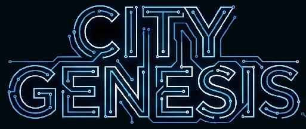

English | [Japanese (original)](../ja/README.md)

# City Genesis

Not a diorama maker, not a traffic simulator—a true city simulation game.

## Features

- **Autonomous Economic Simulation** — Hundreds of thousands of citizens and shops autonomously consume, produce, and invest, building an organic city economy.
- **Zero-Sum Financial System** — Simulates credit creation, central bank settlement of failed businesses, and tax systems. Money never appears from nothing: every payment is someone else's receipt.
- **Fluid Traffic Model** — Realistic traffic flow based on economic activity directly influences storefront sales and daytime population density.
- **Supply Chain** — From raw materials to processing and retail, the balance of supply and demand determines all prices.
- **Real Estate Market** — Land prices and rents vary by location, and dynamic urban landscapes emerge based on real estate demand.
- **Open Source** — The Unity frontend and Tauri UI are open source. The simulation core is a separate, closed-source component.

## Documentation

Japanese is the authoritative source. English pages are translations of the Japanese originals.

### Economic Simulation

Concepts behind agents, markets, finance, production, consumption, employment, education, and trade.

- [Overview](economics/01_overview.md)
- [Agents](economics/02_agents.md)
- [Paths and nodes](economics/03_paths-and-nodes.md)
- [Districts and parcels](economics/04_districts-and-parcels.md)
- [Buildings](economics/05_buildings.md)
- [Real estate market](economics/06_real-estate.md)
- [Households](economics/07_households.md)
- [Employment and education](economics/08_employment-and-education.md)
- [Product market](economics/09_product-market.md)
- [Production](economics/10_production.md)
- [Consumption](economics/11_consumption.md)
- [Financial system](economics/12_finance.md)
- [Environment](economics/13_environment.md)
- [Accidents and disasters](economics/14_accidents-and-disasters.md)
- [Budget management](economics/15_budgets.md)
- [Scores and achievements](economics/16_scores-and-achievements.md)
- [Supply and transport](economics/17_supply-and-transport.md)
- [Public transport](economics/18_public-transport.md)
- [Stations and station buildings](economics/19_stations.md)
- [Tourism](economics/20_tourism.md)

### Component Integration

Architecture and communication shared by the core, Unity graphics, and Tauri UI.

- [Component architecture](programs/component-integration.md)
- [IPC](programs/ipc.md)
- [Sessions and saves](programs/sessions-and-saves.md)
- [Versioning and compatibility](programs/compatibility.md)
- [UI foundations](programs/ui-foundations.md)
- [Unity input](programs/unity-input.md)
- [Unity visual modes](programs/unity-visual-modes.md)
- [Notifications and alerts](programs/notifications.md)
- [Tutorial foundations](programs/tutorials.md)
- [Sound system](programs/sound.md)

### Geometries

Shape specifications for paths, land, buildings, and terrain.

- [Path geometry](geometries/A_path-geometry.md)
- [Land geometry](geometries/B_land-geometry.md)
- [Building geometry](geometries/C_building-geometry.md)
- [Terrain](geometries/D_terrain.md)
- [LOD](geometries/E_lod.md)
- [Building meshes — Shared conventions](geometries/F_building-meshes.md)
- [Building meshes — Assembly methods](geometries/F1_building-mesh-methods.md)
- [Road meshes](geometries/G_road-meshes.md)
- [Backend data loading](geometries/H_data-loading.md)
- [Path intersections](geometries/J_path-intersections.md)
- [Terrain props](geometries/M_terrain-props.md)
- [Track meshes](geometries/N_track-meshes.md)
- [Vehicle rendering](geometries/O_vehicle-rendering.md)
- [Traffic simulation and rendering](geometries/T_traffic-and-rendering.md)
- [Material sharing and export](geometries/P_material-sharing.md)
- [Station building meshes](geometries/Q_station-building-meshes.md)
- [Material resolution](geometries/R_material-resolution.md)
- [Fire effects](geometries/S_fire-effects.md)
- [Weather and lighting](geometries/U_weather-and-lighting.md)
- [Ambient vehicles](geometries/V_ambient-vehicles.md)
- [Pedestrian rendering](geometries/W_pedestrian-rendering.md)
- [Asset packs](geometries/X_asset-packs.md)

### Contributing

- [Translation glossary](contributing/glossary.md)
- [Assets and credits](contributing/asset-credits.md)

### API Reference

Full endpoint specifications for the backend REST API.

[OpenAPI](../api/openapi.json)

© 2024-2026 City Genesis Project
