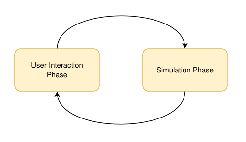

# 1. Overview

City Genesis is a city-building simulation in which the player, acting as mayor, provides roads, parcels, and public facilities, and economic activity allows the city to grow. Cities emerge from people's activities. As in the real world, an established city is difficult to rebuild from scratch.

## 1.1. Epochs

The player allocates budgets and prepares construction plans, then runs one epoch of simulation. The city's state does not advance until the epoch runs, leaving time to think.

The simulation approximates supply, demand, and traffic numerically instead of moving each person and vehicle individually. Heavy computation occurs only during epoch execution, so planning remains responsive as the city grows. On-screen vehicles and pedestrians visualize traffic and other results calculated by the core ([traffic and rendering](../geometries/T_traffic-and-rendering.md)).

#### Virtual calendar

The game uses a virtual calendar with 30 days per month and 12 months, or 360 days, per year. There are no leap years or differences in month length.
Dates exchanged between modules are elapsed days since January 1, 1800, which is day zero. This convention applies to city dates and dates such as building completion.

The initial game settings determine whether an epoch advances 7 or 30 days. Running an epoch advances the city date by that amount. Games started from scenarios continue from the date saved in the scenario.

## 1.2. Components

The game runs as three processes.

| Component | Responsibility |
| --- | --- |
| Core | Owns city state, calculates epochs, and provides an HTTP API |
| UI (Tauri) | Windows, charts, and controls; the application entry point, which launches the core and Unity as child processes |
| Graphics (Unity) | 3D rendering and spatial input, including selection and placement on the map |

The UI and graphics each fetch city data from the core over HTTP and submit edits and epoch requests to it. They synchronize selection and editing state through MemoryMappedFile messages. The core is the sole authority for city state; the UI and graphics reload it after epochs and confirmed edits. See [component integration](../programs/component-integration.md), [IPC](../programs/ipc.md), and [data loading](../geometries/H_data-loading.md).

## 1.3. City data

| Data | Meaning |
| --- | --- |
| [Nodes and paths](03_paths-and-nodes.md) | A graph representing roads, tracks, infrastructure conduits, and public transport lines. Paths are shaped lines; nodes are endpoints and intersections |
| [Districts and parcels](04_districts-and-parcels.md) | Districts group roads and form the units for economic calculations and building regulations. Parcels are land polygons with owners and land prices |
| [Agents](02_agents.md) | Units that exchange money and products: households, shops, factories, schools, city government, and buildings |
| [Citizens](07_households.md) | Individuals belonging to households, with ages and skills, who study and work |
| [Products](09_product-market.md) | Goods and services produced and consumed by agents |

Buildings occupy parcels; households and shops rent space in them. Agents trade products, hire citizens in the labor market, and rent space in the real estate market. Commuting, education, shopping, and freight generate road traffic. Traffic volumes and travel times in turn affect living environments, customer access, and location choices.
