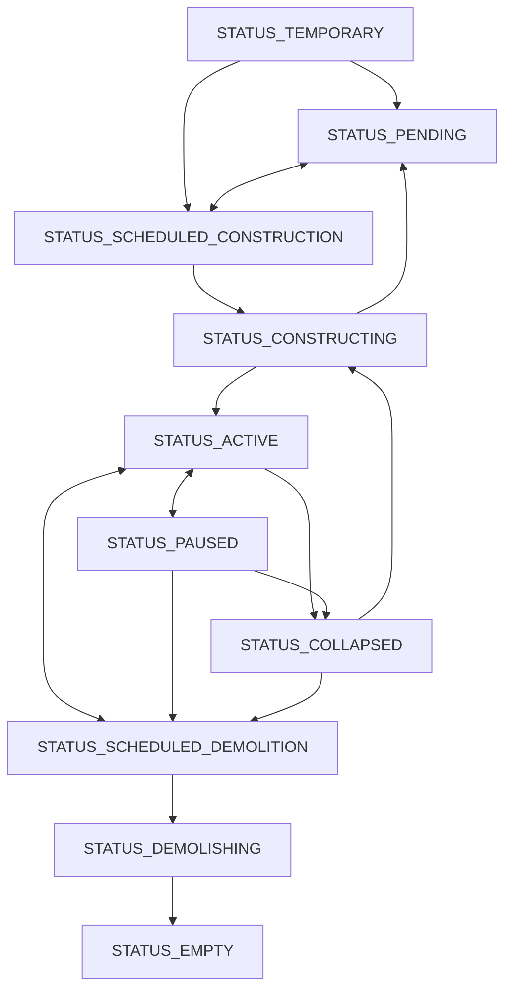

# 2. Agents

## 2.1. What is an agent?

An agent is the basic simulation unit that exchanges money and products. Households, shops, factories, schools, foreign trading partners, city government, and buildings are all agents. Each has funds, demand, supply, and employment, and trades through the product, labor, and real estate markets.

## 2.2. Agent categories

Agents have a broad `type` (`TYPE_*`) and a more specific `variant`.

| Category | Constant | Meaning |
| --- | --- | --- |
| City government | `TYPE_CITY` | The city's accounting entity; receives taxes and makes public expenditures |
| Education | `TYPE_EDUCATION` | Schools and universities ([employment and education](08_employment-and-education.md)) |
| Household | `TYPE_HOUSEHOLD` | Income and consumption units to which citizens belong; tourists are also households ([households](07_households.md), [tourism](20_tourism.md)) |
| Trade hub | `TYPE_TRADE` | Trading partners outside the city, including ports and international freight stations |
| Standard facility | `TYPE_STANDARD` | Producers of goods and services, from shops, factories, and farms to power plants and hospitals |
| Shared building | `TYPE_BUILDING` | Buildings that rent space to other agents, including housing, offices, commercial buildings, and farmland |
| Open space | `TYPE_OPEN_SPACE` | Land uses without production or employment: parking, squares, parks, and [earthworks](04_districts-and-parcels.md) |
| Other | `TYPE_DEFAULT` | Accounting entities such as district representatives and [public transport lines](18_public-transport.md), and border checkpoints |

## 2.3. Entry and exit

### Agent spawning

Private agents spawn when conditions permit, without direct mayoral action. Households arise through independence, marriage, and immigration ([households](07_households.md)); shared buildings appear when a district lacks space for prospective occupants ([buildings](05_buildings.md)). Standard facilities enter when they can capture demand and expect to sell at a price covering costs plus profit. Export opportunities can justify entry even when local demand is insufficient.

### Agent exit

Standard facilities with persistently low recent margins and shared buildings with low occupancy withdraw. Buildings pause (`STATUS_PAUSED`) and their tenants leave. Facilities without their own buildings settle their funds and are deleted ([finance](12_finance.md)). Public facilities do not pause because of profitability or utilization. Paused private buildings resume when demand for their space returns in the district.

## 2.4. Agent status transitions

| Status | Meaning |
| --- | --- |
| `STATUS_TEMPORARY` | A building is being placed and is unconfirmed; a standard facility without a building has entered and is awaiting premises |
| `STATUS_PENDING` | Placed, with construction on hold |
| `STATUS_SCHEDULED_CONSTRUCTION` | Construction requested; awaiting land acquisition or demolition of existing buildings |
| `STATUS_CONSTRUCTING` | Under construction; progress depends on construction services obtained |
| `STATUS_ACTIVE` | Operating |
| `STATUS_PAUSED` | Inactive; economic activity stops and tenants leave |
| `STATUS_SCHEDULED_DEMOLITION` | Scheduled for demolition |
| `STATUS_DEMOLISHING` | Being demolished |
| `STATUS_EMPTY` | Demolition or earthworks are complete; awaiting settlement |
| `STATUS_COLLAPSED` | Collapsed ruins |

Agents without buildings use only `STATUS_TEMPORARY`, `STATUS_ACTIVE`, and `STATUS_PAUSED` (for suspended public transport lines), and are deleted when they withdraw. The main building transitions are:

