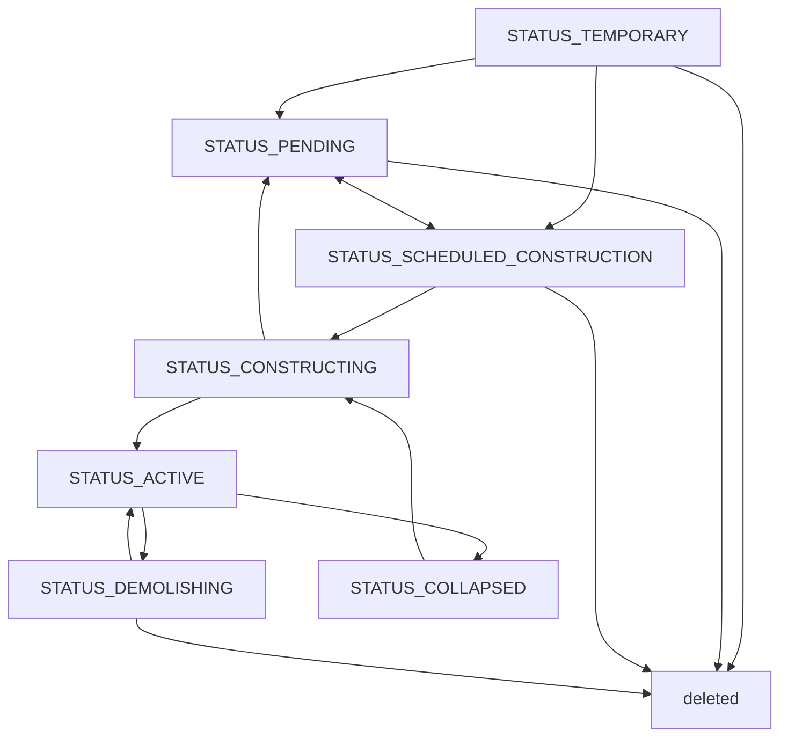

# 3. Paths and nodes

## 3.1. What are paths and nodes?

Paths represent roads, tracks, infrastructure conduits, and public transport lines. Nodes are their endpoints and intersections.

## 3.2. Path categories

Paths have a broad `type` (`PATH_*`) and a more specific `variant`.

| Category | Constant | Meaning |
| --- | --- | --- |
| Street | `PATH_STREET` | Roads for cars and pedestrians. Parcels can be created alongside and front onto only variants whose `path_master.frontage_allowed` is true |
| Motorway | `PATH_MOTORWAY` | Roads for motor vehicles only, including interchange ramps |
| Walkway | `PATH_WALKWAY` | Pedestrian-only paths |
| Track | `PATH_TRACK` | Railway tracks, station platforms, and dedicated LRT tracks. Variants with `infra_products` also carry electricity ([supply and transport](17_supply-and-transport.md)) |
| Monorail | `PATH_MONORAIL` | Monorail tracks and stations |
| People mover | `PATH_CONVEYOR` | Facilities such as ropeways without an operating agent. Pedestrians board and leave only at `boardable` endpoints |
| Waterway | `PATH_FERRY` | Lanes on the water, and ferry piers reaching from land out over the water. There are ferry lanes that ferry lines run on, and large-ship lanes that connect ports to the open sea ([public transport](18_public-transport.md), [supply and transport](17_supply-and-transport.md)). Lanes are normally hidden and shown like planned paths |
| Public transport | `PATH_TRANSPORT` | Logical sections between stops, without construction ([public transport](18_public-transport.md)) |
| Power line | `PATH_ELECTRICITY` | Infrastructure delivery only ([supply and transport](17_supply-and-transport.md)) |
| Water pipe | `PATH_WATER` | Infrastructure delivery only ([supply and transport](17_supply-and-transport.md)) |
| Pipeline | `PATH_PIPELINE` | Infrastructure delivery only ([supply and transport](17_supply-and-transport.md)) |
| Station building | `PATH_STATION_HOUSE` | A passage grouping platforms. It has no nodes and does not participate in the transport network or intersection processing ([stations](19_stations.md)) |

## 3.3. Shape overview

#### Two-dimensional shape (X–Z)

Path geometry is a sequence of cubic Bézier curves defined by anchors (`start_point`, `end_point`, `waypoints`) and control points (`start_control`, `end_control`, and waypoint `control_in`/`control_out`). Straight lines are curves with collinear control points. See [path geometry](../geometries/A_path-geometry.md).

When roads or tracks cross at the same height, a node is created and both paths split to form an intersection or level crossing. Non-overlapping vertical extents, from relative height through the variant's `height`, form a grade-separated crossing. Overlapping extents at different heights prevent placement.

#### Three-dimensional shape (Y)

Anchor Y values on paths and nodes are heights relative to the ground. Positive relative height produces an elevated section; negative height produces an underground section.
Variants without height editing sit on the surface. For those that may be laid on water (ferries) the surface is the water, so the relative height of an anchor on water is the depth from the water surface to the bed.

| Section | Condition | Appearance |
| --- | --- | --- |
| Cutting | 0 < depth ≤ `height` | Terrain is excavated to the surface when construction starts; rendered normally |
| Portal | Where depth crosses `height` | Tunnel entrance parts are rendered |
| Tunnel | Depth > `height` | Visible only in the underground view |

Paths generally cannot be placed through parcels even above or below ground. Sufficiently deep tunnels and sections above or below city-owned parcels can be built while retaining the parcels. Parcels crossed by shallow underground or elevated paths have `has_crossing_path` set ([districts and parcels](04_districts-and-parcels.md)).

## 3.4. Movement and traffic

### Travel direction

`travel_direction` is `DIR_BOTH`, `DIR_FORWARD` (start to end), or `DIR_BACKWARD` (end to start). Cars and public transport vehicles obey one-way restrictions, so outbound and return routes may differ. Pedestrians can walk in either direction.

Single railway and monorail tracks can be one-way or bidirectional; two opposite one-way paths form a double-track arrangement. A single path carrying both tracks is always `DIR_BOTH` and rejects one-way settings. Rail vehicles cannot reverse sharply at nodes or turn at flat crossings; they reverse only at stops.

### Speed and traffic volume

Travel is described at three levels:

- Speed limit (`max_speed`): the regulatory limit set citywide or for an individual road.
- Base speed (`base_speed`): the speed after penalties for curves, gradients, and similar conditions.
- Travel time (`travel_time`): the time to traverse a section, including congestion and obstruction from street parking in addition to base speed.

Traffic volume counts passages per day. Roads and tracks have capacities; congestion increases with traffic relative to capacity. Road congestion increases travel times and affects accident risk ([accidents and disasters](14_accidents-and-disasters.md)).

Street parking obstructs automobile traffic as soon as it exceeds dedicated parking spaces. `street_parking_capacity` is a reference capacity for comparing parking quantities, not a set of spaces that vehicles can use without affecting traffic. `path_master.parking_capacity_ratio` expresses dedicated capacity relative to that reference, while `parking_ratio` includes all street parking, including vehicles in dedicated spaces. Road displays and vehicle animation use the adjusted times returned by the core; the frontend must not apply the delay again.

### Interchanges and junctions

An interchange (IC) connects a motorway to streets; a junction (JCT) connects motorways. Both are recognized automatically from groups of ramp roads.

## 3.5. Path status and construction

| Status | Meaning |
| --- | --- |
| `STATUS_TEMPORARY` | Placed but unconfirmed |
| `STATUS_PENDING` | Planned, with construction on hold |
| `STATUS_SCHEDULED_CONSTRUCTION` | Construction requested; awaiting land |
| `STATUS_CONSTRUCTING` | Under construction |
| `STATUS_ACTIVE` | Operating; participates in transport and infrastructure networks |
| `STATUS_DEMOLISHING` | Being demolished |
| `STATUS_COLLAPSED` | Collapsed |

Public transport section paths require no construction and are either operating or suspended ([public transport](18_public-transport.md)).

Path construction requires land and construction services. Existing roadside land uses can require acquisition and demolition. Active paths can also be rebuilt. See [budgets](15_budgets.md) for costs.

## 3.6. Named roads

A named road groups paths separated by intersections into a recognizable road, such as Ome Kaido. It is a unit for identifying and naming a road across sections and does not affect economic or traffic calculations.

## 3.7. City boundary

Transport networks connect beyond city boundaries. Roads and facilities outside the city are provided by the scenario and connect the playable city to the wider world.

## 3.8. People movers

People mover paths (`PATH_CONVEYOR`), such as ropeways, carry people without operating a public transport line. Pedestrian routes treat them as fast walkways traversed at the equipment's speed.

They have no operating agent and charge no fares. Construction and maintenance work like other paths.

| Aspect | Walkway | People mover | Public transport |
| --- | --- | --- | --- |
| Access | Walk directly on the network | Use boarding points | Use stops |
| Speed | Walking speed | Equipment speed | Line operation |
| Waiting | None | Equipment-specific | Depends on headway |
| Fare | None | None | Set for each line |
| Operations | None | None | Vehicles and lines are managed |

See [public transport](18_public-transport.md).

Residents walk to a boarding point and cannot board or leave midway. Equipment connects in series and cannot form a branching road-like network.

Ropeways provide access across valleys and height differences. Concentrated demand causes congestion and increases the burden of travel.

