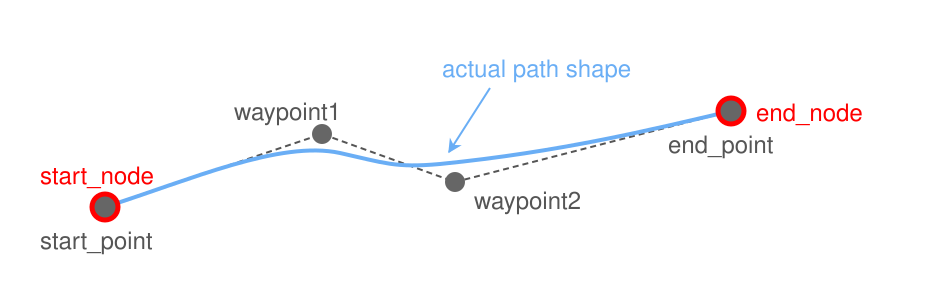
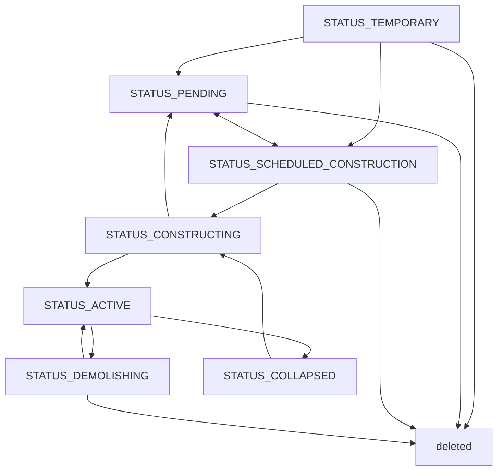

# 3. パスとノード

## 3.1 パスとノードとは

パスとは、都市の道路・線路・インフラの管路・公共交通の路線などを示す線のこと。ノードはパスの端点と交差点である。

## 3.2. パスの分類

経済主体は、大分類 `type`(`PATH_*`)と小分類 `variant`の2段階で分類する。大分類は以下の通り。

| 大分類    | 定数                   | 内容                                                                                    |
| ------ | -------------------- | ------------------------------------------------------------------------------------- |
| 街路     | `PATH_STREET`        | 自動車と歩行者が通る道路。沿道に土地区画を作れて接道先にもなれるのは `path_master` の `frontage_allowed` が真のバリアントだけ      |
| 高速道路   | `PATH_MOTORWAY`      | 自動車だけが通る道路。インターチェンジのランプもこの種類                                                          |
| 歩道     | `PATH_WALKWAY`       | 歩行者だけが通る道                                                                             |
| 線路     | `PATH_TRACK`         | 列車が走る線路。駅のホームとLRT専用軌道もこの種類。`infra_products` を持つバリアントは送電網を兼ねる（[財の供給と輸送](17_財の供給と輸送.md)） |
| モノレール  | `PATH_MONORAIL`      | モノレールの軌道と駅                                                                            |
| 人員搬送   | `PATH_CONVEYOR`      | ロープウェイなど運行主体の無い設備。歩行者が乗降できる端点（`boardable`）でだけ乗り降りする        |
| フェリー   | `PATH_FERRY`         | フェリー路線が走る水の上の航路と、陸から水の上へ延びる桟橋。航路は普段は描かず、計画中のパスと同じく表示する([18_公共交通機関](18_公共交通機関.md)) |
| 公共交通   | `PATH_TRANSPORT`     | 公共交通路線の停留所間の区間。建設を伴わない論理的な線（[18_公共交通機関](18_公共交通機関.md)）                                  |
| 送電線    | `PATH_ELECTRICITY`   | インフラ財の配送だけに使う（[財の供給と輸送](17_財の供給と輸送.md)）                                                |
| 水道管    | `PATH_WATER`         | インフラ財の配送だけに使う（[財の供給と輸送](17_財の供給と輸送.md)）                                                |
| パイプライン | `PATH_PIPELINE`      | インフラ財の配送だけに使う（[財の供給と輸送](17_財の供給と輸送.md)）                                                |
| 駅舎     | `PATH_STATION_HOUSE` | ホームをまとめる駅舎の通路。ノードを持たず、交通網にも交差の処理にも参加しない（[19_駅と駅舎](19_駅と駅舎.md)）                        |

## 3.3 形状概要

#### 二次元形状(X-Z)

パスの形状は、アンカー（`start_point`・`end_point`・`waypoints`）と制御点（端点の `start_control`・`end_control`、ウェイポイントの `control_in`・`control_out`）による3次ベジエ曲線の連なりで、直線も制御点を直線上に置いた曲線として扱う。定義の詳細は [A_パス形状](../geometries/A_パス形状.md) を参照。

道路や線路が同じ高さで交差すると、交点にノードが作られて両方のパスが分割される（交差点・踏切）。高さの占有範囲（相対高さからバリアントの `height` まで）が重ならなければ立体交差になり、重なるのに同じ高さでなければ敷設できない。

#### 三次元形状(Y)

パスやノードにおいて、アンカーのYは地面からの相対高さである。アンカーの相対高さが正の区間は高架、負の区間は地下になる。
高さを編集できないバリアントは地表に置く。水の上に置けるもの(フェリー)の地表は水面なので、水の上のアンカーの相対高さは水面から水底までの深さになる。

| 区間   | 条件                  | 見え方                       |
| ---- | ------------------- | ------------------------- |
| 切り通し | 0 < 深さ ≤ `height`   | 着工時に地形を路面まで掘り下げ、通常どおり描画する |
| 坑口   | 深さが `height` をまたぐ地点 | トンネル出入口のパーツが描画される         |
| トンネル | 深さ > `height`       | 地下を透視した時だけ描画される           |

地下・高架でも土地区画のある場所には原則として敷設できないが、十分に深い地下と、市有の区画の上や下を通る区間は区画を残したまま建設できる。浅い地下や高架のパスが通る区画には `has_crossing_path` が立つ（[4_地区と土地区画](4_地区と土地区画.md)）。

## 3.4 通行と交通

### 通行方向

パスの通行方向 `travel_direction` は `DIR_BOTH`（双方向）・`DIR_FORWARD`（始点→終点だけ）・`DIR_BACKWARD`（終点→始点だけ）である。自動車と公共交通の車両は一方通行の向きにしか進めないので、往路と復路で通る道が変わることがある。歩行者は両方向に歩ける。

線路・モノレールの単線は一方通行にも双方向にもでき、2本を互いに逆向きにすれば複線になる。1本で上下線を持つ複線は常に `DIR_BOTH` で、一方通行の指定は拒否される。
線路の車両はノードで鋭角に折り返したり平面交差で曲がったりできず、折り返しは停留所でだけできる。

### 速度と交通量

速度は以下の3段構成で算出できる。

- 制限速度(`max_speed`): 都市全体または個別の道路ごとに設定する規制値。
- 基本通過速度(`base_speed`): 制限速度からカーブや勾配などのペナルティを差し引いた実際の通過速度。
- 通過時間(`travel_time`): 基本通過速度に加えて渋滞と路上駐車の妨げを考慮し、実際にこの区間を通過するのにかかる時間。

交通量は、そのパスを1日に通過する回数を表す。道路や線路には通行できる容量があり、容量に対して交通量が多いほど混雑する。道路の混雑は所要時間を延ばし、交通事故の起きやすさにも影響する([14_事故と災害](14_事故と災害.md))。

路上駐車は専用駐車枠を超えた分から自動車の通行を妨げる。`street_parking_capacity` は駐車量を比較する基準容量で、影響なく停められる専用枠ではない。専用枠の容量は `path_master.parking_capacity_ratio` が示す基準容量に対する比で、`parking_ratio` は専用枠内も含む全路上駐車台数の比である。道路表示と車両描画はコアが返す補正済み時間を使い、フロントで遅延を重ねて計算しない。

### インターチェンジとジャンクション

インターチェンジ(IC)は高速道路と街路を、ジャンクション(JCT)は高速道路同士を接続する。どちらもランプ道路の集まりから自動的に認識される。

## 3.5 パスのステータスと建設

| ステータス | 意味 |
| --- | --- |
| `STATUS_TEMPORARY` | 配置したが確定していない |
| `STATUS_PENDING` | 計画したが着工を保留している |
| `STATUS_SCHEDULED_CONSTRUCTION` | 着工を指示済み。用地の確保を待っている |
| `STATUS_CONSTRUCTING` | 工事中 |
| `STATUS_ACTIVE` | 稼働中。交通網・インフラ網に参加する |
| `STATUS_DEMOLISHING` | 取り壊し中 |
| `STATUS_COLLAPSED` | 倒壊している |

公共交通の区間パスは建設を伴わず、運行中か運休中の状態を取る([18_公共交通機関](18_公共交通機関.md))。

パスの工事には、用地の確保と建設サービスの調達が必要である。沿道に既存の土地利用がある場所では、買収や建物の取り壊しを伴う。稼働中のパスは造り替えることもできる。費用については[予算管理](15_予算管理.md)を参照。

## 3.6 道路(名前付き道路)

名前付き道路は、交差点で分かれた複数のパスを「青梅街道」のような1本の道路としてまとめるものである。個々の区間を越えて道路を認識し、名前を付けるための単位で、経済・交通の計算には影響しない。

## 3.7 都市境界

交通網は都市の境界を越えてつながる。都市外の道路や設備はシナリオ側で用意され、プレイヤーが開発する都市と外の世界を結ぶ。

## 3.8 人員搬送設備

人員搬送パス(`PATH_CONVEYOR`)は、ロープウェイのように、公共交通の路線を運営せずに人を運ぶ設備である。住民の移動では、設備の速度で進む「速い歩道」として徒歩の経路に組み込まれる。

経済主体としての運営者を持たず、運賃を取らない。設備の建設や修繕は、ほかのパスと同じように行う。

| 観点 | 歩道 | 人員搬送 | 公共交通 |
| --- | --- | --- | --- |
| 乗り降り | 道路網をそのまま歩く | 乗り場を使う | 停留所を使う |
| 移動速度 | 歩く速さ | 設備の速さ | 路線の運行による |
| 待ち時間 | なし | 設備ごとの待ち時間 | 運行間隔による |
| 運賃 | なし | なし | 路線ごとに設定 |
| 運行管理 | なし | なし | 車両と路線を管理する |

公共交通については[公共交通機関](18_公共交通機関.md)を参照。

住民は乗り場へ歩いて向かい、設備の途中では乗り降りしない。設備は直列につながり、道路のように途中で分岐する網は作れない。

ロープウェイは谷や高低差を越える移動を支える。利用が集中すれば混雑し、移動の負担も増える。
