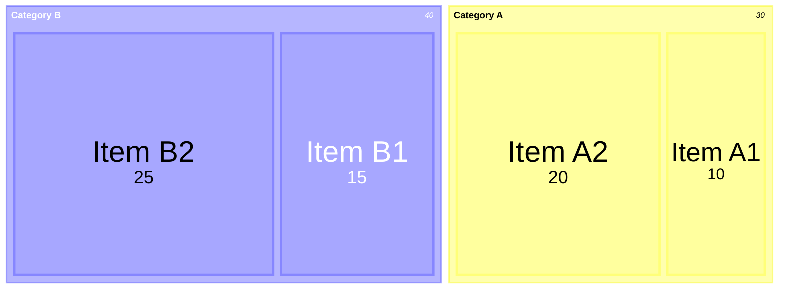

# 各種モーダルの位置について

モーダルを配置する箇所は以下の6種類
あるモーダルを表示するとき、場所が競合するモーダルは非表示にする。
場所が異なるモーダルは同時に表示できる。

[左端1]
- 土地区画の詳細 (ParcelInfoPanel)
- パスの詳細 (PathInfoPanel)

[左端2]
- 建物の詳細 (BuildingInfoPanel) dep. ParcelInfoPanel

[右端1]
- 経済主体の詳細 (EconomicAgentPanel)
- 世帯の詳細 (HouseholdPanel)
- 建設プロジェクト (PojectInfoPanel)
- 土地区画の作成 (ParcelPlanPanel)

[右端2]
- 建物の建設 (BuildingPlanPanel) dep. PojectInfoPanel
- 道路の敷設 (RoadPlanPanel) dep. PojectInfoPanel
- 線路の敷設 (TrackPlanPanel) dep. PojectInfoPanel

[左下]
- ビジュアル変更 (VisualPanel)

[中央]
- 予算の設定 (BudgetPanel)
- 税金の設定 (BudgetPanel)
- 金融政策の設定 (BudgetPanel)
- 統計 (BudgetPanel)
- 地区の設定 (BudgetPanel)
- ログ (LogPanel)
- セーブ/ロード (SaveDataPanel)

[オーバーレイ]
- 確認ダイアログ (ConfirmDialog)

---

# マウスクリックイベント処理の流れ

## 1. InputHandlerシステムの概要

本ゲームでは、すべてのマウスクリックとホバーイベントを`InputHandler`クラスが一元管理し、適切なオブジェクト固有のInputHandlerに処理を振り分けます。

### システム構成
- **中央集約処理**: `InputHandler.cs` - 全体のレイキャスト、オブジェクト判定、処理振り分け
- **オブジェクト固有処理**: 各`*InputHandler.cs` - オブジェクトタイプ別の具体的な処理

### 対応オブジェクトタイプ
- `InputObjectType.BUILDING` - 建物オブジェクト
- `InputObjectType.PARCEL` - 土地区画オブジェクト  
- `InputObjectType.PATH` - 道路オブジェクト
- `InputObjectType.NODE` - ノードオブジェクト
- `InputObjectType.TERRAIN` - 地形オブジェクト

### 選択モード
- `InputMode.MODE_NORMAL` - 通常モード（情報表示）
- `InputMode.MODE_CONSTRUCT` - 建設モード
- `InputMode.MODE_EDIT` - 編集モード
- `InputMode.MODE_DEMOLISH` - 解体モード
- `InputMode.MODE_NONE` - 何も処理しない

## 2. 処理の流れ

### 2.1 中央集約処理（InputHandler.cs）

#### 毎フレーム処理 (`Update()`)
1. **UI判定**: `EventSystem.current.IsPointerOverGameObject()` でUI上のクリックを除外
2. **レイキャスト**: カメラからマウス位置へRayを発射
3. **テレイン位置更新**: `UpdateTerrainPosition()` でマウス座標（posX, posZ）を更新
4. **オブジェクト判定**: レイキャストヒット時に `HandleObjectHit()` を呼び出し
5. **クリック処理**: マウスボタンダウン時に適切なハンドルメソッドを呼び出し

#### オブジェクトタイプ判定 (`GetObjectType()`)
オブジェクト名のプレフィックスでタイプを判定：
- `Building_*` → `InputObjectType.BUILDING`
- `Parcel_*` → `InputObjectType.PARCEL`
- `Path_*` → `InputObjectType.PATH`
- `Node_*` → `InputObjectType.NODE`
- Terrainコンポーネント → `InputObjectType.TERRAIN`

#### 処理振り分け (`CallObjectClick()`)
各オブジェクトタイプに応じて、対応するInputHandlerの`onClick(int mode)`メソッドを呼び出し

### 2.2 オブジェクト固有処理

#### 建物InputHandler (`BuildingInputHandler.cs`)
- **通常モード**: 建物詳細情報の表示、APIからデータ取得
- **解体モード**: 解体確認、API経由での解体処理
- **編集モード**: 建物編集UI表示（TODO）
- **ホバー処理**: ハイライトマテリアルの適用/解除

#### 土地区画InputHandler (`ParcelInputHandler.cs`)
- **通常モード**: 土地区画詳細情報の表示、APIからデータ取得
- **建設モード**: 建設メニュー表示（TODO）
- **編集モード**: 土地区画編集UI表示（TODO）
- **編集モード中の制御**: `ParcelPlanPopupManager.IsAnyParcelEditMode()` で編集モード時は処理をスキップ

#### 道路InputHandler (`PathInputHandler.cs`)
- **通常モード**: 道路詳細情報の表示、APIからデータ取得
- **編集モード**: 道路編集UI表示（TODO）
- **解体モード**: 解体確認、API経由での解体処理
- **編集モード中の制御**: パーセル編集モード時は処理をスキップ

#### 地形InputHandler (`TerrainInputHandler.cs`)
- **マーカー表示**: 建設・編集モード時にホバー位置にマーカーを表示
- **パーセルエディター統合**: 地点選択モード時の処理
- **モード判定**: `ShouldShowMarker()` でマーカー表示条件を判定
- **地形高度取得**: `GetTerrainHeight()` で正確な地形高度を計算

## 3. 編集モードとの連携

### 3.1 編集モード判定
`ParcelPlanPopupManager.IsAnyParcelEditMode()` で以下のいずれかが`true`の場合、編集モードと判定：
- `isPointSelectionMode` - 地点選択モード
- `isPathSelectionMode` - 道路選択モード  
- `isParcelSelectionMode` - 土地区画選択モード

### 3.2 編集モード時の処理制御
- **土地区画・道路**: 編集モード中はクリック処理をスキップ
- **地形**: パーセルエディターの地点選択処理を優先実行
- **建物**: 編集モードに関係なく通常処理を実行

### 3.3 パーセルエディターとの統合
`TerrainInputHandler`がパーセルエディター機能を統合：
- 地点選択時の`ParcelEditorManager.OnPointSelected()`呼び出し
- マーカー表示による視覚的フィードバック
- Escキーによるキャンセル処理

## 4. API連携

各InputHandlerは以下のAPIエンドポイントと連携：

### 建物関連
- `GET /api/v1/buildings/detail/{buildingId}` - 建物詳細取得
- `POST /api/v1/buildings/{buildingId}/demolish` - 建物解体

### 土地区画関連  
- `GET /api/v1/parcels/{parcelId}/detail` - 土地区画詳細取得

### 道路関連
- `GET /api/v1/paths/{pathId}` - 道路詳細取得
- `POST /api/v1/paths/{pathId}/demolish` - 道路解体

## 5. UI連携

### 情報表示 (`InformationPopupManager`)
- `SelectBuilding()` - 建物情報表示
- `SelectParcel()` - 土地区画情報表示
- `SelectPath()` - 道路情報表示
- `HighlightBuilding()` / `HighlightParcel()` / `HighlightPath()` - オブジェクトハイライト

### パーセル編集 (`ParcelPlanPopupManager`)
- 編集モード状態の管理
- 地点・道路・土地区画選択結果の処理

## 6. 使用例

### 建物クリック時の処理フロー
1. `InputHandler.Update()` でレイキャスト実行
2. `GetObjectType()` で建物オブジェクトと判定
3. `CallObjectClick()` で `BuildingInputHandler.onClick()` を呼び出し
4. `onClick()` 内で選択モードに応じて分岐
5. 通常モード時: `HandleNormalClick()` → APIから詳細取得 → UI表示

### 地形ホバー時の処理フロー
1. `InputHandler.Update()` でテレイン位置更新
2. `HandleTerrainHover()` で地形ホバー処理
3. `CallObjectHover()` で `TerrainInputHandler.onHover()` を呼び出し
4. `ShouldShowMarker()` でマーカー表示条件判定
5. 条件満了時: `ShowMarker()` でマーカー表示

